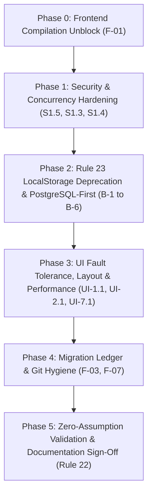

# MASTER AUDIT REMEDIATION PLAN: OPERATIONAL WORKFLOW MANAGEMENT
## End-to-End Engineering Roadmap for Tri-Audit Defect Remediation & Full Governance Sign-Off

**Document Identifier**: `COMPREHENSIVE_AUDIT_REMEDIATION_PLAN_2026-10-10.md`  
**Creation Date**: October 10, 2026  
**Governance Authority**: [`AGENTS.md`](file:///c:/Users/hp/Downloads/opration-workflow-mangement1/AGENTS.md) (Rules 1–23) & [`bo-operational-governance`](file:///c:/Users/hp/Downloads/opration-workflow-mangement1/.agents/skills/bo-operational-governance/SKILL.md)  
**Master Entry Point**: [`MASTER_ARCHITECTURE_INDEX.md`](file:///c:/Users/hp/Downloads/opration-workflow-mangement1/MASTER_ARCHITECTURE_INDEX.md)  
**Governing Inputs**:
1. [`FRONTEND_UI_UX_AUDIT_REPORT_2026-10-10.md`](file:///c:/Users/hp/Downloads/opration-workflow-mangement1/FRONTEND_UI_UX_AUDIT_REPORT_2026-10-10.md) *(UI/UX Design System Audit)*
2. [`AUDIT_REPORT_2026-10-10.md`](file:///c:/Users/hp/Downloads/opration-workflow-mangement1/AUDIT_REPORT_2026-10-10.md) *(Backend, Database & Engine Audit)*
3. [`audit_output/FINAL_ASSESSMENT.md`](file:///c:/Users/hp/Downloads/opration-workflow-mangement1/audit_output/FINAL_ASSESSMENT.md) & [`audit_output/GOVERNANCE_BREACH_LOCALSTORAGE.md`](file:///c:/Users/hp/Downloads/opration-workflow-mangement1/audit_output/GOVERNANCE_BREACH_LOCALSTORAGE.md) *(Master System Architecture Audit)*

---

## 1. Executive Purpose & Remediation Objective

This engineering plan outlines the definitive, step-by-step implementation sequence to resolve all **confirmed defects, governance breaches, security vulnerabilities, and architectural mismatches** identified across the three October 10, 2026 system audits.

### Core Objectives:
1. **Unblock Frontend Compilation**: Resolve the 12 TypeScript errors in the working tree (`tsc --noEmit`).
2. **Eliminate AGENTS.md Rule 23 Breaches**: Deprecate browser `localStorage` as a primary state store for business entities, datasets, transformation rules, and workspace configurations; enforce **PostgreSQL-First** persistence.
3. **Remediate Security & Concurrency Risks**: Protect database passwords against plaintext exposure and masked bullet overwrites; eliminate connection pool leaks on `BEGIN ... COMMIT` blocks.
4. **Enforce UI/UX Design System Rules**: Fix viewport height subtractions (Rule 16), add missing `<ErrorBoundary>` wrappers (Rule 6), and remove synchronous UI-thread blocking loops.
5. **Clean Repository Hygiene**: Disambiguate migration prefixes, untrack build artifacts, and synchronize architecture documentation.

---

## 2. Remediation Phase Overview



---

## 3. Detailed Phase Work Breakdown

### Phase 0: Immediate Working-Tree Compilation Unblock (Finding F-01)
**Goal**: Restore passing frontend TypeScript compilation (`tsc --noEmit`).

1. **Fix `HashtagManager.tsx` State Hooks**:
   - **File**: [`frontend/src/components/issue/HashtagManager.tsx`](file:///c:/Users/hp/Downloads/opration-workflow-mangement1/frontend/src/components/issue/HashtagManager.tsx#L1312)
   - **Action**: Declare missing state variables and setters:
     ```tsx
     const [showSampleDataPreview, setShowSampleDataPreview] = useState(false);
     const [showDataTransformModal, setShowDataTransformModal] = useState(false);
     ```
2. **Export Missing Symbols in `StandardFileIngestionWorkspace.tsx`**:
   - **File**: [`frontend/src/components/common/StandardFileIngestionWorkspace.tsx`](file:///c:/Users/hp/Downloads/opration-workflow-mangement1/frontend/src/components/common/StandardFileIngestionWorkspace.tsx)
   - **Action**: Export the interfaces expected by [`WorkspaceTaskCreator.tsx:26`](file:///c:/Users/hp/Downloads/opration-workflow-mangement1/frontend/src/components/issue/WorkspaceTaskCreator.tsx#L26):
     ```tsx
     export interface StandardFileIngestionRef {
       getParsedDataset: () => IngestionDatasetPayload | null;
       reset: () => void;
       validate: () => IngestionValidationOutcome;
     }
     export interface IngestionValidationOutcome {
       isValid: boolean;
       errors: string[];
       warnings: string[];
     }
     ```
   - Fix line 841 `HTMLCollection` type conversion error by converting to array: `Array.from(parentEl.children)`.
3. **Wire `persistValueDicts` in `SystemSettings.tsx`**:
   - **File**: [`frontend/src/components/settings/SystemSettings.tsx:2933`](file:///c:/Users/hp/Downloads/opration-workflow-mangement1/frontend/src/components/settings/SystemSettings.tsx#L2933)
   - **Action**: Define `persistValueDicts` using the backend API route or repository client.
4. **Verification Gate**:
   - Command: `cmd /c "npm run lint"` inside `frontend/`.
   - Exit code must be 0 with 0 TypeScript errors.

---

### Phase 1: Security & Concurrency Hardening (Findings S1.5, S1.3, S1.4)
**Goal**: Guarantee credential safety and eliminate transaction leaks.

1. **Mask Database Passwords on Retrieval (Rule 19)**:
   - **File**: [`backend/src/store/postgresRepo.ts:801`](file:///c:/Users/hp/Downloads/opration-workflow-mangement1/backend/src/store/postgresRepo.ts#L801)
   - **Action**: Modify `mapDbConnectionRow`:
     ```typescript
     password: r.password ? '••••••••' : undefined,
     ```
2. **Protect Stored Passwords on Metadata Updates (Rule 19)**:
   - **Files**: [`backend/src/store/postgresRepo.ts:927`](file:///c:/Users/hp/Downloads/opration-workflow-mangement1/backend/src/store/postgresRepo.ts#L927) & [`backend/src/routes/database.ts:685`](file:///c:/Users/hp/Downloads/opration-workflow-mangement1/backend/src/routes/database.ts#L685)
   - **Action**: If `updates.password === '••••••••'` or `updates.password === ''`, delete `updates.password` before merging so that the existing database password in PostgreSQL is preserved.
3. **Fix Connection Pool Starvation & Retain Advisory Locks (Rules 10 & 13)**:
   - **Files**:
     - [`backend/src/services/hashtagService.ts:430-480`](file:///c:/Users/hp/Downloads/opration-workflow-mangement1/backend/src/services/hashtagService.ts#L430-L480)
     - [`backend/src/services/workflowBundleService.ts:206`](file:///c:/Users/hp/Downloads/opration-workflow-mangement1/backend/src/services/workflowBundleService.ts#L206)
     - [`backend/src/services/reversionService.ts:118`](file:///c:/Users/hp/Downloads/opration-workflow-mangement1/backend/src/services/reversionService.ts#L118)
   - **Action**: Replace `pool.query('BEGIN')` with a dedicated checked-out client:
     ```typescript
     const pool = getPostgresPool();
     const client = await pool.connect();
     try {
       await client.query('BEGIN');
       await client.query('SELECT pg_advisory_xact_lock($1::bigint)', [lockBigInt]);
       // Execute SQL statements on client...
       await client.query('COMMIT');
     } catch (err) {
       await client.query('ROLLBACK');
       throw err;
     } finally {
       client.release();
     }
     ```
4. **Verification Gate**:
   - Unit test asserting that passwords in API responses are masked.
   - Unit test asserting that metadata updates with `••••••••` do not alter the database secret.
   - Concurrency test with 30 simulated parallel executions verifying zero `idle in transaction` clients.

---

### Phase 2: AGENTS.md Rule 23 LocalStorage Deprecation & PostgreSQL-First State Architecture
**Goal**: Enforce PostgreSQL as the sole system of record for all business entities, transaction datasets, and configurations.

1. **Unconditional PostgreSQL Hydration in `App.tsx` (B-1)**:
   - **File**: [`frontend/src/App.tsx:61-94, 236-276`](file:///c:/Users/hp/Downloads/opration-workflow-mangement1/frontend/src/App.tsx#L61-L94)
   - **Action**:
     - Provide backend REST hydration for `users`, `currentUser`, `issues`, `hashtags`, `databases`, `systems`, `teams`.
     - Remove frontend mock arrays (`INITIAL_USERS`, `INITIAL_ISSUES`, `INITIAL_HASHTAGS`) as the persistent system of record.
     - Demote `usePersistentState` to strictly non-business UI ergonomics (e.g., active tab selection).
2. **Migrate Transaction Dataset Records to PostgreSQL (B-2)**:
   - **Files**:
     - [`frontend/src/components/WorkspaceTable.tsx`](file:///c:/Users/hp/Downloads/opration-workflow-mangement1/frontend/src/components/WorkspaceTable.tsx#L40)
     - [`frontend/src/components/IssueDetailView.tsx:1329`](file:///c:/Users/hp/Downloads/opration-workflow-mangement1/frontend/src/components/IssueDetailView.tsx#L1329)
     - [`frontend/src/components/issue/WorkspaceTaskCreator.tsx:741`](file:///c:/Users/hp/Downloads/opration-workflow-mangement1/frontend/src/components/issue/WorkspaceTaskCreator.tsx#L741)
   - **Action**:
     - Delete all `localStorage.getItem('workspace_table_records')` and `localStorage.setItem('workspace_table_records')` calls.
     - Route transaction dataset persistence through `task_dataset_transactions` via `/api/issues/:id/transactions` and `/api/transactions`.
3. **Persist Transformation Rules & Value Translation Dictionaries (B-3 & B-4)**:
   - **Files**:
     - [`frontend/src/components/settings/SystemSettings.tsx:162, 191`](file:///c:/Users/hp/Downloads/opration-workflow-mangement1/frontend/src/components/settings/SystemSettings.tsx#L162-L191)
     - [`backend/src/database/migrations/029_value_translation_dictionaries.sql`](file:///c:/Users/hp/Downloads/opration-workflow-mangement1/backend/src/database/migrations/029_value_translation_dictionaries.sql)
   - **Action**:
     - Apply migration 029 and add migration `030_system_transformation_rules.sql`.
     - Mount REST endpoints `/api/settings/transformation-rules` and `/api/settings/value-dictionaries`.
     - Wire `SystemSettings.tsx` to read and save through these endpoints.
4. **Persist Workspace Configuration via Governance Proposals (B-5)**:
   - **File**: [`frontend/src/components/WorkspaceSettings.tsx:125-140`](file:///c:/Users/hp/Downloads/opration-workflow-mangement1/frontend/src/components/WorkspaceSettings.tsx#L125-L140)
   - **Action**:
     - Wire `handleSaveDraft` and `handleApplyChanges` to call `/api/settings/proposals`.
     - Restrict `localStorage` to an ephemeral offline draft buffer.
5. **Verification Gate**:
   - Clear `localStorage` in browser.
   - Reload the application.
   - Verify all 19 entities, transaction tables, and configurations load fully from PostgreSQL `/api/*`.

---

### Phase 3: Frontend Fault Tolerance, Layout & UI Thread Performance (Findings UI-1.1, UI-2.1, UI-7.1)
**Goal**: Enforce Rule 6 and Rule 16 layout and stability standards.

1. **Add Dedicated ErrorBoundary Wrappers (Rule 6)**:
   - **File**: [`frontend/src/components/investigation/InvestigationWorkspace.tsx:27-29`](file:///c:/Users/hp/Downloads/opration-workflow-mangement1/frontend/src/components/investigation/InvestigationWorkspace.tsx#L27-L29)
   - **Action**: Wrap the returned view in `<ErrorBoundary fallbackTitle="Investigation Workspace Error">`.
   - Also wrap `DatabaseCrossVerificationPanel` and `QuerySandbox`.
2. **Replace Hardcoded Viewport Heights with Flexbox Scroll Containment (Rule 16)**:
   - **Files**:
     - [`frontend/src/components/investigation/ValidationOrchestratorWorkspace.tsx:2704, 3740`](file:///c:/Users/hp/Downloads/opration-workflow-mangement1/frontend/src/components/investigation/ValidationOrchestratorWorkspace.tsx#L2704)
     - [`frontend/src/components/team/TeamDiscussionTab.tsx:85`](file:///c:/Users/hp/Downloads/opration-workflow-mangement1/frontend/src/components/team/TeamDiscussionTab.tsx#L85)
     - [`frontend/src/components/PersonalChat.tsx:132`](file:///c:/Users/hp/Downloads/opration-workflow-mangement1/frontend/src/components/PersonalChat.tsx#L132)
   - **Action**: Replace `max-h-[calc(100vh-210px)]` and `h-[calc(100vh-14rem)]` with `flex-1 min-h-0 overflow-y-auto` wrapped in `flex flex-col h-full overflow-hidden`.
   - Add `.no-scrollbar` class to dual-pane mail and chat tabs.
3. **Offload UI-Thread Batch Investigation (Finding 7.1)**:
   - **File**: [`frontend/src/components/investigation/ValidationOrchestratorWorkspace.tsx:1255-1257`](file:///c:/Users/hp/Downloads/opration-workflow-mangement1/frontend/src/components/investigation/ValidationOrchestratorWorkspace.tsx#L1255-L1257)
   - **Action**: Remove synchronous `executeBatchInvestigation` from render-cycle `useMemo`. Defer batch evaluation to server-side `POST /api/investigations/execute-universal` or execute via an asynchronous chunked worker.
4. **Verification Gate**:
   - Resize viewport to mobile/laptop dimensions; verify stationary headers and zero outer scroll leaks.
   - Intentionally throw inside `ValidationOrchestratorWorkspace`; verify graceful fallback UI displays without crashing parent navigation.

---

### Phase 4: Migration Ledger & Repository Hygiene (Findings F-03, F-07)
**Goal**: Deterministic database migration ordering and clean git version tracking.

1. **Disambiguate Duplicate Migration Prefix**:
   - **File**: Rename [`backend/src/database/migrations/002_hashtag_governance_and_reversion.sql`](file:///c:/Users/hp/Downloads/opration-workflow-mangement1/backend/src/database/migrations/002_hashtag_governance_and_reversion.sql) to a unique sequence (e.g. `002b_...` or renumber to preserve DAG sequence).
2. **Untrack Build Artifacts**:
   - **Action**:
     - Run `git rm -r --cached backend/dist`.
     - Confirm `dist/` is listed in `.gitignore`.
     - Prevent `npm start` from serving stale compiled JavaScript.
3. **Decouple Live-Server Test Dependency**:
   - **Files**:
     - [`backend/src/services/__tests__/teamDatabaseAccessAndPermanentTeam.test.ts`](file:///c:/Users/hp/Downloads/opration-workflow-mangement1/backend/src/services/__tests__/teamDatabaseAccessAndPermanentTeam.test.ts#L4)
     - [`backend/src/services/__tests__/teamDelegatedAdmin.test.ts`](file:///c:/Users/hp/Downloads/opration-workflow-mangement1/backend/src/services/__tests__/teamDelegatedAdmin.test.ts)
     - [`backend/src/services/__tests__/teamMemberPrivilegesAndResources.test.ts`](file:///c:/Users/hp/Downloads/opration-workflow-mangement1/backend/src/services/__tests__/teamMemberPrivilegesAndResources.test.ts)
   - **Action**: Use an in-process express test app harness or `supertest` instead of hardcoded `fetch('http://localhost:5002/api')`, allowing `npm test` to pass cleanly in standalone CI/CD without requiring an external server process.
4. **Verification Gate**:
   - `git ls-files backend/dist` returns 0.
   - `npm test --prefix backend` executes all 34 test files with 100% pass rate in standalone environment.

---

### Phase 5: Zero-Assumption Validation & Documentation Sign-Off (Rule 22)
**Goal**: Synchronize all architecture documentation and achieve formal sign-off.

1. **Update Master Architecture Index**:
   - **File**: [`MASTER_ARCHITECTURE_INDEX.md`](file:///c:/Users/hp/Downloads/opration-workflow-mangement1/MASTER_ARCHITECTURE_INDEX.md)
   - **Action**:
     - Correct test suite counts (34 suites / 266 tests).
     - Correct table counts (33 initial tables / 76 public tables).
     - Record the completed remediation under Section 3 and Section 5.
2. **Revise Acceptance Reports**:
   - **File**: [`ARCHITECTURE_REMEDIATION_FINAL_ACCEPTANCE_REPORT.md`](file:///c:/Users/hp/Downloads/opration-workflow-mangement1/ARCHITECTURE_REMEDIATION_FINAL_ACCEPTANCE_REPORT.md)
   - **Action**: Update the report to reflect the resolved dual-audit findings and code reality.
3. **Final Sign-Off Verification Sequence**:
   ```bash
   # 1. Frontend compilation
   npm run lint --prefix frontend
   npm run build --prefix frontend

   # 2. Backend compilation
   npm run build --prefix backend

   # 3. Full test suite execution
   npm test --prefix backend
   ```

---

## 4. Remediation Schedule & Effort Allocation

| Phase | Description | Files Affected | Estimated Effort | Target Gate |
|---|---|---|---|---|
| **Phase 0** | Frontend Compilation Unblock | 4 files | 2 hours | `npm run lint` exit 0 |
| **Phase 1** | Security & Concurrency Hardening | 5 files | 4 hours | Credential & Lock unit tests pass |
| **Phase 2** | Rule 23 LocalStorage Deprecation | 7 files + 2 migrations | 12 hours | Zero business state in `localStorage` |
| **Phase 3** | UI Layout, ErrorBoundary & Thread Offload | 5 files | 6 hours | Scroll containment & crash isolation |
| **Phase 4** | Migration Disambiguation & Git Clean-up | 4 files | 3 hours | Clean `git status`, test standalone pass |
| **Phase 5** | Doc Sync & Zero-Assumption Sign-Off | 3 files | 3 hours | Full CI/CD green & signed-off index |
| **TOTAL** | **Full End-to-End Remediation** | **~25 files** | **30 hours** | **100% Certified Sign-Off** |

---

*This document is the authoritative plan governing all defect remediation and sign-off activities across the Operational Workflow Management repository.*
