# MASTER IMPLEMENTATION PLAN: FRONTEND AUDIT REMEDIATION
## Engineering Roadmap & Definitive Acceptance Criteria for Frontend Remediation & Full Governance Certification

| Field | Value |
|---|---|
| **Document ID** | `FRONTEND_AUDIT_REMEDIATION_IMPLEMENTATION_PLAN.md` |
| **Creation Date** | November 13, 2026 |
| **Governing Authority** | [`AGENTS.md`](file:///c:/Users/hp/Downloads/opration-workflow-mangement1/AGENTS.md) (Rules 1–23) & [`bo-operational-governance`](file:///c:/Users/hp/Downloads/opration-workflow-mangement1/.agents/skills/bo-operational-governance/SKILL.md) |
| **Master Index** | [`MASTER_ARCHITECTURE_INDEX.md`](file:///c:/Users/hp/Downloads/opration-workflow-mangement1/MASTER_ARCHITECTURE_INDEX.md) |
| **Governing Audit** | [`FRONTEND_DESIGN_IMPLEMENTATION_AUDIT_2026-11-12.md`](file:///c:/Users/hp/Downloads/opration-workflow-mangement1/FRONTEND_DESIGN_IMPLEMENTATION_AUDIT_2026-11-12.md) |
| **Current Status** | DRAFT PLAN — Pending Phase Execution |

---

## 1. Executive Purpose & Remediation Objective

This engineering plan provides the definitive, sequenced implementation roadmap and rigorous acceptance criteria to remediate all **38 findings (4 Critical, 12 High, 15 Medium, 7 Low)** identified in the November 12, 2026 Physical Code Audit ([`FRONTEND_DESIGN_IMPLEMENTATION_AUDIT_2026-11-12.md`](file:///c:/Users/hp/Downloads/opration-workflow-mangement1/FRONTEND_DESIGN_IMPLEMENTATION_AUDIT_2026-11-12.md)).

### Core Engineering Objectives:
1. **Unblock Frontend Type Gate (FE-05)**: Resolve all 41 TypeScript errors so `npm run lint` (`tsc --noEmit`) exits cleanly with 0 errors.
2. **Eliminate Security Vulnerabilities (FE-01, FE-03)**:
   - Sanitize all external HTML rendered from email message ingestion with DOMPurify to eliminate stored Cross-Site Scripting (XSS).
   - Wire the frontend to real backend JWT authentication (`api.login`/`api.logout`), remove in-memory credentials, and mount `requireAuth` on backend API routers.
3. **Enforce Absolute Verdict Integrity (FE-04, Rule 2)**:
   - Strip all frontend synthesis and client heuristics that fabricate `PASS` verdicts for unevaluated steps; ensure the UI is a pure projection of backend engine results (`NOT_EVALUATED` when unverified).
4. **Deprecate `localStorage` as System of Record (FE-02, FE-15, Rule 23)**:
   - Migrate business entities to server-authoritative hydration; ensure empty arrays (`[]`) propagate server deletions rather than retaining stale caches.
5. **Ensure Workspace Fault Tolerance & Resilience (FE-07, FE-10, Rule 6)**:
   - Wrap all 5 unwrapped workspace routes in `<ErrorBoundary>` to eliminate full-screen unmounts.
   - Fix broken and phantom API client methods in `ResourceDetailView.tsx`.
6. **Harmonize Design System & Observability (FE-08, FE-09, FE-13, FE-14)**:
   - Remove fake default counters (`237`, `60`, `7`); wire live system metrics.
   - Standardize modals on accessible overlays (`role="dialog"`, Escape handler, focus trap).

---

## 2. Phased Architecture & Execution Topology

```mermaid
flowchart TD
    subgraph P0["Phase 0: Release-Blocking Security, Integrity & Compilation"]
        P0_1["0.1 Fix 41 TypeScript Errors (FE-05, FE-07, FE-27, FE-29)"]
        P0_2["0.2 Sanitize Inbound Email HTML with DOMPurify (FE-03)"]
        P0_3["0.3 Strip Verdict Fabrication in Validation Workspace (FE-04, Rule 2)"]
        P0_4["0.4 Real JWT Authentication & Backend Router Protection (FE-01)"]
        P0_5["0.5 Authoritative Empty-Array Server Hydration (FE-15, Rule 23)"]
        P0_6["0.6 Maker-Checker Proposal Submission Before Apply (FE-16, Rule 7)"]
    end

    subgraph P1["Phase 1: Resilience, Observability & Core Accessibility"]
        P1_1["1.1 Wrap 5 Unwrapped Routes in ErrorBoundary (FE-10, Rule 6)"]
        P1_2["1.2 Install React 19 Typings & Restore Typed ErrorBoundary (FE-06, FE-32)"]
        P1_3["1.3 Remove Fabricated Badges 237/60; Bind Real Counts (FE-13)"]
        P1_4["1.4 Wire or Safely Stash Universal Search Ctrl+K (FE-14)"]
        P1_5["1.5 Normalize Raw fetch() Calls to api/client.ts (FE-20, FE-21)"]
        P1_6["1.6 Fix Notification Toast Expiration & Banner Dismissal (FE-19)"]
    end

    subgraph P2["Phase 2: Design System Harmonization & Token Cleanup"]
        P2_1["2.1 Harmonize Overlays with common/Overlay.tsx (FE-08)"]
        P2_2["2.2 Enforce ds-* Brand Tokens & Remove Loose Hex (FE-09)"]
        P2_3["2.3 Typography Scale Floor (12px Minimum) (FE-11)"]
        P2_4["2.4 Replace window.alert/confirm with Modal (FE-33)"]
    end

    subgraph P3["Phase 3: Structural Hygiene & CI Gates"]
        P3_1["3.1 Deprecate/Archive 15 Orphaned Component Files (FE-23)"]
        P3_2["3.2 Lazy-Load Heavy Dependencies like xlsx (FE-25)"]
        P3_3["3.3 Configure Vitest & Frontend Testing Library (FE-26)"]
        P3_4["3.4 Pre-Build Type Check Enforced in CI (Rule 22)"]
    end

    P0 --> P1
    P1 --> P2
    P2 --> P3
```



---

## 3. Detailed Work Breakdown by Phase

### Phase 0: Release-Blocking Security, Integrity & Compilation (Immediate)
*Target: Release unblock & core governance compliance.*

#### 0.1 — Resolve 41 TypeScript Errors & API Method Drift (`FE-05`, `FE-07`, `FE-27`, `FE-29`, `FE-30`)
1. **Fix Phantom Methods in `ResourceDetailView.tsx`**:
   - Change `api.inspectFtpStructure(...)` to `api.inspectFtpFileStructure(...)`.
   - Change `api.triggerFtpScheduledIngestion(...)` to `api.runScheduledFtpStaging(...)`.
2. **Fix Type Signatures in `HashtagFileUploadModal.tsx`**:
   - Add `executionMode?: 'dry_run' | 'execute'` to `executeHashtagFile` payload in `client.ts`.
   - Update return type of `executeHashtagFile` to include `stats`, `newlyCollectedCount`, `fixedCount`, `waitingCount`, `failedCount`.
3. **Fix `MessageChatActions.tsx`**:
   - Cast or guard `unknown` properties when checking message reactions or forward targets.
4. **Fix Seed/Interface Mismatch in `StandardFileIngestionWorkspace.tsx`**:
   - Ensure embedded fallback templates satisfy `FileIngestionMappingTemplate` (`manualHeaders: []`, `deletedColumns: []`, `cleaningRecipe: []`, `createdAt`, `updatedAt`).
5. **Deduplicate `CaseDiscussionDrawer.tsx`**:
   - Remove duplicate `import { api } from '../../api/client';` on line 17.
6. **Fix `EscalationRoomView.tsx` & `TeamOrgStructureTab.tsx`**:
   - Replace invalid `fullName` field with `username` or optional `name` on `User`.
   - Replace `team.lead` with `team.managerId`.
7. **Fix `WorkspaceSettings.tsx` Hook Calls & Null Checks**:
   - Fix 2-argument calls to single-argument hooks; use `currentUser.name || currentUser.username`.
8. **Verification Gate**: `npm run lint --prefix frontend` exits with **0 errors**.

#### 0.2 — Sanitize Inbound Email HTML (`FE-03`)
1. **Install Dependencies**:
   - `npm install dompurify --prefix frontend`
   - `npm install -D @types/dompurify --prefix frontend`
2. **Update `PersonalChat.tsx`**:
   - In [`PersonalChat.tsx:1697-1702`](file:///c:/Users/hp/Downloads/opration-workflow-mangement1/frontend/src/components/PersonalChat.tsx#L1697-L1702), wrap `msg.html_body` with `DOMPurify.sanitize(msg.html_body, { USE_PROFILES: { html: true } })`.
   - Block inline scripts, javascript URLs, and unsafe object embeds.

#### 0.3 — Eliminate Frontend Verdict Fabrication (`FE-04`, Rule 2)
1. **Refactor `ValidationOrchestratorWorkspace.tsx`**:
   - Remove lines 3039–3046 where steps with `idx !== 0` are arbitrarily emitted as `status: 'PASS'`, `detail: 'Condition satisfied'` when rows are missing.
   - If a record is missing in the target database, set subsequent dependent steps to `status: 'NOT_EVALUATED'`, `actionTaken: 'STOP'`, `detail: 'Skipped - prerequisite target record missing'`.
   - In lines 3101–3103, change fallback status from `let sStatus = 'PASS'` to `let sStatus: 'PASS' | 'FAIL' | 'PENDING' | 'NOT_EVALUATED' = 'NOT_EVALUATED'`.
   - Ensure the UI disables "Reconcile" or "Close Case" actions if any step is `NOT_EVALUATED`.

#### 0.4 — Real JWT Authentication & Router Guarding (`FE-01`)
1. **Wire `LoginScreen.tsx` to `api.login`**:
   - Update `handleLoginSubmit` in [`LoginScreen.tsx`](file:///c:/Users/hp/Downloads/opration-workflow-mangement1/frontend/src/components/LoginScreen.tsx) to call `await api.login(username.trim(), password)`.
   - Store the returned JWT token via `localStorage.setItem('auth_token', res.token)`.
   - Remove automatic user creation on wrong username.
   - Gate "Quick Login" buttons behind an explicit `import.meta.env.VITE_ENABLE_DEV_LOGIN === 'true'` flag.
2. **Mount `requireAuth` on Backend Routers**:
   - In [`backend/src/server.ts`](file:///c:/Users/hp/Downloads/opration-workflow-mangement1/backend/src/server.ts), mount `requireAuth` on non-public routers:
     `app.use('/api/issues', requireAuth, issuesRouter);`
     `app.use('/api/workflows', requireAuth, workflowsRouter);`
     `app.use('/api/db', requireAuth, databaseRouter);`
     `app.use('/api/teams', requireAuth, teamsRouter);`

#### 0.5 — Authoritative Server Hydration & Cache Invalidation (`FE-15`, Rule 23)
1. **Refactor `App.tsx` Hydration**:
   - In [`App.tsx:240-315`](file:///c:/Users/hp/Downloads/opration-workflow-mangement1/frontend/src/App.tsx#L240-L315), remove the `&& v.length > 0` condition from fulfilled server responses.
   - When a server returns an empty array `[]` (e.g. all tasks deleted or resolved), update client state to `[]`.
   - Clear all cached entities (`it_*`) upon explicit `handleLogout`.

#### 0.6 — Maker-Checker Proposal Submission Before Apply (`FE-16`, Rule 7)
1. **Refactor `WorkspaceSettings.tsx`**:
   - In [`WorkspaceSettings.tsx:158-192`](file:///c:/Users/hp/Downloads/opration-workflow-mangement1/frontend/src/components/WorkspaceSettings.tsx#L158-L192), do NOT write to local storage before submitting the proposal.
   - Submit the proposal first via `api.submitWorkspaceSettingProposal`.
   - In the `catch` block, display a prominent error banner (`type: 'error'`) rather than claiming a successful save.

---

### Phase 1: Resilience, Observability & Core Accessibility
*Target: Operational trust, system fault tolerance, and baseline compliance.*

#### 1.1 — Wrap Unprotected Routes in `ErrorBoundary` (`FE-10`, Rule 6)
- In [`frontend/src/App.tsx:1279-1363`](file:///c:/Users/hp/Downloads/opration-workflow-mangement1/frontend/src/App.tsx#L1279-L1363), wrap each of the 5 direct `Suspense` children in a dedicated `<ErrorBoundary>`:
  1. `PersonalChat` -> `<ErrorBoundary fallbackTitle="Chat Workspace Error">`
  2. `DbQueryTool` -> `<ErrorBoundary fallbackTitle="Database Explorer Error">`
  3. `ManagerialDashboard` -> `<ErrorBoundary fallbackTitle="Managerial Analytics Error">`
  4. `AdminPanel` -> `<ErrorBoundary fallbackTitle="System Administration Error">`
  5. `PeopleAccessView` -> `<ErrorBoundary fallbackTitle="User Access Control Error">`

#### 1.2 — Install React 19 Typings & Restore Typed `ErrorBoundary` (`FE-06`, `FE-32`)
- Install `@types/react@^19.0.0` and `@types/react-dom@^19.0.0`.
- Refactor [`ErrorBoundary.tsx`](file:///c:/Users/hp/Downloads/opration-workflow-mangement1/frontend/src/components/ErrorBoundary.tsx) from `(React.Component as any)` to `React.Component<ErrorBoundaryProps, ErrorBoundaryState>`.

#### 1.3 — Remove Fabricated Badges & Bind Live Counters (`FE-13`)
- In [`SideNav.tsx`](file:///c:/Users/hp/Downloads/opration-workflow-mangement1/frontend/src/components/SideNav.tsx#L57-L61) and [`App.tsx:1161-1165`](file:///c:/Users/hp/Downloads/opration-workflow-mangement1/frontend/src/App.tsx#L1161-L1165):
  - Change `openIssuesCount = 237` default to `0`.
  - Change `intakeCount = 60` default to `0`.
  - Change `automationsCount = 7` default to `0`.
  - Bind the environment indicator in `TopBar.tsx` to a real health check endpoint (`/api/health`) rather than a hardcoded static green pill.

#### 1.4 — Wire Universal Search (`Ctrl+K`) (`FE-14`)
- Connect `searchQuery` in [`TopBar.tsx`](file:///c:/Users/hp/Downloads/opration-workflow-mangement1/frontend/src/components/TopBar.tsx#L48) to an actual search handler that filters active cases, tasks, or navigates to the matching view upon pressing `Enter`.

#### 1.5 — Replace Direct `fetch()` with API Client (`FE-20`, `FE-21`)
- Migrate the 10 direct `fetch()` calls in [`TeamWorkspace.tsx`](file:///c:/Users/hp/Downloads/opration-workflow-mangement1/frontend/src/components/TeamWorkspace.tsx) into typed methods in [`frontend/src/api/client.ts`](file:///c:/Users/hp/Downloads/opration-workflow-mangement1/frontend/src/api/client.ts).
- Add 401 handling in `client.ts` to trigger session expiration and redirect to login.

#### 1.6 — Notification Toast Lifecycle Fix (`FE-19`)
- Refactor [`NotificationToastsAndBanner.tsx`](file:///c:/Users/hp/Downloads/opration-workflow-mangement1/frontend/src/components/notifications/NotificationToastsAndBanner.tsx) so each toast has its own independent timeout.
- Reset `bannerDismissed` whenever a new high-severity notification arrives.

---

### Phase 2: Design System Harmonization & Token Cleanup
*Target: Visual consistency, accessible dialogs, and token alignment.*

#### 2.1 — Overlay Harmonization (`FE-08`)
- Migrate custom `fixed inset-0` dialogs across high-traffic views to use [`components/common/Overlay.tsx`](file:///c:/Users/hp/Downloads/opration-workflow-mangement1/frontend/src/components/common/Overlay.tsx) or [`Modal.tsx`](file:///c:/Users/hp/Downloads/opration-workflow-mangement1/frontend/src/components/common/Modal.tsx) to guarantee `role="dialog"`, `aria-modal="true"`, focus restoration, and `Escape` key dismissal.

#### 2.2 — Enforce `ds-*` Brand Tokens (`FE-09`)
- Consolidate color utilities in core views around the official EthioPay brand tokens (`#F27421` orange and `#0F142A` dark navy).
- Remove unused dark-mode variables or implement the theme toggle switch in settings.

#### 2.3 — Typography Floor & Form Semantics (`FE-11`, `FE-12`)
- Enforce a minimum font size floor of 12px for body and table data (reserving 10px strictly for non-critical badges/timestamps).
- Ensure all `<input>` elements have matching `<label htmlFor="...">` associations.
- Add explicit `type="button"` to non-submitting buttons inside forms.

#### 2.4 — Replace Native Dialogs (`FE-33`)
- Replace the 12 occurrences of `window.alert`, `window.confirm`, and `window.prompt` with the existing `DestructiveConfirmModal` or `Modal`.

---

### Phase 3: Structural Hygiene & CI Gates
*Target: Maintainability, payload optimization, and automated quality gates.*

#### 3.1 — Clean Up Orphaned Component Files (`FE-23`)
- Inspect and remove or archive the 15 unreferenced component files (~700 KB) in accordance with Rule 17 (Mandatory Dry-Run).

#### 3.2 — Lazy-Load Heavy Dependencies (`FE-25`)
- Convert `import * as XLSX from 'xlsx'` at module scope in ingestion components to dynamic `await import('xlsx')` at parse boundaries to reduce initial bundle chunk size.

#### 3.3 — Frontend Test Suite Harness (`FE-26`)
- Configure Vitest in `frontend/` with `@testing-library/react`.
- Add `"test": "vitest run"` to `frontend/package.json`.
- Add unit tests verifying verdict projection logic, auth state handling, and hydration fallbacks.

#### 3.4 — Enforce Pre-Build Type Checking (`FE-05`, Rule 22)
- Update `package.json` build script: `"build": "tsc --noEmit && vite build"`.
- Guarantees that no production bundle can ever be built with hidden TypeScript errors.

---

## 4. Definitive Acceptance Criteria Matrix

| Finding ID | Acceptance Criterion | Verification Method / Command | Pass / Fail Rule |
|---|---|---|---|
| **FE-05** | `npm run lint` exits with code 0 and zero compiler errors. | `npm run lint --prefix frontend` | Exit code == 0 |
| **FE-03** | Inbound HTML containing `<script>alert(1)</script>` renders inert text without executing script. | Load test message with `<script>` tag in `PersonalChat`. Inspect DOM. | No script execution; payload stripped by DOMPurify. |
| **FE-04** | An unevaluated check step or missing target record outputs `NOT_EVALUATED` / `PENDING`, never synthetic `PASS`. | Evaluate missing record in `ValidationOrchestratorWorkspace`. | No step labeled `Condition satisfied` if unevaluated. |
| **FE-01** | Login requires real valid credentials; invalid password returns HTTP 401; protected API endpoints reject unauthenticated requests. | Call `/api/issues` with no token; attempt login with wrong password. | HTTP 401 returned; no user auto-created. |
| **FE-07** | "Inspect FTP Structure" and "Trigger FTP Staging" buttons execute real backend endpoints without throwing `TypeError`. | Click both buttons in `ResourceDetailView`. | Real API calls dispatch to `inspectFtpFileStructure` & `runScheduledFtpStaging`. |
| **FE-10** | Throwing a simulated render error in `PersonalChat`, `DbQueryTool`, `ManagerialDashboard`, `AdminPanel`, or `PeopleAccessView` displays an isolated fallback card without crashing the shell. | Inject throw in test render; inspect UI. | Main App layout, TopBar, and SideNav remain mounted. |
| **FE-13** | Fresh/empty database displays `0` open issues, `0` intake items, and real database count in sidebar. | Inspect SideNav with empty issues table. | Counter displays `0`, not `237` or `60`. |
| **FE-15** | Wiping an entity on the backend updates the client state to `[]` after reload/hydration. | Clear team tasks in DB and refresh page. | `teamTasks` state becomes `[]`, not stale cached items. |
| **FE-16** | Saving workspace settings submits proposal to Maker-Checker; does not write to active config; shows error banner on network failure. | Click "Apply" in `WorkspaceSettings` with simulated network fail. | Error banner shown; active config remains unchanged until approved. |
| **FE-34** | Pre-build type gate enforces clean builds on CI. | `npm run build --prefix frontend` | Fails if any TypeScript error exists. |

---

## 5. Verification Commands Script

The following automated verification script must be executed to certify the remediation:

```powershell
# 1. Type Gate Verification (Must exit 0)
npm run lint --prefix frontend
if ($LASTEXITCODE -ne 0) { Write-Error "Gate 1 Failed: Type errors detected" }

# 2. Production Build Verification (Must exit 0)
npm run build --prefix frontend
if ($LASTEXITCODE -ne 0) { Write-Error "Gate 2 Failed: Production build failed" }

# 3. Backend Unit Test Suite (Must pass all 38 suites / 300 tests)
npm test --prefix backend
if ($LASTEXITCODE -ne 0) { Write-Error "Gate 3 Failed: Backend tests regressed" }

# 4. Physical Check: No un-sanitized dangerouslySetInnerHTML
Select-String -Path frontend/src/**/*.tsx -Pattern "dangerouslySetInnerHTML" |
  ForEach-Object {
    if ($_ -notmatch "DOMPurify\.sanitize") {
      Write-Error "Gate 4 Failed: Unsanitized HTML rendering found in $($_.Path)"
    }
  }

# 5. Physical Check: No fabricated 237 or 60 badge fallbacks
Select-String -Path frontend/src/**/*.tsx -Pattern "\|\|\s*237|intakeCount=\{60\}" |
  ForEach-Object {
    Write-Error "Gate 5 Failed: Fabricated badge counters detected in $($_.Path)"
  }
```

---

## 6. Architectural Traceability & Sign-Off Ledger

- **Anchor Specification**: [`FRONTEND_DESIGN_IMPLEMENTATION_AUDIT_2026-11-12.md`](file:///c:/Users/hp/Downloads/opration-workflow-mangement1/FRONTEND_DESIGN_IMPLEMENTATION_AUDIT_2026-11-12.md)
- **Central Governance Index**: [`MASTER_ARCHITECTURE_INDEX.md`](file:///c:/Users/hp/Downloads/opration-workflow-mangement1/MASTER_ARCHITECTURE_INDEX.md)
- **Governance Standard**: [`AGENTS.md`](file:///c:/Users/hp/Downloads/opration-workflow-mangement1/AGENTS.md) Rules 1, 2, 6, 7, 10, 16, 18, 20, 22, 23.

