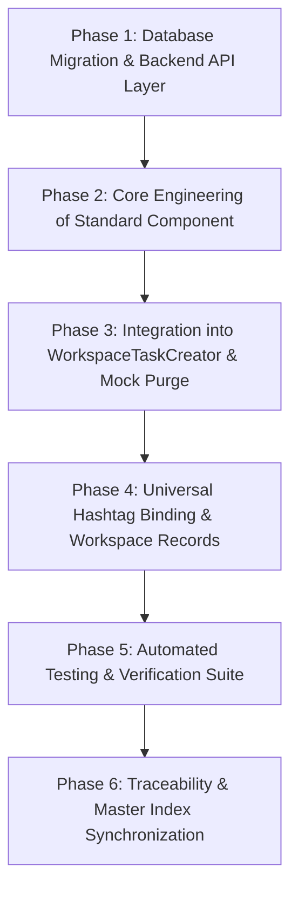

# Engineering Implementation & Refactoring Plan: Standard File Ingestion & Column Mapping Workspace

## Document Metadata
* **Document Identifier**: `PLAN-FILE-INGESTION-REFACTOR-001`
* **Version**: `1.0.0`
* **Status**: `READY FOR EXECUTION`
* **Author**: Core Back-Office Architecture & Automation Team
* **Master Specification Anchor**: [`STANDARD_FILE_INGESTION_AND_MAPPING_ARCHITECTURE.md`](file:///c:/Users/hp/Downloads/opration-workflow-mangement1/STANDARD_FILE_INGESTION_AND_MAPPING_ARCHITECTURE.md)
* **Master Architecture Index**: [`MASTER_ARCHITECTURE_INDEX.md`](file:///c:/Users/hp/Downloads/opration-workflow-mangement1/MASTER_ARCHITECTURE_INDEX.md)

---

## 1. Executive Summary & Refactoring Objectives

This engineering plan details the systematic extraction, modernization, and hardening of the file ingestion and column mapping subsystem from [`WorkspaceTaskCreator.tsx`](file:///c:/Users/hp/Downloads/opration-workflow-mangement1/frontend/src/components/issue/WorkspaceTaskCreator.tsx) into a standalone, reusable, enterprise-grade component: [`StandardFileIngestionWorkspace.tsx`](file:///c:/Users/hp/Downloads/opration-workflow-mangement1/frontend/src/components/common/StandardFileIngestionWorkspace.tsx).

### Key Deliverables:
1. **Preamble-Aware Header Row Positioning**: Allows operators to set where the header row begins (e.g. Line 1, 2, 4) and truncates preceding preamble metadata.
2. **Interactive Headerless Data Support**: Automatically detects column counts on headerless files and prompts operators to manually assign unique column headers.
3. **PostgreSQL Relational Template Persistence**: Replaces in-memory mock templates (`tpl-1`, `tpl-2`, `tpl-3`) with dedicated PostgreSQL persistence (`file_ingestion_mapping_templates`) and REST endpoints.
4. **Deleted Columns & Data Cleaning Recipe**: Formally tracks excluded columns, empty row policies (`DROP`, `FILL_NA`, `ERROR_BLOCK`), duplicate row policies (`DROP_EXACT`, `KEEP_FIRST`, `FLAG_FOR_REVIEW`), and data hygiene actions.
5. **Pre-Commit Data Integrity Gate & Save Interruption**: Aborts task creation if the file is incomplete, un-mapped, or schema-mismatched, displaying clear corrective feedback.
6. **Decommissioning Mock Loaders**: Completely purges synthetic sample buttons (`📄 Chargebacks CSV`, `📊 Settlement CSV`) from production intake.

---

## 2. Refactoring Phases & Execution Roadmap

---

### Phase 1: Database Migration & Backend Persistence Layer

#### Objectives:
Establish true PostgreSQL relational persistence for file ingestion mapping templates, replacing hardcoded mock templates and in-memory arrays.

#### Tasks:
1. **Migration File**:
   - Create `backend/src/database/migrations/028_file_ingestion_mapping_templates.sql`.
   - Define table `file_ingestion_mapping_templates` with columns:
     - `id VARCHAR(64) PRIMARY KEY`
     - `name VARCHAR(255) NOT NULL`
     - `description TEXT`
     - `source_type VARCHAR(32) NOT NULL DEFAULT 'csv'`
     - `header_mode VARCHAR(32) NOT NULL DEFAULT 'ROW_INDEX'`
     - `header_row_index INT NOT NULL DEFAULT 1`
     - `manual_headers JSONB NOT NULL DEFAULT '{}'::jsonb`
     - `deleted_columns JSONB NOT NULL DEFAULT '[]'::jsonb`
     - `required_columns JSONB NOT NULL DEFAULT '[]'::jsonb`
     - `column_mappings JSONB NOT NULL DEFAULT '{}'::jsonb`
     - `cleaning_recipe JSONB NOT NULL DEFAULT '{}'::jsonb`
     - `created_by VARCHAR(64)`
     - `team_id VARCHAR(64)`
     - `is_default BOOLEAN NOT NULL DEFAULT false`
     - `created_at TIMESTAMPTZ NOT NULL DEFAULT NOW()`
     - `updated_at TIMESTAMPTZ NOT NULL DEFAULT NOW()`
   - Add indexing on `(team_id)` and `(name)`.
2. **Backend Type Definitions**:
   - Update `backend/src/types.ts` and `frontend/src/types.ts` to include `FileIngestionMappingTemplate` and `FileIngestionRecipe`.
3. **Repository Methods in `postgresRepo.ts`**:
   - Implement:
     - `getFileMappingTemplates(teamId?: string): Promise<FileIngestionMappingTemplate[]>`
     - `getFileMappingTemplateById(id: string): Promise<FileIngestionMappingTemplate | null>`
     - `createOrUpdateFileMappingTemplate(template: FileIngestionMappingTemplate): Promise<FileIngestionMappingTemplate>`
     - `deleteFileMappingTemplate(id: string): Promise<boolean>`
4. **REST API Routes in `misc.ts` or `transactionSettings.ts`**:
   - Expose:
     - `GET /api/file-mapping-templates`
     - `POST /api/file-mapping-templates`
     - `DELETE /api/file-mapping-templates/:id`
5. **Frontend API Client**:
   - Add corresponding client calls to [`frontend/src/api/client.ts`](file:///c:/Users/hp/Downloads/opration-workflow-mangement1/frontend/src/api/client.ts).

---

### Phase 2: Core Engineering of `StandardFileIngestionWorkspace.tsx`

#### Objectives:
Build the decoupled, multi-format ingestion engine with preamble detection, headerless manual input, data cleaning recipes, and database template management.

#### Tasks:
1. **Component Initialization**:
   - Create [`frontend/src/components/common/StandardFileIngestionWorkspace.tsx`](file:///c:/Users/hp/Downloads/opration-workflow-mangement1/frontend/src/components/common/StandardFileIngestionWorkspace.tsx).
   - Define component props:
     - `selectedHashtag?: HashtagPreset | null`
     - `onDatasetReady: (payload: IngestionDatasetPayload) => void`
     - `onValidationChange?: (isValid: boolean, errors: string[]) => void`
     - `currentUser: User`
     - `initialFile?: File | null`
2. **Multi-Format Preamble & Structure Inspector**:
   - Parse raw files (.csv, .xlsx, .xls, .xml).
   - Display a 10-line raw sample preview.
   - Implement **Header Mode Switch**:
     - `Header Row in File`: Numeric selector (`Header starts at row [N]`). Preceding rows are stripped; row N becomes headers; row N+1 begins data.
     - `Headerless File`: Calculates total columns (e.g. 6 columns). Renders an inline header definition bar where the operator enters a custom header name for each column.
3. **Column Exclusion Registry (`deletedColumns`)**:
   - Track deleted columns in state.
   - Filter excluded columns before rendering preview and passing to downstream payloads.
4. **Data Cleaning Recipe & Hygiene Tools**:
   - **Empty Rows Policy**: Drop, Fill N/A, or Error Block.
   - **Duplicate Rows Policy**: Drop Exact, Keep First, Flag for Review, or Error Block.
   - **In-place Cleaners**: Trim all whitespace, ISO Date normalizer, Card PAN mask.
5. **Decouple GlobalMappingService & Implement Template-Scoped Required Fields**:
   - Remove hardcoded global required column enforcement from `GlobalMappingService` (`validateRequiredColumns`). Global standard fields provide the vocabulary of canonical targets, but individual mapping templates govern mandatory column constraints.
   - Allow operators to toggle `[x] Required` per column in the template builder, serializing `requiredColumns: string[]` into the template recipe.
   - Enforce template required columns during task creation: if any column in `template.requiredColumns` is missing or unmapped, block task persistence with an alert.
6. **PostgreSQL Template Integration**:
   - Load templates from `api.getFileMappingTemplates()`.
   - Save Template modal that writes full ingestion recipes to PostgreSQL (`file_ingestion_mapping_templates`).

---

### Phase 3: Integration into `WorkspaceTaskCreator.tsx` & Mock Purge

#### Objectives:
Clean up `WorkspaceTaskCreator.tsx`, remove mock loaders, integrate the new component, and wire the pre-commit integrity gate.

#### Tasks:
1. **Purge Mock Loaders**:
   - Delete `handleLoadSampleChargebacks` and `handleLoadSampleSettlements`.
   - Remove `📄 Chargebacks CSV` and `📊 Settlement CSV` buttons.
2. **Refactor Ingestion Container**:
   - Replace the legacy 700-line inline upload/table block in `WorkspaceTaskCreator.tsx` with `<StandardFileIngestionWorkspace />`.
3. **Pre-Commit Integrity Gate & Save Interruption**:
   - In `handleCreateTaskSubmit`:
     - Check `ingestionWorkspaceRef.current?.validateAndPrepareDataset()`.
     - If the dataset is incomplete, has un-named headerless columns, or is missing required columns from the selected template or hashtag:
       - Interrupt save immediately (`return`).
       - Highlight the error banner in the ingestion workspace.
     - If valid: attach the sanitized dataset (`uploadedFileHeaders`, `fileMapping`, `firstLevelMappedData`) to the task payload and persist.

---

### Phase 4: Integration with Universal Hashtags & Ingestion Absorption

#### Objectives:
Ensure full synchronization between hashtag directives, mapping templates, and transaction absorption.

#### Tasks:
1. **Directive Binding**:
   - Pass `selectedTagPreset` into `StandardFileIngestionWorkspace`.
   - The component automatically binds the directive's `mappingTemplateId` or `minimumRequiredColumns` into its validation pipeline.
2. **Hashtag Ingestion Absorption Enforcement**:
   - When a hashtag absorbs input transactions (e.g. in `executeFileIngestionHashtag` or task creation), enforce the linked template's `requiredColumns`.
   - If any mandated column is missing in the absorbed transaction batch, reject or flag the batch before executing downstream workflow nodes.
3. **Workspace Table Records Persistence**:
   - Transform mapped records into canonical global schema and persist to PostgreSQL (`api.saveWorkspaceTableRecords`).

---

### Phase 5: Automated Testing & Verification Suite

#### Objectives:
Verify that all functionality works correctly without regressions.

#### Tasks:
1. **Backend Integration Tests**:
   - Add test suite in `backend/src/services/__tests__/fileIngestionMappingTemplates.test.ts`:
     - Verify CRUD operations for `file_ingestion_mapping_templates`.
     - Test template retrieval and team isolation.
2. **Multi-Format Parsing Tests**:
   - Test CSV, Excel, and XML parsing with preamble rows (Header at Row 3).
   - Test headerless file with manual column naming.
   - Test empty row and duplicate row policies.
3. **Build Integrity**:
   - Run backend `tsc` (exit code 0).
   - Run frontend `vite build` (exit code 0).
   - Run Vitest test suites (100% pass).

---

### Phase 6: Traceability & Master Architecture Index Synchronization

#### Objectives:
Update repository architectural indices in compliance with **AGENTS.md Rule 22**.

#### Tasks:
1. Update [`STANDARD_FILE_INGESTION_AND_MAPPING_ARCHITECTURE.md`](file:///c:/Users/hp/Downloads/opration-workflow-mangement1/STANDARD_FILE_INGESTION_AND_MAPPING_ARCHITECTURE.md) changelog.
2. Mirror changes in central [`MASTER_ARCHITECTURE_INDEX.md`](file:///c:/Users/hp/Downloads/opration-workflow-mangement1/MASTER_ARCHITECTURE_INDEX.md) under Domain 7.
