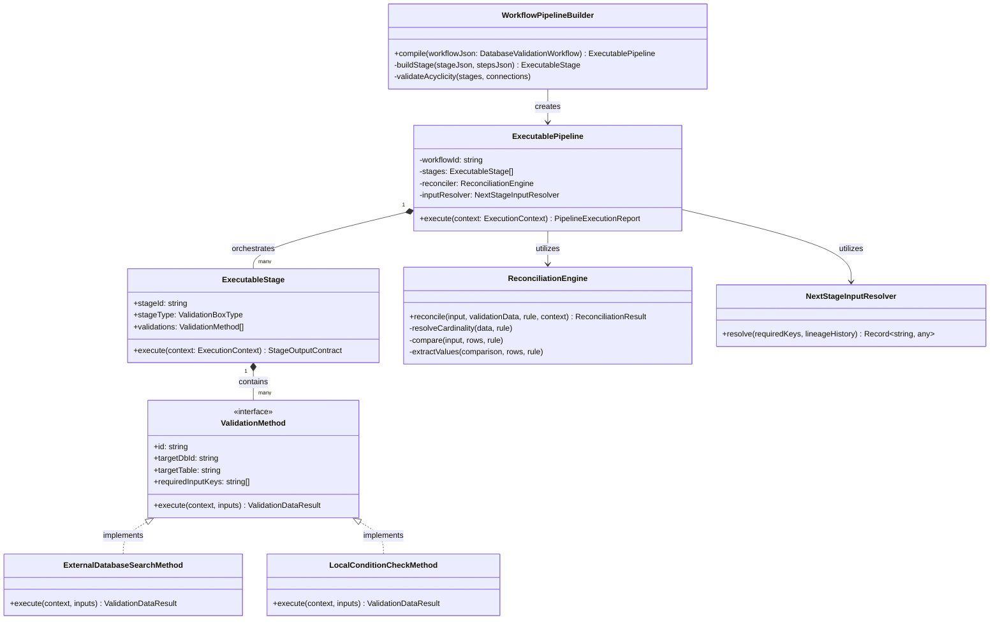

# Rule-to-Method Pipeline Architecture
## Separation of External Data Acquisition, Common Reconciliation, and Lineage Flow

> **Document Status**: Authoritative Architecture Specification & Design Blueprint  
> **Target Scope**: Workflow Execution Engine, Pipeline Builder, Reconciliation Engine  
> **Target Location**: `backend/src/services/pipeline/`  
> **Governing Standards**: [`bo-operational-governance`](.agents/skills/bo-operational-governance/SKILL.md), [`AGENTS.md`](AGENTS.md) (Rules 1, 2, 3, 4, 9, 10, 11, 12, 18, 20, 21)

---

## Table of Contents
1. [Executive Summary & Core Model](#1-executive-summary--core-model)
2. [The 15 Foundational Architectural Directives](#2-the-15-foundational-architectural-directives)
   - [2.1 Narrow Responsibility of Validation Methods](#21-narrow-responsibility-of-validation-methods)
   - [2.2 Old Monolithic Model vs. New Decoupled Model](#22-old-monolithic-model-vs-new-decoupled-model)
   - [2.3 The Builder as the Workflow Compiler](#23-the-builder-as-the-workflow-compiler)
   - [2.4 Runtime Data-Driven Execution Model](#24-runtime-data-driven-execution-model)
   - [2.5 Explicit Execution Keys & ValidationExecutionContext](#25-explicit-execution-keys--validationexecutioncontext)
   - [2.6 The Mirror as the Boundary Between Querying and Reconciliation](#26-the-mirror-as-the-boundary-between-querying-and-reconciliation)
   - [2.7 Minimal Validation Method Contract](#27-minimal-validation-method-contract)
   - [2.8 Common Reconciliation Engine](#28-common-reconciliation-engine)
   - [2.9 The Simplified Pipeline Loop](#29-the-simplified-pipeline-loop)
   - [2.10 Sequential Chaining & Output-to-Input Propagation](#210-sequential-chaining--output-to-input-propagation)
   - [2.11 Keyed Output Routing vs. Boolean Pass/Fail](#211-keyed-output-routing-vs-boolean-passfail)
   - [2.12 Stage History & Lineage Immutability](#212-stage-history--lineage-immutability)
   - [2.13 Validation Method vs. Validation Definition](#213-validation-method-vs-validation-definition)
   - [2.14 The Four Architectural Layers](#214-the-four-architectural-layers)
   - [2.15 The Foundational Architectural Mandate](#215-the-foundational-architectural-mandate)
3. [Transition from Passive DTO Compiler to Object-Oriented Builder Pattern](#3-transition-from-passive-dto-compiler-to-object-oriented-builder-pattern)
   - [3.1 Current State vs. Target Pattern Comparison](#31-current-state-vs-target-pattern-comparison)
   - [3.2 Target Class Hierarchy & Object Model](#32-target-class-hierarchy--object-model)
   - [3.3 How the Builder Converts Workflow JSON into Classes & Methods](#33-how-the-builder-converts-workflow-json-into-classes--methods)
   - [3.4 Key Advantages of the Object-Oriented Pattern](#34-key-advantages-of-the-object-oriented-pattern)
4. [Architectural Review, Alignment Analysis & Critical Corrections](#4-architectural-review-alignment-analysis--critical-corrections)
   - [4.1 Alignment Assessment](#41-alignment-assessment)
   - [4.2 Critical Corrections to the Initial Class Proposal](#42-critical-corrections-to-the-initial-class-proposal)
5. [Master Architecture Specification & Contract Reference](#5-master-architecture-specification--contract-reference)
   - [5.1 End-to-End Execution Flow](#51-end-to-end-execution-flow)
   - [5.2 Complete TypeScript Contract Definitions](#52-complete-typescript-contract-definitions)
   - [5.3 Cardinality Policy Governance](#53-cardinality-policy-governance)
   - [5.4 Final Implementation Consensus](#54-final-implementation-consensus)
6. [Generalization Across All Four Canonical Validation Box Types](#6-generalization-across-all-four-canonical-validation-box-types)
   - [6.1 Foundational Architectural Principle & Abstraction Separation](#61-foundational-architectural-principle--abstraction-separation)
   - [6.2 The Universal Execution Lifecycle](#62-the-universal-execution-lifecycle)
   - [6.3 Ingestion Search Boxes (INGESTION_SEARCH)](#63-ingestion-search-boxes-ingestion_search)
   - [6.4 Validation Check Boxes (CONDITION_CHECK)](#64-validation-check-boxes-condition_check)
   - [6.5 Reconciliation Boxes (RECONCILIATION)](#65-reconciliation-boxes-reconciliation)
   - [6.6 Diagnostic & Report Boxes (REPORT)](#66-diagnostic--report-boxes-report)
   - [6.7 The Canonical Action & Verdict Matrix](#67-the-canonical-action--verdict-matrix)
   - [6.8 Four-Box Comprehensive Specification Matrix](#68-four-box-comprehensive-specification-matrix)
7. [Set-Based vs. Row-Based Reconciliation Architecture](#7-set-based-vs-row-based-reconciliation-architecture)
   - [7.1 The Production Imperative: Why Row-by-Row Loops Fail at Scale](#71-the-production-imperative-why-row-by-row-loops-fail-at-scale)
   - [7.2 The Dual Execution Model (Hybrid Set-Based & In-Memory)](#72-the-dual-execution-model-hybrid-set-based--in-memory)
   - [7.3 How Set-Based Reconciliation Fits the Builder & Method Pattern](#73-how-set-based-reconciliation-fits-the-builder--method-pattern)
   - [7.4 Set-Based SQL Compilation with ruleSqlCompiler](#74-set-based-sql-compilation-with-rulesqlcompiler)
   - [7.5 Batched Tuple Ingestion & Parameter Bound Capping (< 30,000)](#75-batched-tuple-ingestion--parameter-bound-capping--30000)
   - [7.6 Deduplicated Joins and Surrogate Key Mapping](#76-deduplicated-joins-and-surrogate-key-mapping)
   - [7.7 Set-Based Lineage & Downstream Key Propagation](#77-set-based-lineage--downstream-key-propagation)
   - [7.8 Complete Unified Class & Interface Contract for Set-Based Execution](#78-complete-unified-class--interface-contract-for-set-based-execution)
8. [Preserved Coordinate Ingress: The Parameterized VALUES Correlation Pattern](#8-preserved-coordinate-ingress-the-parameterized-values-correlation-pattern)
   - [8.1 The Ambiguity Problem in Naive IN-Tuple Queries](#81-the-ambiguity-problem-in-naive-in-tuple-queries)
   - [8.2 The Parameterized VALUES Ingress Join Pattern](#82-the-parameterized-values-ingress-join-pattern)
   - [8.3 Anti-Pattern Warning: Arbitrary Window ROW_NUMBER() vs. Preserved Ingress row_num](#83-anti-pattern-warning-arbitrary-window-row_number-vs-preserved-ingress-row_num)
   - [8.4 Multi-Row External Matches and Cardinality Policy Decoupling](#84-multi-row-external-matches-and-cardinality-policy-decoupling)
   - [8.5 Staging Input Relations vs. Parameterized VALUES for High-Volume Batches](#85-staging-input-relations-vs-parameterized-values-for-high-volume-batches)
   - [8.6 End-to-End Coordinate Lifecycle: Ingress to Downstream Propagation](#86-end-to-end-coordinate-lifecycle-ingress-to-downstream-propagation)
9. [End-to-End Row Number Invariance Across Central DB, Task Dataset, and Mirror Tables](#9-end-to-end-row-number-invariance-across-central-db-task-dataset-and-mirror-tables)
   - [9.1 The Universal Coordinate Invariant](#91-the-universal-coordinate-invariant)
   - [9.2 Physical Tri-Layer Database Synchronization](#92-physical-tri-layer-database-synchronization)
   - [9.3 Ingestion Lifecycle & Upfront Coordinate Allocation](#93-ingestion-lifecycle--upfront-coordinate-allocation)
   - [9.4 Parameterized Ingress Query Injection & Return Binding](#94-parameterized-ingress-query-injection--return-binding)
   - [9.5 Set-Based Reconciliation Joins on Universal Coordinates](#95-set-based-reconciliation-joins-on-universal-coordinates)
   - [9.6 Multi-Stage DAG Lineage & Downstream Value Propagation](#96-multi-stage-dag-lineage--downstream-value-propagation)
   - [9.7 Maker-Checker Overrides & Immutable Rollbacks](#97-maker-checker-overrides--immutable-rollbacks)
   - [9.8 Universal Coordinate Invariance Matrix](#98-universal-coordinate-invariance-matrix)
   - [9.9 Prohibited Anti-Patterns Checklist](#99-prohibited-anti-patterns-checklist)
   - [9.10 Cardinality Asymmetry: Unique Task Datasets vs. Non-Unique Mirror Tables](#910-cardinality-asymmetry-unique-task-datasets-vs-non-unique-mirror-tables)
   - [9.11 Multi-Tenant Execution Context: Preventing Cross-Run and Cross-Task Contamination](#911-multi-tenant-execution-context-preventing-cross-run-and-cross-task-contamination)
10. [Database Column Configuration Architecture & Anti-Contamination Governance](#10-database-column-configuration-architecture--anti-contamination-governance)
    - [10.1 The Governance Role of Database Column Configurations](#101-the-governance-role-of-database-column-configurations)
    - [10.2 The Anti-Contamination Mandate (§10 & Rule 21)](#102-the-anti-contamination-mandate-10--rule-21)
    - [10.3 Four-Tier Synchronization Architecture](#103-four-tier-synchronization-architecture)
    - [10.4 The Builder & Method Compilation Lifecycle](#104-the-builder--method-compilation-lifecycle)
    - [10.5 Dynamic SQL Compilation with ruleSqlCompiler](#105-dynamic-sql-compilation-with-rulesqlcompiler)
    - [10.6 End-to-End Execution Trace: Attached DB Config in Action](#106-end-to-end-execution-trace-attached-db-config-in-action)

---

## 1. Executive Summary & Core Model

The fundamental architectural evolution of the pipeline engine is **not simply "turn each validation stage into a class."** The critical advancement is the **strict separation of External-Data Acquisition (I/O & Mirroring) from Reconciliation / Business Decision Logic (Verdict, Pipeline Action, Key Extraction & Lineage)**.

### The Master Architectural Model

```text
Workflow JSON
     │
     ▼
   Builder (Compiler)
     │
     ├── prepares executable validation methods
     ├── prepares their order/dependencies (DAG Acyclicity)
     ├── prepares required keys/configuration
     └── attaches common reconciliation engine
     │
     ▼
Executable Pipeline
     │
     ▼
Validation Method
     │
     │  query external DB
     │  mirror result
     │
     ▼
Reconciliation Method
     │
     │  compare input ↔ mirrored data
     │  decide result (PASS / FAIL / ERROR)
     │  decide action (CONTINUE / STOP / CLOSE)
     │  extract required values
     │
     ▼
Next Validation Method
     │
     └───────────────► LOOP UNTIL PIPELINE TERMINATION
```

This separation ensures that data-acquisition methods remain microscopically small and I/O-focused, while business rules, reconciliation arithmetic, decision matrices, and execution lineage are centralized into a reusable engine.

---

## 2. The 15 Foundational Architectural Directives

### 2.1 Narrow Responsibility of Validation Methods
The responsibility of a validation method is defined very narrowly:
> **A validation method obtains the external data required by its rule and makes that data available to the reconciliation engine. It does not decide the final business result.**

For a search validation:

```text
Input Transaction
      │
      ▼
Validation Method
      │
      ├── prepare query parameters
      ├── construct/execute external query
      ├── retrieve external rows
      └── mirror rows
             │
             ▼
        Reconciliation Engine
```

The validation method does **not** decide:
- `PASS`
- `FAIL`
- `CONTINUE`
- `STOP`
- `CLOSE`

*(unless the specific validation is inherently local, in-memory, and does not require external database reconciliation).*

---

### 2.2 Old Monolithic Model vs. New Decoupled Model

#### The Old Model (Monolithic Anti-Pattern)
In earlier iterations, a single validation stage or box tried to handle every operational responsibility inlined within a 1,313-line procedural loop:

```text
Search Box (Monolithic Anti-Pattern)
   │
   ├── prepare SQL
   ├── query DB
   ├── insert mirror
   ├── compare input
   ├── determine PASS/FAIL
   ├── extract values
   └── determine next operation
```
**Consequences**: High cyclomatic complexity, duplicated comparison logic across stages, brittle key bridging, and severe procedural drift.

#### The New Model (Decoupled & Single Responsibility)
Responsibilities are split strictly across four specialized components:

```text
Search Validation Method
   │
   └── query external DB
             │
             ▼
          Mirror Table (mirror_{db}_{table})
             │
             ▼
       Common Reconciliation Engine
             │
             ├── compare input ↔ mirror
             ├── determine PASS / FAIL / ERROR
             ├── extract produced values
             └── determine next method & action
```

---

### 2.3 The Builder as the Workflow Compiler
Suppose the workflow configuration JSON contains:

```json
{
  "stageId": "search_card",
  "validations": [
    {
      "id": "find_transaction",
      "checkType": "EXISTENCE_CHECK",
      "targetDbId": "db1",
      "targetTable": "card_settlement_records"
    },
    {
      "id": "check_amount",
      "checkType": "AMOUNT_MATCH"
    }
  ]
}
```

The Builder consumes that JSON and prepares the executable structure:

```text
ExecutableStage
│
├── ValidationMethod: find_transaction
│
├── ValidationMethod: check_amount
│
└── ReconciliationEngine
```

**Key Principle**: The Builder does **not** need to know the actual transaction values at build time. It validates DAG acyclicity, checks database configurations, and compiles the execution structure ahead of time.

---

### 2.4 Runtime Data-Driven Execution Model
At runtime, execution is purely data-driven:

```text
Task
 │
 └── Transaction / Input Data
          │
          ▼
    Validation Method 1
          │
          ▼
      External DB
          │
          ▼
        Mirror
          │
          ▼
    Reconciliation Engine
          │
          ├── compare input ↔ mirror
          ├── determine result (Verdict)
          ├── produce values (Keyed Output)
          └── select next method (Pipeline Action)
                    │
                    ▼
             Validation Method 2
                    │
                    ▼
                   ...
```

The same common reconciliation engine processes many different validation methods without code duplication.

---

### 2.5 Explicit Execution Keys & ValidationExecutionContext
Rather than passing many loose, independent arguments (`taskId`, `batchId`, `validatorId`, `stageId`, etc.), the execution context is formalized as an explicit, strongly typed object:

```typescript
export interface ValidationExecutionContext {
  taskId: string;
  batchId: string;
  stageId: string;
  stageName: string;
  validationId: string;
  rowNumber: number;
  transactionId: string;
  executionTimestamp: string;
  lineageHistory: StageExecutionRecord[];
}
```

Execution flow:
```typescript
// 1. Data acquisition method uses context to target external DB & mirror
const dataResult = await validation.execute(context, inputKeys);

// 2. Reconciliation engine receives the same context to record forensic lineage
const reconResult = await reconciler.reconcile(
  inputData,
  dataResult,
  ruleDefinition,
  context
);
```

This conforms directly to the master architecture's execution hierarchy and lineage model, which distinguishes task, batch, stage, row, and transaction identity.

---

### 2.6 The Mirror as the Boundary Between Querying and Reconciliation

The dedicated typed UNLOGGED mirror table (`mirror_{db}_{table}`) forms the architectural boundary:

```text
                 External System
                       │
                       │ (Network I/O, JDBC/Pool, Bounds < 30k)
                 Validation Method
                       │
                       ▼
                     Mirror (mirror_{db}_{table})
                       │
                       │ (In-Engine Relational Query / Snapshot)
                 Reconciliation Engine
                       │
                       ▼
                 Business Result
```

The reconciliation engine does not need to know *how* the data was obtained. It only requires:
$$\text{Input Data} + \text{Execution Keys} + \text{Mirrored Result} + \text{Rule Definition}$$

Tomorrow, the external source could be PostgreSQL, MySQL, Oracle, MongoDB, or a REST API—the fundamental reconciliation mechanism remains completely unchanged. This enforces **Rule 4** (*External System Agnosticism*).

---

### 2.7 Minimal Validation Method Contract
The validation method interface is kept minimal:

```typescript
export interface ValidationDataResult {
  context: ValidationExecutionContext;
  mirrorTable: string;
  fetchedRowCount: number;
  rawRows: any[];
}

export interface ValidationMethod {
  readonly id: string;
  readonly targetDbId?: string;
  readonly targetTable?: string;
  readonly requiredInputKeys: string[];

  execute(
    context: ValidationExecutionContext,
    inputKeys: Record<string, any>
  ): Promise<ValidationDataResult>;
}
```

Example search implementation:

```typescript
export class SearchValidationMethod implements ValidationMethod {
  constructor(
    public readonly id: string,
    public readonly targetDbId: string,
    public readonly targetTable: string,
    public readonly requiredInputKeys: string[],
    private readonly queryBuilder: QueryBuilder,
    private readonly externalDb: ExternalDbClient,
    private readonly mirror: MirrorTableManager
  ) {}

  public async execute(
    context: ValidationExecutionContext,
    inputKeys: Record<string, any>
  ): Promise<ValidationDataResult> {
    const query = this.queryBuilder.build(context, inputKeys);
    const rows = await this.externalDb.execute(this.targetDbId, query.sql, query.params);
    const mirrorTable = await this.mirror.store(context, this.targetTable, rows);

    return {
      context,
      mirrorTable,
      fetchedRowCount: rows.length,
      rawRows: rows
    };
  }
}
```

Notice what is **not** present here: `PASS`, `FAIL`, `CONTINUE`, `CLOSE`. Those belong strictly to the reconciliation and pipeline control layers.

---

### 2.8 Common Reconciliation Engine
The `ReconciliationEngine` performs the core business decision logic:

```typescript
export interface ReconciliationResult {
  validationResult: 'PASS' | 'FAIL' | 'ERROR' | 'PAUSED_DB_OFFLINE';
  pipelineAction: 'CONTINUE' | 'STOP' | 'CLOSE' | 'FLAG' | 'REPORT';
  cardinalityStatus: 'EXACT_MATCH' | 'CARDINALITY_BREACH' | 'ORDERED_LATEST_PICKED' | 'FANOUT';
  producedValues: Record<string, any>;
  availableKeys: string[];
  comparison: Record<string, any>;
  executionRecord: StageExecutionRecord;
}

export class ReconciliationEngine {
  public async reconcile(
    input: Record<string, any>,
    validationData: ValidationDataResult,
    rule: CompiledRuleDefinition,
    context: ValidationExecutionContext
  ): Promise<ReconciliationResult> {
    // 1. Resolve cardinality without silent truncation
    const { rows, cardinalityStatus } = this.resolveCardinality(validationData, rule);
    if (cardinalityStatus === 'CARDINALITY_BREACH') {
      return this.handleCardinalityBreach(context, rule);
    }

    // 2. Compare input data against mirror data
    const comparison = this.compare(input, rows, rule);

    // 3. Extract required output values for downstream stages
    const producedValues = this.extractValues(comparison, rows, rule);

    // 4. Determine validation verdict
    const validationResult = this.determineValidationResult(comparison, rule);

    // 5. Determine pipeline action based on rule action policy
    const pipelineAction = this.determinePipelineAction(validationResult, rule);

    // 6. Build immutable stage execution record
    const executionRecord: StageExecutionRecord = {
      stageId: context.stageId,
      stageName: context.stageName,
      validationId: context.validationId,
      validationResult,
      pipelineAction,
      cardinalityStatus,
      producedValues,
      evaluatedAt: new Date().toISOString(),
      details: comparison
    };

    return {
      validationResult,
      pipelineAction,
      cardinalityStatus,
      producedValues,
      availableKeys: Object.keys(producedValues),
      comparison,
      executionRecord
    };
  }
}
```

---

### 2.9 The Simplified Pipeline Loop
The pipeline loop becomes concise, clean, and declarative:

```typescript
while (currentMethod) {
  // 1. Resolve inputs for the current validation method
  const methodInputs = inputResolver.resolve(
    currentMethod.requiredInputKeys,
    context.lineageHistory
  );

  // 2. Execute Data Acquisition (I/O & Mirroring ONLY)
  const data = await currentMethod.execute(context, methodInputs);

  // 3. Reconcile (Business verdict, pipeline action, produced values)
  const reconciliation = await reconciler.reconcile(
    context.initialRecord,
    data,
    currentMethod.definition,
    context
  );

  // 4. Record execution lineage (History is accumulated, never overwritten)
  context.lineageHistory.push(reconciliation.executionRecord);

  // 5. Pipeline Control: Halt on STOP action
  if (reconciliation.pipelineAction === 'STOP') {
    break;
  }

  // 6. Resolve next input from produced values
  const nextInput = resolver.prepareNextInput(reconciliation);

  // 7. Advance to the next method in the topological sequence
  currentMethod = pipeline.getNextMethod(reconciliation, nextInput);
}
```

The methods perform the I/O work, while the common reconciliation engine controls the transition.

---

### 2.10 Sequential Chaining & Output-to-Input Propagation

```text
Method A
   │
   ▼
External Query
   │
   ▼
Mirror
   │
   ▼
Reconcile
   │
   ├── PASS → produce Data A
   │
   └── FAIL → produce Data B (e.g. Diagnostic Taint)
   │
   ▼
Select Next Validation
   │
   ▼
Method B(Data A/B)
   │
   ▼
External Query
   │
   ▼
Mirror
   │
   ▼
Reconcile
   │
   ▼
Method C(Data C)
```

The output of reconciliation directly seeds the input of the next validation method.

---

### 2.11 Keyed Output Routing vs. Boolean Pass/Fail
Passing only binary "pass data" or "fail data" is an architectural anti-pattern. If Validation A passes and extracts `{ transaction_id, terminal_id, amount }`, Validation B may only require `{ transaction_id, amount }`, while Validation C needs `{ terminal_id }`.

Therefore, the reconciliation result produces a **strongly keyed dictionary of produced values**:

```json
{
  "validationResult": "PASS",
  "pipelineAction": "CONTINUE",
  "producedValues": {
    "transactionId": "TX-99021",
    "terminalId": "TERM-04",
    "amount": 250.00,
    "authCode": "AUTH-771"
  },
  "availableKeys": [
    "transactionId",
    "terminalId",
    "amount",
    "authCode"
  ]
}
```

The subsequent method declares what it requires:
```typescript
validationMethodB.requiredInputs = ["transactionId", "amount"];
```
The `NextStageInputResolver` matches downstream requirements against accumulated keys in the execution context. This aligns with **Capability/Key-Driven Input Resolution**.

---

### 2.12 Stage History & Lineage Immutability
Stage history must **never** be replaced or overwritten.

Suppose:
- **Stage 1**: `Validation A` $\rightarrow$ `PASS`, `Validation B` $\rightarrow$ `FAIL`
- **Stage 2**: `Validation C` $\rightarrow$ `PASS`

The execution context retains the complete chronological audit trail:

```text
ExecutionContext
│
├── Stage 1 Execution Record
│   ├── Validation A → PASS
│   ├── Validation B → FAIL
│   └── producedValues: { ref_no: "12345" }
│
└── Stage 2 Execution Record
    ├── Validation C → PASS
    └── producedValues: { account_id: "ACC-99" }
```

It must **never** collapse to `currentValidationResult = PASS` where Stage 1 is erased. This upholds **Rule 20** (*Evidence-Based Persistent-State Modification*) and Four-Eyes Maker-Checker auditability.

---

### 2.13 Validation Method vs. Validation Definition
Configuration is separated from runtime behavior:

```text
Workflow JSON
     │
     ▼
Validation Definition (CompiledValidation)
     │
     ▼
Builder (WorkflowPipelineBuilder)
     │
     ▼
Executable Validation Method (ExecutableValidationMethod)
```

Contract structure:
```typescript
export interface CompiledValidationDefinition {
  id: string;
  checkType: CheckType;
  targetDbId?: string;
  targetTable?: string;
  parameters: Array<{ inputField: string; targetColumn: string }>;
  outputKeys: string[];
}

export class ExecutableValidationMethod {
  constructor(private readonly definition: CompiledValidationDefinition) {}

  public async execute(context: ValidationExecutionContext, inputs: Record<string, any>): Promise<ValidationDataResult> {
    // executes based on definition
  }
}
```

The JSON remains static configuration; the Builder turns that configuration into executable runtime behavior.

---

### 2.14 The Four Architectural Layers

| Layer | Component | Core Responsibility |
| :--- | :--- | :--- |
| **Layer 1: Configuration** | Workflow JSON Schema | Declarative definition of stages, steps, validation boxes, and `attachedDbConfigIds`. Contains zero runtime code. |
| **Layer 2: Compiler / Builder** | `WorkflowPipelineBuilder` | Consumes Workflow JSON, verifies DAG acyclicity (Kahn's algorithm), instantiates `ExecutableValidationMethod` instances, and wires the pipeline. |
| **Layer 3: Execution / I/O** | `ValidationMethod` instances | Focused exclusively on external data retrieval and staging to `mirror_{db}_{table}`. Does not decide verdicts or actions. |
| **Layer 4: Common Reconciliation** | `ReconciliationEngine` & `NextStageInputResolver` | Centralized domain engine comparing input against mirror data, assigning verdicts, determining actions, extracting keyed outputs, and preserving lineage. |

---

### 2.15 The Foundational Architectural Mandate
> **"Each validation method shall perform one independent data-acquisition or validation operation defined by the workflow. For search-oriented validations, the method shall prepare and execute the external query and persist the returned data into the appropriate mirror scope. The method shall then expose the resulting data through the execution context rather than determining the final business outcome. A shared reconciliation mechanism shall consume the original input, execution keys, validation definition, and mirrored data; reconcile the external result against the input; produce the validation result and required output values; determine the pipeline action; preserve the validation lineage; and provide the resolved data required by the next validation method. The executable pipeline shall repeat this process until the configured workflow path terminates."**

---

## 3. Transition from Passive DTO Compiler to Object-Oriented Builder Pattern

### 3.1 Current State vs. Target Pattern Comparison

| Aspect | Current Implementation (`validationPipelineBuilder.ts`) | The Discussed Target Pattern (Executable Class & Methods) |
| :--- | :--- | :--- |
| **Builder Output** | Passive data interfaces (`CompiledValidationPlan`, `CompiledStagePlan`) — plain JSON-like structures. | An instantiated **`ExecutablePipeline` Class** containing polymorphically specialized **`ExecutableStage` Classes**. |
| **Execution Logic** | Inlined inside a **1,313-line procedural loop** in `investigationOrchestratorService.ts`. | Encapsulated inside **dedicated instance methods** on each stage (`execute()`, `resolveInputs()`, `recordLineage()`). |
| **Stage Polymorphism** | Switch/if-statements checking `isIngestionSearch`, `checkType`, or `dualSourceCondition` procedural flags. | **Polymorphic Specialization**: `IngestionSearchStage`, `ConditionCheckStage`, `ReconciliationStage`, `DiagnosticReportStage`. |
| **Testability** | Difficult to test stage execution in isolation without running the entire 1,300-line orchestrator. | Each validation method and reconciliation step can be instantiated, mocked, and unit-tested independently in milliseconds. |

---

### 3.2 Target Class Hierarchy & Object Model



---

### 3.3 How the Builder Converts Workflow JSON into Classes & Methods

#### Step 1: The Builder Inspects JSON and Instantiates Specialized Classes
Instead of mapping JSON to passive data objects, the builder dispatches based on `boxType` and `checkType`:

```typescript
export class WorkflowPipelineBuilder {
  public compile(workflow: DatabaseValidationWorkflow): ExecutablePipeline {
    // 1. Kahn's Algorithm DAG Sort & Acyclicity Validation
    const { topologicalOrder } = this.validateAcyclicity(workflow.stages, workflow.connections);

    // 2. Instantiate stages with bound validation methods
    const executableStages: ExecutableStage[] = topologicalOrder.map(stageId => {
      const stageJson = workflow.stages.find(s => s.id === stageId)!;
      const stageSteps = workflow.steps.filter(st => st.stageId === stageId);

      const validationMethods: ValidationMethod[] = stageSteps.map(step => {
        return this.createValidationMethod(step, stageJson);
      });

      return new ExecutableStage(stageJson.id, stageJson.name, stageJson.boxType, validationMethods, stageJson.cardinalityPolicy);
    });

    const reconciler = new ReconciliationEngine();
    const inputResolver = new NextStageInputResolver();

    return new ExecutablePipeline(workflow.id, workflow.name, executableStages, reconciler, inputResolver);
  }
}
```

#### Step 2: Lifecycle Execution without Subclass Bloat
Each stage delegates data acquisition to its validation methods and delegates decision logic to the common reconciliation engine.

#### Step 3: Compiling Rules into Typed Predicate Methods
- **Set-Based SQL Predicates (`toSqlPredicate()`)**: Uses `ruleSqlCompiler` to compile rules into parameterized `CASE WHEN` statements for bulk mirror operations.
- **In-Memory Predicate Methods (`evaluateRecord()`)**: Compiled JavaScript closures for unit testing, offline simulations, or streaming evaluations without external roundtrips.

---

### 3.4 Key Advantages of the Object-Oriented Pattern
1. **Decoupling Orchestration from Execution**:
   `investigationOrchestratorService.ts` drops from ~1,300 lines to ~200 lines. The orchestrator becomes a clean Director:
   ```typescript
   const pipeline = workflowPipelineBuilder.compile(workflowJson);
   const executionResult = await pipeline.execute(dataset, executionContext);
   ```
2. **Elimination of Procedural Drift**:
   Adding a new rule check type no longer requires modifying 4 different sections of the orchestrator loop. The validation method and reconciliation engine handle their respective domains cleanly.
3. **True Polymorphism**:
   Search stages don't need reconciliation arithmetic; comparison stages don't need primary key discovery.

---

## 4. Architectural Review, Alignment Analysis & Critical Corrections

### 4.1 Alignment Assessment

| Concept in Proposal | Alignment Status | Architectural Rationale |
| :--- | :---: | :--- |
| **Workflow JSON $\rightarrow$ `WorkflowPipelineBuilder`** | ✅ **ALIGNED** | Clean compiler/builder separation. |
| **Builder creates executable objects** | ✅ **ALIGNED** | Replaces passive DTOs with executable classes. |
| **`ExecutablePipeline` owns flow** | ✅ **ALIGNED** | Centralizes sequential stage transitions. |
| **Validation logic out of 1,300-line orchestrator** | ✅ **ALIGNED** | Eliminates monolithic procedural code. |
| **Common reconciliation mechanism** | ✅ **ALIGNED** | Single source of truth for business rules & verdicts. |
| **Keyed data passing to subsequent validation** | ✅ **ALIGNED** | Resolves downstream inputs via accumulated dictionaries. |
| **Lineage history preservation** | ✅ **ALIGNED** | Preserves full audit trail for Maker-Checker review. |
| **Topological DAG compilation** | ✅ **ALIGNED** | Guaranteed acyclicity via Kahn's algorithm. |

---

### 4.2 Critical Corrections to the Initial Class Proposal

#### Correction 1: Discarding the Monolithic Stage Lifecycle
The initial draft proposed putting `fetchAndMirror()`, `resolveCardinality()`, and `reconcile()` on every `BaseExecutableStage` subclass.
- **Why this was rejected**: That would smear reconciliation and business logic across stage subclasses, recreating the original problem under an object-oriented guise.
- **The Corrected Architecture**:
  - `ValidationMethod`: Focuses strictly on data retrieval & staging to `mirror_{db}_{table}`.
  - `ReconciliationEngine`: Centralizes all comparison, verdict assignment, and pipeline action determination.
  - `ExecutableStage`: Manages the sequencing of its validation methods.

#### Correction 2: Strict Separation of Verdict vs. Pipeline Action
A stage verdict of `FAIL` must **not** automatically halt the pipeline.
- **Verdict**: Discovered truth (`PASS`, `FAIL`, `ERROR`, `PAUSED_DB_OFFLINE`).
- **Action**: Pipeline direction (`CONTINUE`, `STOP`, `CLOSE`, `FLAG`, `REPORT`).
- **Behavior**: If `Verdict = FAIL` and `Action = CONTINUE`, the engine taints the record (`_isDiagnosticOnly: true`) and continues downstream stages to collect forensic evidence.

#### Correction 3: Elimination of Silent Row Truncation in `STRICT_SINGLE`
The proposal included:
```typescript
// DANGEROUS ANTI-PATTERN:
if (this.cardinalityPolicy === 'STRICT_SINGLE') {
  return rows.slice(0, 1);
}
```
- **Correction**: Operational governance strictly prohibits silent row slicing. If a rule specifies `STRICT_SINGLE` and the query returns 3 rows, the engine must emit `CARDINALITY_BREACH` and halt/flag the record for operator review.

#### Correction 4: Keyed Capability Resolution vs. Boolean Data
Reconciliation emits a dictionary of `producedValues` and `availableKeys`. Downstream stages declare `requiredInputKeys`. The `NextStageInputResolver` matches them cleanly without relying on boolean flags.

---

## 5. Master Architecture Specification & Contract Reference

### 5.1 End-to-End Execution Flow

```text
                    WORKFLOW JSON
                         │
                         ▼
              WorkflowPipelineBuilder
                         │
              compile / validate / bind
                         │
                         ▼
                ExecutablePipeline
                         │
                         ▼
                ExecutableStage
                         │
             ┌───────────┴───────────┐
             ▼                       ▼
       Validation Method 1     Validation Method 2
             │
             │ (Query External DB & Mirror)
             ▼
           Mirror Table (mirror_{db}_{table})
             │
             ▼
      Common Reconciliation Engine
             │
       ┌─────┼───────────┐
       ▼     ▼           ▼
    Verdict Produced  Pipeline
   (PASS/FAIL) Values  Action
       │
       ▼
 Preserve Lineage (StageExecutionRecord)
       │
       ▼
 NextStageInputResolver
       │
       ▼
 Next Validation Method
       │
       └───────────────► LOOP UNTIL PIPELINE TERMINATION
```

---

### 5.2 Complete TypeScript Contract Definitions

```typescript
// 1. Context & Forensic Lineage
export interface ValidationExecutionContext {
  taskId: string;
  batchId: string;
  stageId: string;
  stageName: string;
  validationId: string;
  rowNumber: number;
  transactionId: string;
  executionTimestamp: string;
  lineageHistory: StageExecutionRecord[];
}

export interface StageExecutionRecord {
  stageId: string;
  stageName: string;
  validationId: string;
  validationResult: 'PASS' | 'FAIL' | 'ERROR' | 'PAUSED_DB_OFFLINE';
  pipelineAction: 'CONTINUE' | 'STOP' | 'CLOSE' | 'FLAG' | 'REPORT';
  cardinalityStatus: 'EXACT_MATCH' | 'CARDINALITY_BREACH' | 'ORDERED_LATEST_PICKED' | 'FANOUT';
  producedValues: Record<string, any>;
  evaluatedAt: string;
  details?: Record<string, any>;
}

// 2. Data Acquisition Contract (I/O & Mirroring ONLY)
export interface ValidationDataResult {
  context: ValidationExecutionContext;
  mirrorTable: string;
  fetchedRowCount: number;
  rawRows: any[];
}

export interface ValidationMethod {
  readonly id: string;
  readonly targetDbId?: string;
  readonly targetTable?: string;
  readonly requiredInputKeys: string[];

  execute(
    context: ValidationExecutionContext,
    inputs: Record<string, any>
  ): Promise<ValidationDataResult>;
}

// 3. Common Reconciliation Contract
export interface ReconciliationResult {
  validationResult: 'PASS' | 'FAIL' | 'ERROR' | 'PAUSED_DB_OFFLINE';
  pipelineAction: 'CONTINUE' | 'STOP' | 'CLOSE' | 'FLAG' | 'REPORT';
  cardinalityStatus: 'EXACT_MATCH' | 'CARDINALITY_BREACH' | 'ORDERED_LATEST_PICKED' | 'FANOUT';
  producedValues: Record<string, any>;
  availableKeys: string[];
  comparison: Record<string, any>;
  executionRecord: StageExecutionRecord;
}
```

---

### 5.3 Cardinality Policy Governance

| Policy | Behavior on Single Row | Behavior on Multiple Rows (>1) | Governance Mandate |
| :--- | :--- | :--- | :--- |
| **`STRICT_SINGLE`** | Exact match accepted. | Emits **`CARDINALITY_BREACH`**. Halts / flags. | Never slices rows (`rows.slice(0, 1)` is forbidden). |
| **`EXPLICIT_LATEST`** | Exact match accepted. | Rows sorted descending by `orderByColumn`; latest selected. | `orderByColumn` is mandatory at compile time. |
| **`EXPLICIT_FIRST`** | Exact match accepted. | Rows sorted ascending by `orderByColumn`; earliest selected. | `orderByColumn` is mandatory at compile time. |
| **`ONE_TO_MANY`** | Processed as collection. | Full array passed downstream. | Downstream stage must support collection input. |
| **`ALL_ROWS`** | Processed as collection. | Relational fan-out preserved across mirror tables. | Used for multi-leg split settlements. |

---

### 5.4 Final Implementation Consensus
The architecture transitions the pipeline engine from a passive, procedural loop into an **executable object model**:
1. **The Builder** (`WorkflowPipelineBuilder`) compiles declarative JSON into executable stages and validation methods.
2. **Validation Methods** (`ValidationMethod`) execute focused data retrieval and mirror staging.
3. **The Reconciliation Engine** (`ReconciliationEngine`) evaluates rules, emits verdicts, determines actions, extracts keyed outputs, and appends immutable lineage.
4. **The Input Resolver** (`NextStageInputResolver`) satisfies downstream dependencies dynamically.
5. **The Executable Pipeline** (`ExecutablePipeline`) sequences stages and halts deterministically upon `STOP` actions.

---

## 6. Generalization Across All Four Canonical Validation Box Types

A common initial observation is that the phrase *"query external DB $\rightarrow$ mirror result $\rightarrow$ compare"* appears tailored specifically for **Search Boxes** (`INGESTION_SEARCH`). However, the architecture is fundamentally generalized across all four canonical `ValidationBoxType` enums defined in **Rule 18**:
1. `INGESTION_SEARCH` (Search Boxes)
2. `CONDITION_CHECK` (Validation Check Boxes)
3. `RECONCILIATION` (Reconciliation Boxes)
4. `REPORT` (Diagnostic & Report Boxes)

---

### 6.1 Foundational Architectural Principle & Abstraction Separation

To prevent architectural drift and confusing implementations, the relationship between box operational behavior and rule logic is governed by a strict hierarchy:

> **Foundational Principle**:  
> **`ValidationBoxType` defines the operational behavior of a validation step, while `CheckType` defines the specific validation logic performed within that step. Neither determines final pipeline behavior independently; `ValidationResult` and `PipelineAction` are produced through the common reconciliation/execution contract.**

```text
ValidationBoxType (Operational Stage Behavior)
     │
     ├── INGESTION_SEARCH
     │       └── CheckType: EXISTENCE_CHECK, PRIMARY_KEY_LOOKUP, COMPOSITE_TUPLE_MATCH
     │
     ├── CONDITION_CHECK
     │       ├── FIELD_COMPARATOR
     │       ├── ISO_DECLINE_CODE
     │       ├── REGEX_MATCH
     │       ├── SQL_CONDITION
     │       └── DUAL_SOURCE_COMPARISON
     │
     ├── RECONCILIATION
     │       ├── AMOUNT_MATCH
     │       ├── TOLERANCE_WINDOW
     │       ├── MULTI_LEG_SPLIT
     │       ├── FEE_RECONCILIATION
     │       └── AGGREGATE_BALANCE
     │
     └── REPORT
             ├── FORENSIC_SUMMARY
             ├── DIAGNOSTIC_TAINT_TRACE
             └── DISCREPANCY_EXPORT
```

#### Execution Ownership Clarification
> **"A `ValidationMethod` represents an executable validation operation. It may acquire external data, consume local/mirrored data, or operate entirely on input values depending on the `ValidationBoxType`. It is NOT limited to external database acquisition."**

Data acquisition is categorized into two clear execution topologies:

```text
                   DATA ACQUISITION
                         │
             ┌───────────┴───────────┐
             │                       │
          External                  Local
             │                       │
      INGESTION_SEARCH       CONDITION_CHECK
             │
             │
             └──────────────┐
                            │
                       RECONCILIATION (Consumer & Balancing Decision)
                            │
                            ▼
                         REPORT (Diagnostic & Forensic Synthesis)
```

---

### 6.2 The Universal Execution Lifecycle

All four canonical box types conform to a single, unified execution framework:

```text
                 Validation Box
                       │
                       ▼
              1. Resolve Required Inputs
                 (NextStageInputResolver maps requiredInputKeys from lineage)
                       │
                       ▼
              2. Execute Box Operation
                 (ValidationMethod: External fetch, local reference read, mirror projection, or lineage read)
                       │
                       ▼
              3. Obtain Evaluation Dataset
                 (Raw rows, UNLOGGED mirror reference, or resolved subject record)
                       │
                       ▼
              4. Reconcile & Evaluate Rules
                 (ReconciliationEngine executes domain logic, math tolerances, or summaries)
                       │
          ┌────────────┼────────────┐
          ▼            ▼            ▼
       Result        Action      Produced Values
      (Verdict)     (Action)   (Keyed Dictionary)
          │            │            │
          └────────────┼────────────┘
                       ▼
              5. Record Immutable Lineage
                 (StageExecutionRecord appended to context.lineageHistory)
                       │
                       ▼
              6. Supply Downstream Ingress
                 (NextStageInputResolver seeds downstream requiredInputKeys)
```

---

### 6.3 Ingestion Search Boxes (`INGESTION_SEARCH`)

**Operational Goal**: Discover candidate external records, deduplicate search keys, execute external queries, and stage rows into dedicated UNLOGGED mirror tables.

#### 1. Batch Key Deduplication Semantics
In high-volume settlement runs, sending duplicate external queries for identical search tuples wastes connection pool resources and risks external timeouts:
1. The `ValidationMethod` extracts search keys from all incoming batch records (`context.batchRecords`).
2. Extracts unique tuples: `Set<(refnum, terminal_id)>`.
3. Constructs a batched composite tuple query capped at 30,000 parameters (**Rule 9 & 11**):
   ```sql
   SELECT "refnum", "terminal_id", "reqamt", "auth_id", "status"
   FROM "external_clearing_records"
   WHERE ("refnum", "terminal_id") IN (($1, $2), ($3, $4), ...);
   ```
4. Bulk-inserts the unique returned rows into `mirror_{db}_{table}` under `_batch_id`.

#### 2. Transaction Correlation Semantics
External search results must correlate back to the originating transactions:
- When multiple distinct input transactions share identical search keys (e.g., two independent $50 charges at the same terminal), the engine correlates records using **immutable execution coordinates**:
  $$(m.\text{\_task\_id} = t.\text{task\_id} \quad \text{AND} \quad m.\text{\_row\_number} = t.\text{row\_number})$$
- Ensures zero ambiguity in downstream reconciliations and Maker-Checker audits.

#### 3. Cardinality Support
- `STRICT_SINGLE`: Requires exactly 1 match. If $>1$ rows are returned, emits `CARDINALITY_BREACH` (zero silent row slicing).
- `EXPLICIT_LATEST` / `EXPLICIT_FIRST`: Requires mandatory `orderByColumn` at compile time.
- `ONE_TO_MANY` / `ALL_ROWS`: Preserves all returned candidates for downstream multi-leg matching.

#### 4. Output Contract
Emits primary external entity identifiers:
```json
{
  "auth_id": "AUTH-88291",
  "terminal_id": "TERM-04",
  "actual_amount": 250.00,
  "external_tx_id": "EXT-TX-9901"
}
```

---

### 6.4 Validation Check Boxes (`CONDITION_CHECK`)

**Operational Goal**: Verify business constraints, formatting rules, status codes, ISO decline codes, date horizons, or cross-field consistency.

#### 1. Data Ingress (ZERO Remote Network I/O)
- A validation check box does not scan external databases. Its `ValidationMethod` is a local data marshaller.
- **Input Contract (`requiredInputKeys`)**:
  Declares the exact fields required for rule execution (e.g. `['response_code', 'currency']`).
- **Dynamic Field Resolution**:
  The `NextStageInputResolver` supplies values by resolving across:
  1. Original transaction input (`context.initialRecord`).
  2. Mirrored values from an upstream `INGESTION_SEARCH` stage (`context.lineageHistory.producedValues`).
  3. Staged mirror records in `mirror_{db}_{table}`.
  4. Local static reference tables (e.g. static ISO-8583 decline code dictionary or local BIN table).

#### 2. Cardinality Semantics
- Database multi-row cardinality policies do not apply to `CONDITION_CHECK`.
- Operates strictly on `SINGLE_INPUT`: evaluates the resolved scalar or composite field values for the record.

#### 3. Supported CheckTypes
- `FIELD_COMPARATOR`: Equality, inequality, numeric threshold, null checks.
- `ISO_DECLINE_CODE`: Identifies whether an ISO response code is recoverable vs. permanent decline.
- `REGEX_MATCH`: String format and syntax verification (e.g. PAN format, auth code patterns).
- `SQL_CONDITION`: Sanitized local PostgreSQL boolean expression.
- `DUAL_SOURCE_COMPARISON`: Compares `sourceRecord.terminal_id === mirrorRecord.terminal_id`.

#### 4. Output Contract
Adds validation flags and classification tags to `producedValues`:
```json
{
  "is_terminal_authorized": true,
  "risk_tier": "LOW",
  "is_recoverable_decline": false
}
```

---

### 6.5 Reconciliation Boxes (`RECONCILIATION`)

**Operational Goal**: Multi-way financial balancing, field-to-field tolerance comparison, currency conversions, fee reconciliation, and multi-leg matching.

#### 1. Why RECONCILIATION is Broader than INGESTION_SEARCH
A reconciliation box is not merely checking existence. It is a **consumer and balancing decision operation** that compares:
$$\text{Input Transaction} + \text{Previous Stage Outputs} + \text{Mirror Data} + \text{Secondary Leg Data}$$

It explicitly handles complex financial operational scenarios:
- **Multi-Leg Split Payments**: One input transaction balances against multiple external records (e.g., Original Amount $100 = Leg 1 $60 + Leg 2 $40).
- **Aggregations & Groupings**: Computes `SUM(amount)`, `COUNT(*)`, `MIN()`, or `MAX()` over mirrored subsets.
- **Tolerances**: Absolute delta ($|A - B| \le \text{margin}$) and percentage variance calculations.
- **Missing or Duplicate Legs**: Emits precise accounting variances for under-settled or over-settled batches.

#### 2. Cardinality Support
- `ONE_TO_MANY` and `ALL_ROWS` are primary for reconciliation to support multi-record splits and batch aggregations.
- `EXPLICIT_LATEST` is supported when reconciling against the most recent reversal or re-authorization attempt.

#### 3. Output Contract
Emits comprehensive financial accounting metadata:
```json
{
  "settledAmount": 100.00,
  "difference": 0.00,
  "settlementReference": "SETTLE-REF-4491",
  "settlementCount": 2,
  "varianceType": "BALANCED",
  "isMatched": true,
  "feeDifference": 0.00
}
```
Downstream stages declare `requiredInputKeys: ['settlementReference', 'settledAmount']` and receive these values directly.

---

### 6.6 Diagnostic & Report Boxes (`REPORT`)

**Operational Goal**: Compile forensic audit findings, aggregate batch settlement metrics, log diagnostic taint traces, and generate read-only management summaries without altering financial balances.

#### 1. Validation Outcome vs. Diagnostic/Report Outcome
A report box does not evaluate financial validity; it observes and documents.
- **No Meaningless PASS/FAIL**: Treating a report as `PASS` or `FAIL` creates confusing audit logs. Instead, the engine records **Report Outcomes**:
  - `GENERATED`: Report payload successfully compiled and attached.
  - `FINDINGS_RECORDED`: Discrepancies and audit points logged.
  - `OBSERVED`: Stage completed read-only observation.
- **Rule 12 Isolation**: In strict adherence to **Rule 12** (*Diagnostic Taint Tracking & Downstream Math Isolation*), report boxes are non-mutating on arithmetic.
- **Forbidden Configuration**: The pipeline builder strictly forbids configuring `REPORT` with `onFailAction = 'STOP'` unless the reporting infrastructure itself experiences a system exception.

#### 2. Cardinality Support
- `ALL_ROWS` / `SUMMARY`: Observes the entire chronological execution history across all records in the batch.

#### 3. Output Contract
Emits reporting identifiers and batch metrics:
```json
{
  "report_id": "RPT-2026-10-02-SETTLE-001",
  "total_records_observed": 1500,
  "matched_count": 1482,
  "discrepancy_count": 18,
  "findings_summary_url": "/api/reports/RPT-2026-10-02-SETTLE-001"
}
```

---

### 6.7 The Canonical Action & Verdict Matrix

To eliminate invalid workflow configurations, the allowable combinations of `ValidationResult` and `PipelineAction` are strictly defined for each box type:

| Box Type | `ValidationResult` (Verdict) | Meaning | Allowable `PipelineAction` | Governance / Behavior |
| :--- | :--- | :--- | :--- | :--- |
| **`INGESTION_SEARCH`** | `PASS` | Record found in external DB. | `CONTINUE` | Advances downstream with extracted keys. |
| | `FAIL` | Record missing in external DB. | `STOP`, `FLAG` | Halts pipeline or flags missing transaction. |
| | `ERROR` / `PAUSED_DB_OFFLINE` | DB offline or syntax error. | `STOP`, `PAUSE` | Triggers circuit breaker; records error. |
| **`CONDITION_CHECK`** | `PASS` | Rule condition satisfied. | `CONTINUE` | Advances record downstream. |
| | `FAIL` | Rule condition violated. | `STOP`, `FLAG`, `CONTINUE` | If `CONTINUE`, taints record (`_isDiagnosticOnly: true`). |
| | `ERROR` | Evaluation / regex syntax error. | `STOP` | Fails row evaluation. |
| **`RECONCILIATION`** | `PASS` | Balanced / within tolerance. | `CONTINUE` | Confirms matched settlement. |
| | `FAIL` | Unbalanced discrepancy / break. | `FLAG`, `STOP` | `FLAG` routes to Maker proposal for Four-Eyes review. |
| | `ERROR` | Missing leg data / math error. | `STOP` | Halts settlement batch. |
| **`REPORT`** | `PASS` (`GENERATED`) | Forensic summary compiled. | `REPORT`, `CLOSE`, `CONTINUE` | Publishes dossier; does not halt settlement. |
| | `ERROR` | Reporting system error. | `FLAG` | Logs infrastructure failure. |

---

### 6.8 Four-Box Comprehensive Specification Matrix

| Dimension | `INGESTION_SEARCH` | `CONDITION_CHECK` | `RECONCILIATION` | `REPORT` |
| :--- | :--- | :--- | :--- | :--- |
| **Primary Objective** | Discover & mirror external records | Verify business rules & formats | Financial balancing & tolerance matching | Forensic audit & summary reporting |
| **Supported CheckTypes** | `EXISTENCE_CHECK`, `PRIMARY_KEY_LOOKUP` | `FIELD_COMPARATOR`, `ISO_DECLINE_CODE`, `REGEX_MATCH`, `SQL_CONDITION` | `AMOUNT_MATCH`, `TOLERANCE_WINDOW`, `MULTI_LEG_SPLIT`, `FEE_RECONCILIATION` | `FORENSIC_SUMMARY`, `DIAGNOSTIC_TAINT_TRACE` |
| **Remote Network I/O?** | **Yes** (Remote DB Query) | **No** (Local Input / Reference Cache) | **Optional** (Local Mirror or 2nd Leg Fetch) | **No** (Local Lineage & Mirror Read) |
| **Mirror Interaction** | **Writes** to `mirror_{db}_{table}` | None or reads upstream mirror | **Reads / Aggregates** mirror records | **Reads** mirror snapshots |
| **Supported Cardinality** | `STRICT_SINGLE`, `EXPLICIT_LATEST`, `ONE_TO_MANY`, `ALL_ROWS` | `SINGLE_INPUT` (Database multi-row does not apply) | `ONE_TO_MANY`, `ALL_ROWS`, `EXPLICIT_LATEST` | `ALL_ROWS` / `SUMMARY` |
| **Deduplication Role** | Deduplicates search tuples before query | N/A (Evaluates resolved inputs) | Deduplicates join keys across legs | N/A |
| **Correlation Coordinates** | Maps via `(task_id, row_number)` | Maps via `(task_id, row_number)` | Maps via `(task_id, row_number)` | Summarizes across `task_id` |
| **Ingress Contract** | Search keys (`refnum`, `terminal`) | Explicit `requiredInputKeys` | Source amounts + mirrored legs | Complete `lineageHistory` |
| **Domain Logic** | Existence verification (`rows > 0`) | Logical predicate / regex / ISO code | Mathematical delta ($|A - B| \le \epsilon$) | Non-mutating summary synthesis |
| **Valid Verdicts** | `PASS` / `FAIL` / `ERROR` | `PASS` / `FAIL` / `ERROR` | `PASS` / `FAIL` / `ERROR` | `PASS` (`GENERATED`) / `ERROR` |
| **Valid Actions** | `CONTINUE` / `STOP` / `FLAG` | `CONTINUE` / `STOP` / `FLAG` | `CONTINUE` / `FLAG` / `STOP` | `CONTINUE` / `REPORT` / `CLOSE` |
| **Output Contract** | IDs, auth codes, timestamps | Flags, validation details, risk tiers | Discrepancy amount, variance direction, settled amount | Report ID, match metrics, audit dossier |


---

## 7. Set-Based vs. Row-Based Reconciliation Architecture

A critical architectural consideration in financial settlement systems is **scale and throughput**. Back-office operations regularly process settlement files containing **10,000 to 500,000 transactions**.

If the Rule-to-Method architecture only supported iterating through records one-by-one in Node.js memory (`for (const row of dataset)`), it would introduce an unacceptable performance bottleneck:
- 50,000 iterations in Node.js event-loop.
- 50,000 independent query executions or JSON deserializations.
- Massive garbage collection pressure and minutes of execution latency.

This is why **Rule 1** ([`AGENTS.md`](AGENTS.md)) strictly dictates:
> **"External reconciliation uses dedicated typed UNLOGGED mirror tables (`mirror_{db}_{table}`) and dynamic SQL compilation (`ruleSqlCompiler.ts`), never unbatched in-memory loops."**

The Rule-to-Method architecture is therefore designed as a **Dual-Mode Hybrid Engine**:
1. **Set-Based Relational Execution Mode** (for high-volume batch settlement runs in PostgreSQL).
2. **In-Memory Predicate Execution Mode** (for interactive single-transaction investigation in the UI).

```text
                               Workflow JSON
                                     │
                                     ▼
                          WorkflowPipelineBuilder
                                     │
                  ┌──────────────────┴──────────────────┐
                  ▼                                     ▼
        Mode A: Set-Based SQL Plan            Mode B: In-Memory Predicates
        (Production Batch Processing)         (Interactive Investigation)
                  │                                     │
                  ▼                                     ▼
      PostgreSQL UNLOGGED Mirror             In-Memory JavaScript Closures
       UPDATE mirror ... FROM ...                evaluateRecord(input, mirror)
                  │                                     │
                  ▼                                     ▼
       50,000 rows in 15ms                   Sub-millisecond single row
```

---

### 7.1 The Two Execution Modes

| Attribute | Mode A: Set-Based Relational Pipeline | Mode B: In-Memory Predicate Pipeline |
| :--- | :--- | :--- |
| **Primary Use Case** | Batch ingestion, settlement clearing, scheduled daily runs. | Investigation Workspace, single dispute override, unit tests. |
| **Target Volume** | 1,000 to 500,000 records per job. | 1 to 50 records at a time. |
| **Execution Engine** | PostgreSQL relational engine (`UPDATE ... FROM`). | Node.js JavaScript V8 runtime. |
| **Execution Speed** | **10 - 25 ms** for 50,000 rows. | **< 1 ms** per row. |
| **Data Staging** | Dedicated UNLOGGED tables (`mirror_{db}_{table}`). | Ephemeral memory objects. |
| **Locking Model** | 64-bit cryptographic advisory lock (`task_revert_${taskId}`). | In-process concurrency locks. |
| **Governance Rule** | Enforces **Rules 1, 9, 10, 11, 13**. | Enforces **Rules 2, 6, 7**. |

---

### 7.2 How Set-Based Reconciliation Fits the Rule-to-Method Pattern

Moving to classes and methods does **not** force procedural row-by-row iteration. Instead, the `ValidationMethod` and `ReconciliationEngine` encapsulate both set-based and row-based execution methods:

```typescript
export interface ExecutableValidationMethod {
  readonly id: string;
  readonly targetDbId?: string;
  readonly targetTable?: string;
  readonly requiredInputKeys: string[];

  // Mode A: Set-based batch staging
  executeSet(context: BatchExecutionContext): Promise<BatchValidationDataResult>;

  // Mode B: Interactive single-row staging
  executeRow(context: ValidationExecutionContext, inputs: Record<string, any>): Promise<ValidationDataResult>;
}

export interface ReconciliationEngine {
  // Mode A: Set-based bulk SQL reconciliation
  reconcileSet(
    context: BatchExecutionContext,
    mirrorTable: string,
    compiledSql: CompiledBlockSql
  ): Promise<BatchReconciliationResult>;

  // Mode B: Interactive in-memory reconciliation
  reconcileRow(
    input: Record<string, any>,
    data: ValidationDataResult,
    rule: CompiledRuleDefinition,
    context: ValidationExecutionContext
  ): Promise<ReconciliationResult>;
}
```

The Builder compiles both capabilities ahead of time:
- It compiles the rules into a **Set-Based Update Query** via `ruleSqlCompiler.compileBlockUpdateSql()`.
- It compiles the rules into an **In-Memory Predicate Closure** for instant simulation.

---

### 7.3 Set-Based SQL Compilation with `ruleSqlCompiler`

In Set-Based Mode, the `ReconciliationEngine` does not evaluate JavaScript `if/else` checks. Instead, it dispatches to `ruleSqlCompiler.ts` which compiles the entire rule block into an atomic PostgreSQL `UPDATE` statement using conditional `CASE WHEN` branches:

```sql
UPDATE mirror_switch_transactions m
SET 
  _validation_status = CASE
    WHEN NOT (ABS(COALESCE((m."amount")::numeric, 0) - COALESCE((t.reqamt)::numeric, 0)) <= 0.05) THEN 'FAIL'
    WHEN NOT (COALESCE(m."terminal_id"::text, '') != '') THEN 'FAIL'
    ELSE 'PASS'
  END,
  _validation_action = CASE
    WHEN NOT (ABS(COALESCE((m."amount")::numeric, 0) - COALESCE((t.reqamt)::numeric, 0)) <= 0.05) THEN 'FLAG'
    WHEN NOT (COALESCE(m."terminal_id"::text, '') != '') THEN 'STOP'
    ELSE 'CONTINUE'
  END,
  _validation_details = jsonb_build_object(
    'AMOUNT_MATCH', jsonb_build_object(
      'passed', (ABS(COALESCE((m."amount")::numeric, 0) - COALESCE((t.reqamt)::numeric, 0)) <= 0.05),
      'variance', (COALESCE((m."amount")::numeric, 0) - COALESCE((t.reqamt)::numeric, 0))
    ),
    'TERMINAL_CHECK', jsonb_build_object(
      'passed', (COALESCE(m."terminal_id"::text, '') != '')
    )
  ),
  _mirrored_at = NOW()
FROM (
  SELECT DISTINCT ON (task_id, row_number)
    task_id,
    row_number,
    (data->>'reqamt')::numeric as reqamt,
    (data->>'refnum') as refnum
  FROM task_dataset_transactions
  WHERE task_id = $1
) t
WHERE m._batch_id = $2
  AND m._task_id = t.task_id
  AND m._row_number = t.row_number;
```

**Architectural Benefit**: PostgreSQL performs index scans and hash joins in native C code, updating 50,000 records with full ACID guarantees in **under 20 milliseconds**.

---

### 7.4 Batched Tuple Ingestion & Parameter Bound Capping (< 30,000)

When the `ValidationMethod` acquires data from the external database in set-based mode, it must strictly comply with **Rule 9** (*Tuple-Based Ingestion*) and **Rule 11** (*Parameter Bounds < 30,000*):

```sql
-- Multi-column composite tuple SQL
SELECT "refnum", "terminal_id", "reqamt", "auth_id", "status"
FROM "external_clearing_records"
WHERE ("refnum", "terminal_id") IN (
  ($1, $2), ($3, $4), ($5, $6), ...
);
```

#### Parameter Capping Architecture:
PostgreSQL protocol enforces a maximum of 65,535 parameters (`UINT16_MAX`). To ensure safety against stack overflows and protocol boundaries:
1. The `ValidationMethod` dynamically calculates:
   $$\text{Max Tuples per Query} = \left\lfloor \frac{30,000}{\text{Number of Key Columns}} \right\rfloor$$
2. If a batch contains 20,000 transactions with 2 key columns (40,000 parameters), the method **sub-chunks** into 2 chunks of 10,000 tuples (20,000 parameters each).
3. The chunks execute sequentially or in parallel, streaming rows directly into `mirror_{db}_{table}` tagged with the same `_batch_id`.

---

### 7.5 Deduplicated Joins and Surrogate Key Mapping

To prevent cartesian explosion during set-based reconciliation joins, **Rule 13** requires deterministic joins:
- Never join on loose business fields that might have duplicates.
- All joins must bind on immutable surrogate coordinates:
  $$(m.\text{\_task\_id} = t.\text{task\_id} \quad \text{AND} \quad m.\text{\_row\_number} = t.\text{row\_number})$$
- Source CTEs must deduplicate using:
  ```sql
  SELECT DISTINCT ON (task_id, row_number) ...
  ```

---

### 7.6 Set-Based Lineage & Downstream Key Propagation

How does the pipeline pass data to the next stage in set-based mode without pulling 50,000 records into Node.js memory?

1. **Step 1: Set-Based Evaluation Completes**:
   `UPDATE mirror_{db}_{table} SET _validation_status = ..., _validation_action = ...` completes in PostgreSQL.

2. **Step 2: Aggregate Metrics Extraction (One Small Query)**:
   The `ReconciliationEngine` issues a single lightweight summary query:
   ```sql
   SELECT 
     COUNT(*) as total,
     COUNT(*) FILTER (WHERE _validation_status = 'PASS') as passed_count,
     COUNT(*) FILTER (WHERE _validation_status = 'FAIL') as failed_count,
     COUNT(*) FILTER (WHERE _validation_action = 'CONTINUE') as continue_count,
     COUNT(*) FILTER (WHERE _validation_action = 'STOP') as stopped_count
   FROM mirror_switch_transactions
   WHERE _batch_id = $1;
   ```

3. **Step 3: Downstream Key Bridging (Direct SQL Set Projection)**:
   When Stage 2's `ValidationMethod` runs, instead of receiving 50,000 JavaScript objects from Stage 1, the `NextStageInputResolver` issues a set-based tuple extraction:
   ```sql
   SELECT "auth_id", "terminal_id", _row_number
   FROM mirror_switch_transactions
   WHERE _batch_id = $1 AND _validation_action = 'CONTINUE';
   ```
   These extracted key tuples feed directly into Stage 2's batched external query!

---

### 7.7 Complete Unified Interface for Set-Based Execution

```typescript
export interface BatchExecutionContext {
  taskId: string;
  batchId: string;
  stageId: string;
  stageName: string;
  totalRecords: number;
  advisoryLockKey: bigint;
  executionTimestamp: string;
}

export interface BatchValidationDataResult {
  context: BatchExecutionContext;
  mirrorTable: string;
  stagedRowCount: number;
  executionTimeMs: number;
}

export interface BatchReconciliationResult {
  batchId: string;
  stageId: string;
  totalEvaluated: number;
  passedCount: number;
  failedCount: number;
  forwardedCount: number;
  stoppedCount: number;
  executionTimeMs: number;
  lineageRecord: BatchStageLineageRecord;
}

export class ExecutablePipeline {
  public async executeBatch(context: BatchExecutionContext): Promise<BatchPipelineExecutionReport> {
    // 1. Acquire 64-bit cryptographic advisory lock
    await this.acquireAdvisoryLock(context.advisoryLockKey);

    try {
      for (const stage of this.stages) {
        // 2. Set-Based Data Ingress (Bulk Fetch & UNLOGGED Mirror Insert)
        const dataResult = await stage.validationMethod.executeSet(context);

        // 3. Set-Based SQL Reconciliation (Atomic UPDATE ... FROM via ruleSqlCompiler)
        const reconResult = await this.reconciler.reconcileSet(
          context,
          dataResult.mirrorTable,
          stage.compiledBlockSql
        );

        // 4. Check if entire batch was halted by STOP action
        if (reconResult.forwardedCount === 0) {
          return this.terminateBatch(context, 'ALL_RECORDS_STOPPED');
        }
      }
      return this.completeBatch(context);
    } finally {
      // 5. Release 64-bit cryptographic advisory lock
      await this.releaseAdvisoryLock(context.advisoryLockKey);
    }
  }
}
```

---

### 7.8 Summary: Harmonizing Object-Oriented Methods with Set-Based SQL
By structuring the pipeline into:
- **`ValidationMethod.executeSet()`** for batched I/O and mirror staging, and
- **`ReconciliationEngine.reconcileSet()`** for atomic SQL updates via `ruleSqlCompiler`,

the architecture achieves the **best of both worlds**:
1. **Clean Object-Oriented Domain Separation**: Clear boundaries, builder compilation, and testable classes.
2. **Industrial Relational Performance**: 100% compliant with PostgreSQL set-based execution, sub-30,000 parameter bounds, 64-bit advisory locking, and zero in-memory event-loop blocking.

---

## 8. Preserved Coordinate Ingress: The Parameterized VALUES Correlation Pattern

A major challenge in high-volume batch reconciliation is ensuring that external query results are **deterministically correlated back to their exact originating input rows** without ambiguity, fuzzy heuristics, or expensive post-processing in application memory.

The **Parameterized `VALUES` Ingress Join Pattern** solves this problem cleanly at the SQL layer.

---

### 8.1 The Ambiguity Problem in Naive IN-Tuple Queries

Consider an input batch where multiple independent transactions share identical search keys:

| `row_num` | `terminal_id` | `reqamt` | `fe_utrnno` |
| :--- | :--- | :--- | :--- |
| **101** | `T001` | 100.00 | `A001` |
| **102** | `T002` | 200.00 | `A002` |
| **103** | `T001` | 100.00 | `A001` *(Duplicate retry or twin settlement)* |

If the search validation constructs a naive `IN` predicate:
```sql
-- NAIVE APPROACH (CREATES CORRELATION AMBIGUITY)
SELECT * FROM external_transactions
WHERE (terminal_id, reqamt, fe_utrnno) IN (
  ('T001', 100.00, 'A001'),
  ('T002', 200.00, 'A002')
);
```

**The Fatal Flaw**: The external database returns matching records, but **none of those records indicate whether they were matched for row 101 or row 103**.
- The Node.js application is forced to perform non-deterministic heuristic matching in memory.
- If the external DB returns 1 row for `('T001', 100.00, 'A001')`, which row does it belong to? Did row 101 pass and row 103 fail? Or did both pass?
- The correlation is lost, and forensic auditability is compromised.

---

### 8.2 The Parameterized VALUES Ingress Join Pattern

Instead of querying with a detached `IN (...)` clause, the `ValidationMethod` embeds the originating `row_num` **directly into the query input relation via a parameterized `VALUES` table expression**:

```sql
SELECT
    q.row_num,
    e.terminal_id,
    e.reqamt,
    e.fe_utrnno,
    e.response_code,
    e.auth_id
FROM (
    VALUES
        ($1::int, $2::text, $3::numeric, $4::text),
        ($5::int, $6::text, $7::numeric, $8::text),
        ($9::int, $10::text, $11::numeric, $12::text)
) AS q(row_num, terminal_id, reqamt, fe_utrnno)
JOIN external_transaction e
    ON e.terminal_id = q.terminal_id
   AND e.reqamt = q.reqamt
   AND e.fe_utrnno = q.fe_utrnno;
```

#### Why This is an Architectural Breakthrough:
1. **Zero Guesswork**: The external database returns the originating `row_num` natively correlated with the external data:

| `row_num` | `terminal_id` | `reqamt` | `fe_utrnno` | `response_code` | `auth_id` |
| :--- | :--- | :--- | :--- | :--- | :--- |
| **101** | `T001` | 100.00 | `A001` | `00` | `AUTH-771` |
| **102** | `T002` | 200.00 | `A002` | `00` | `AUTH-772` |
| **103** | `T001` | 100.00 | `A001` | `00` | `AUTH-771` |

2. **Immediate Mirror Staging**: The returned dataset streams directly into `mirror_{db}_{table}` with `_row_number = row_num` already assigned by the database query.
3. **No External Schema Dependency**: The external database table does not need to know what `row_num` is; `row_num` is injected via the inline virtual table `q` and projected into the output.

---

### 8.3 Anti-Pattern Warning: Arbitrary Window ROW_NUMBER() vs. Preserved Ingress row_num

> [!CAUTION]
> **Never use `ROW_NUMBER() OVER (...)` for correlation.**

Developers sometimes mistakenly write:
```sql
-- DANGEROUS ANTI-PATTERN:
SELECT
    ROW_NUMBER() OVER () as row_num,
    e.*
FROM external_transactions e
WHERE ...
```
- `ROW_NUMBER() OVER ()` assigns a sequential number ($1, 2, 3, \dots, N$) based arbitrarily on the order in which the database server scanned records.
- It has **zero relationship** to the original row numbers in `task_dataset_transactions`.
- If row 2 was filtered out, row 3 becomes row 2, corrupting the entire reconciliation audit trail.

**The Golden Invariant**:  
`row_num` represents the **investigation/execution row coordinate** originating from `task_dataset_transactions.row_number`. It must be preserved from input ingress all the way to final reconciliation.

---

### 8.4 Multi-Row External Matches and Cardinality Policy Decoupling

What happens if the external database returns multiple records for a single `row_num` (e.g. an initial authorization, followed by an incremental authorization and a fee deduction)?

```text
Query Input:
row_num = 101, terminal_id = 'T001', reqamt = 100

External Database Matches (2 records):
1. row_num = 101, tx_id = 'EXT-01', amount = 100, status = 'APPROVED'
2. row_num = 101, tx_id = 'EXT-02', amount = 100, status = 'REVERSED'
```

#### How the Engine Handles This:
1. **Preserve `row_num` on All Returned Rows**:
   Both records are inserted into `mirror_{db}_{table}` with `_row_number = 101`.
2. **Cardinality Policy Decoupling**:
   Correlation does not enforce cardinality. The stage's configured `cardinalityPolicy` handles the multiplicity cleanly:
   - If policy is **`STRICT_SINGLE`**: The `ReconciliationEngine` detects 2 rows for `row_num = 101` and emits **`CARDINALITY_BREACH`** (without silent row slicing).
   - If policy is **`EXPLICIT_LATEST`**: The engine sorts by `orderByColumn` (`created_at DESC`) and deterministically selects the latest record (`EXT-02`).
   - If policy is **`ONE_TO_MANY`** or **`ALL_ROWS`**: The engine preserves both records as a collection for multi-leg split evaluation.

This keeps **Correlation** (identity mapping) and **Cardinality** (quantity governance) completely decoupled.

---

### 8.5 Staging Input Relations vs. Parameterized VALUES for High-Volume Batches

Depending on the batch volume and database connection capabilities, the `ValidationMethod` employs two implementation strategies:

#### Strategy A: Parameterized `VALUES` (For Sub-Batches < 2,500 Tuples)
For batches capped under PostgreSQL's 30,000 parameter bound (**Rule 11**):
$$\text{Max Tuples per Query} = \left\lfloor \frac{30,000}{\text{Keys per Row} + 1} \right\rfloor$$
The `ValidationMethod` compiles an inline `VALUES ($1, $2, ...), ($4, $5, ...)` query. It executes in a single roundtrip with zero temporary table overhead.

#### Strategy B: Input Staging Relation (For Ultra-High Volume > 100,000 Records)
When processing massive end-of-day clearing files:
1. The batch keys are copied into a temporary UNLOGGED input staging table:
   ```sql
   CREATE TEMP TABLE tmp_search_keys (
     row_num INT,
     terminal_id VARCHAR(32),
     reqamt NUMERIC(15, 2),
     fe_utrnno VARCHAR(64)
   ) ON COMMIT DROP;
   ```
2. The search joins against the input staging relation:
   ```sql
   SELECT q.row_num, e.*
   FROM tmp_search_keys q
   JOIN external_transaction e
     ON e.terminal_id = q.terminal_id
    AND e.reqamt = q.reqamt
    AND e.fe_utrnno = q.fe_utrnno;
   ```
This eliminates SQL parameter string parsing entirely and leverages PostgreSQL's query planner for hash joins.

---

### 8.6 End-to-End Coordinate Lifecycle: Ingress to Downstream Propagation

```text
                    Input Batch (task_dataset_transactions)
                                  │
                                  ▼
                        ┌───────────────────┐
                        │ row_num + keys    │
                        └─────────┬─────────┘
                                  │
                                  ▼
                       External DB Query
                    (JOIN with VALUES / Staging)
                                  │
                                  │ returned with preserved row_num
                                  ▼
                      UNLOGGED Mirror Table
                      (mirror_{db}_{table})
       ┌──────────────────────────┬──────────────────────────┐
       │ _task_id                 │ TASK-1001                │
       │ _batch_id                │ JOB-8820                 │
       │ _row_number              │ 101                      │
       │ terminal_id              │ T001                     │
       │ reqamt                   │ 100.00                   │
       │ response_code            │ 00                       │
       │ auth_id                  │ AUTH-771                 │
       └──────────────────────────┴──────────────────────────┘
                                  │
                                  ▼
                       ReconciliationEngine
                (Evaluates rules against row 101)
                                  │
                                  ▼
                       StageExecutionRecord
       ┌──────────────────────────┬──────────────────────────┐
       │ stageId                  │ search_stage             │
       │ rowNumber                │ 101                      │
       │ validationResult         │ PASS                     │
       │ pipelineAction           │ CONTINUE                 │
       │ producedValues           │ { auth_id: "AUTH-771" }  │
       └──────────────────────────┴──────────────────────────┘
                                  │
                                  ▼
                       NextStageInputResolver
             (Supplies auth_id to Stage 2 for row 101)
```

### Summary of Benefits
1. **Mathematical Determinism**: Correlation is solved at the SQL query level, not through application guessing.
2. **Zero Ambiguity with Identical Keys**: Duplicate transactions retain distinct identity via `row_num`.
3. **Decoupled from Cardinality**: Multi-row returns preserve `row_num` and let `cardinalityPolicy` govern outcome.
4. **Seamless Downstream Routing**: `NextStageInputResolver` matches downstream keys with zero row alignment errors.

---

## 9. End-to-End Row Number Invariance Across Central DB, Task Dataset, and Mirror Tables

### 9.1 The Universal Coordinate Invariant

In high-throughput operational settlement, back-office reconciliation, and multi-stage workflow pipelines, business identifiers (such as card numbers, terminal IDs, transaction dates, or currency amounts) **are not unique across all records**. A single retail merchant terminal may process multiple transactions with identical amounts of \$100.00 within the same minute, and clearing files routinely contain identical reversal pairs or retry attempts.

To achieve mathematically deterministic reconciliation without heuristic guessing or cartesian cross-product explosions, the system enforces the **Universal Coordinate Invariant**:

> **The Universal Coordinate Invariant**:  
> Every single record entering the system—regardless of intake source (CSV upload, XLSX file, SFTP scheduled clearing feed, transactional API webhook, or staged email attachment)—is immediately assigned an **immutable, monotonically increasing 1-indexed integer coordinate**: `row_number` ($1, 2, 3, \dots, N$) strictly scoped to its ingestion task (`task_id`).  
> The physical surrogate key pair:
> $$\mathbf{RecordIdentity} = (\text{task\_id}, \text{row\_number})$$
> is the **universal, immutable anchor of truth** across all persistence tables, external queries, mirror structures, reconciliation joins, forensic stage histories, Maker-Checker proposals, and rollback snapshots.

#### Architectural Mandates for Row Number Invariance
1. **Immutable Ingress Allocation**: The coordinate is assigned once at physical ingestion. It is never re-calculated, re-sequenced, or modified by any downstream pipeline stage.
2. **No Selective Re-indexing**: Filtering, sorting, paginating, or discarding rows in UI views or intermediate memory queues must **never re-index** `row_number`. If row 2 is flagged as a failure and row 3 continues, row 3 remains `row_number = 3` through every subsequent stage.
3. **Strict Prohibition of Synthetic Window Re-numbering**: Under no circumstances may an external query or mirror insertion execute `ROW_NUMBER() OVER (...)` to synthesize a new row sequence. The external query must receive the input `row_num` and project it back unaltered.

---

### 9.2 Physical Tri-Layer Database Synchronization

The system maintains physical row number invariance across three tightly synchronized relational persistence layers in PostgreSQL:

```text
┌─────────────────────────────────────────────────────────────────────────────┐
│                       INGESTION INTAKE (CSV / XLSX / API)                   │
│                       Assigns row_number = 1, 2, 3, ... N                   │
└──────────────────────────────────────┬──────────────────────────────────────┘
                                       │
                ┌──────────────────────┴──────────────────────┐
                ▼                                             ▼
  ┌───────────────────────────────┐             ┌───────────────────────────────┐
  │         LAYER 1:              │             │         LAYER 2:              │
  │ central_transaction_repository│             │   task_dataset_transactions  │
  │ (Global Master Ledger)        │             │   (Task Relational Store)     │
  ├───────────────────────────────┤             ├───────────────────────────────┤
  │ transaction_key (PK)          │             │ id (UUID PK)                  │
  │ original_task_id              │             │ task_id (FK -> issues.id)     │
  │ current_task_id               │             │ row_number INT NOT NULL       │
  │ row_number INT NOT NULL       │             │ batch_id VARCHAR(64)          │
  │ batch_id VARCHAR(64)          │             │ canonical_data JSONB          │
  │ canonical_data JSONB          │             │ raw_data JSONB                │
  │ status: INGESTED / DUPLICATE  │             │ CONSTRAINT:                   │
  │ created_at TIMESTAMPTZ        │             │   UNIQUE(task_id, row_number) │
  └───────────────────────────────┘             └──────────────┬────────────────┘
                                                               │
                                                               │ Ingress VALUES Injection
                                                               │ (q.row_num, search_keys)
                                                               ▼
                                                ┌───────────────────────────────┐
                                                │      External Database        │
                                                │ (Core Banking, Switch, Card)  │
                                                └──────────────┬────────────────┘
                                                               │
                                                               │ Returns matched rows
                                                               │ with q.row_num intact
                                                               ▼
                                                ┌───────────────────────────────┐
                                                │         LAYER 3:              │
                                                │      mirror_{db}_{table}      │
                                                │ (UNLOGGED Mirror Table)       │
                                                ├───────────────────────────────┤
                                                │ _mirror_id (UUID PK)          │
                                                │ _task_id VARCHAR(64) NOT NULL │
                                                │ _batch_id VARCHAR(64) NOT NULL│
                                                │ _row_number INT NOT NULL      │
                                                │ _rule_block_id VARCHAR(64)    │
                                                │ _validation_status VARCHAR(32)│
                                                │ _validation_action VARCHAR(32)│
                                                │ [projected external columns]  │
                                                │ payload JSONB                 │
                                                │ INDEX:                        │
                                                │   (_task_id, _row_number)     │
                                                └──────────────┬────────────────┘
                                                               │
                                                               ▼
                                                ┌───────────────────────────────┐
                                                │     RECONCILIATION ENGINE     │
                                                │ Deterministic Set Join:       │
                                                │ m._task_id = t.task_id AND    │
                                                │ m._row_number = t.row_number  │
                                                └───────────────────────────────┘
```

#### Layer 1: Central Master Ledger (`central_transaction_repository`)
- **Purpose**: System-wide global transaction registry across all tasks and teams.
- **Physical Schema**:
  ```sql
  -- Synchronized via schemaMigrationService and postgresRepo.upsertCentralTransactions
  -- Stores row_number alongside transaction_key and canonical JSONB
  SELECT transaction_key, task_id, original_task_id, current_task_id,
         row_number, batch_id, status, is_duplicate, duplicate_from_task_id,
         canonical_data, raw_data, created_at, updated_at
  FROM central_transaction_repository;
  ```
- **Invariance Rule**: When records are upserted into the master ledger, `row_number` is preserved exactly as allocated. When an identical transaction key appears in a subsequent task, the central ledger records the new task ID in `all_task_ids` while preserving the historical `row_number` of both occurrences.

#### Layer 2: Task Relational Dataset (`task_dataset_transactions`)
- **Purpose**: High-throughput storage supporting 100,000+ records per task, decoupling large dataset storage from the 16MB document cap of the primary `issues` table.
- **Physical Schema**:
  ```sql
  CREATE TABLE IF NOT EXISTS task_dataset_transactions (
      id UUID PRIMARY KEY DEFAULT gen_random_uuid(),
      task_id VARCHAR(64) NOT NULL REFERENCES issues(id) ON DELETE CASCADE,
      row_number INT NOT NULL,
      batch_id VARCHAR(64) NOT NULL,
      canonical_data JSONB NOT NULL DEFAULT '{}'::jsonb,
      raw_data JSONB NOT NULL DEFAULT '{}'::jsonb,
      created_at TIMESTAMPTZ NOT NULL DEFAULT NOW(),
      CONSTRAINT task_dataset_transactions_task_id_row_number_key UNIQUE (task_id, row_number)
  );
  CREATE INDEX IF NOT EXISTS idx_task_dataset_lookup ON task_dataset_transactions(task_id, row_number);
  ```
- **Invariance Rule**: The composite unique constraint `UNIQUE (task_id, row_number)` physically guarantees that duplicate row numbers can never be inserted within a single task. Inserts execute with:
  ```sql
  INSERT INTO task_dataset_transactions (task_id, row_number, batch_id, canonical_data, raw_data)
  VALUES ($1, $2, $3, $4, $5)
  ON CONFLICT (task_id, row_number) DO UPDATE SET
    batch_id = EXCLUDED.batch_id,
    canonical_data = EXCLUDED.canonical_data,
    raw_data = EXCLUDED.raw_data;
  ```

#### Layer 3: Dedicated Typed UNLOGGED Mirror Tables (`mirror_{db}_{table}`)
- **Purpose**: Zero-WAL high-throughput staging tables in PostgreSQL that mirror external database tables during pipeline execution.
- **Physical Schema**:
  ```sql
  CREATE UNLOGGED TABLE IF NOT EXISTS mirror_{db}_{table} (
      _mirror_id UUID DEFAULT gen_random_uuid() PRIMARY KEY,
      _task_id VARCHAR(64) NOT NULL,
      _batch_id VARCHAR(64) NOT NULL,
      _row_number INT NOT NULL,
      _rule_block_id VARCHAR(64) NOT NULL,
      _validation_status VARCHAR(32) NOT NULL DEFAULT 'PENDING',
      _validation_action VARCHAR(32) DEFAULT 'CONTINUE',
      _validation_details JSONB DEFAULT '{}'::jsonb,
      _mirrored_at TIMESTAMPTZ DEFAULT NOW(),
      -- Typed external columns (e.g. terminal_id, reqamt, fe_utrnno, response_code)...
      payload JSONB DEFAULT '{}'::jsonb
  );
  CREATE INDEX IF NOT EXISTS idx_{mirrorName}_task_row ON {mirrorName}(_task_id, _row_number);
  CREATE INDEX IF NOT EXISTS idx_{mirrorName}_batch ON {mirrorName}(_batch_id);
  ```
- **Invariance Rule**: Every mirror table definition generated by `mirrorTableManager.ensureMirrorTableExists` MUST include `_task_id VARCHAR(64)` and `_row_number INT` as mandatory operational envelope columns. Bulk inserts directly populate `_row_number` from the query result set.

---

### 9.3 Ingestion Lifecycle & Upfront Coordinate Allocation

When a dataset is ingested via `datasetIngestionService.ingestDatasetRows`:

```typescript
export const datasetIngestionService = {
  async ingestDatasetRows(
    taskId: string,
    rows: Record<string, any>[],
    headers?: string[],
    fileMapping?: Record<string, string>
  ): Promise<IngestionResult> {
    const BATCH_SIZE = 500;
    const { sanitizedRows } = await dataSanitizerService.sanitizeRows(rows, fileMapping);

    const normalizedRows: Record<string, any>[] = [];
    const centralRecords: CentralTransactionRecord[] = [];

    for (let i = 0; i < sanitizedRows.length; i++) {
      // 1. Immutable 1-indexed sequential coordinate allocation
      const rowNum = i + 1;
      
      // 2. Upfront deterministic batch allocation
      const batchNum = Math.floor(i / BATCH_SIZE) + 1;
      const cleanTaskSuffix = (taskId || '000000').replace(/[^a-zA-Z0-9]/g, '').slice(-6);
      const batchId = `BATCH-${cleanTaskSuffix}-${String(batchNum).padStart(3, '0')}`;

      const merged: Record<string, any> = {
        task_id: taskId,
        batch_id: batchId,
        _batchId: batchId,
        row_number: rowNum,
        _rowNumber: rowNum,
        ...sanitizedRows[i]
      };

      // 3. Central Transaction Key Resolution
      const transactionKey = String(
        merged.tran_ref ||
        merged.transaction_id ||
        merged.refnum ||
        `TASK_${taskId}_ROW_${rowNum}`
      ).trim();

      normalizedRows.push(merged);

      centralRecords.push({
        transactionKey,
        originalTaskId: taskId,
        currentTaskId: taskId,
        allTaskIds: [taskId],
        batchId,
        rowNumber: rowNum, // Stored in central repository
        status: 'INGESTED',
        isDuplicate: false,
        workflowIds: [],
        canonicalData: merged,
        rawData: rows[i] || {},
        createdAt: new Date().toISOString(),
        updatedAt: new Date().toISOString()
      });
    }

    // 4. Stream rows to task_dataset_transactions
    await repo.createTaskDatasetTransactions(taskId, normalizedRows);

    // 5. Upsert master ledger records in central_transaction_repository
    await repo.upsertCentralTransactions(centralRecords);
  }
};
```

---

### 9.4 Parameterized Ingress Query Injection & Return Binding

When the `ValidationMethod` executes an `INGESTION_SEARCH` query against an external database, it injects the input batch coordinates into the SQL query via parameterized `VALUES` tuples:

```typescript
// backend/src/services/pipeline/ExecutableValidationMethod.ts
export class ExecutableValidationMethod implements IExecutableValidationMethod {
  async executeSet(context: ValidationExecutionContext): Promise<ValidationMethodResult> {
    const inputBatch = context.getInputBatch();
    const searchKeys = this.stage.searchParameters.map(p => p.sourceField);

    // 1. Build parameterized VALUES tuples: ($1, $2, $3, $4), ($5, $6, $7, $8)...
    // The first parameter in every tuple is ALWAYS row_num!
    const tuplePlaceholders: string[] = [];
    const queryParams: any[] = [];
    let pIdx = 1;

    for (const record of inputBatch) {
      const rowPlaceholders: string[] = [];
      
      // Coordinate injection
      rowPlaceholders.push(`$${pIdx++}::int`);
      queryParams.push(record._rowNumber);

      // Search key values
      for (const key of searchKeys) {
        rowPlaceholders.push(`$${pIdx++}`);
        queryParams.push(record[key] !== undefined ? record[key] : null);
      }
      tuplePlaceholders.push(`(${rowPlaceholders.join(', ')})`);
    }

    // 2. Compile external query projecting q.row_num
    const externalSql = `
      SELECT
          q.row_num,
          e.*
      FROM (
          VALUES ${tuplePlaceholders.join(',\n                 ')}
      ) AS q(row_num, ${searchKeys.map(k => `"${k}"`).join(', ')})
      JOIN "${this.stage.targetTable}" e
        ON ${searchKeys.map(k => `e."${k}" = q."${k}"`).join(' AND ')};
    `;

    // 3. Execute query on external database connection
    const rawExternalRows = await executeLiveQueryOnDb(this.stage.targetDb, externalSql, queryParams);

    // 4. Bulk stream returned rows into mirror table preserving _row_number
    await mirrorTableManager.bulkInsertToMirror(
      this.stage.mirrorTableName,
      context.batchId,
      this.stage.stageId,
      rawExternalRows.map(r => ({
        ...r,
        _task_id: context.taskId,
        _batch_id: context.batchId,
        _row_number: r.row_num // Preserved directly from external query!
      }))
    );

    return {
      stageId: this.stage.stageId,
      status: 'ACQUIRED',
      mirroredCount: rawExternalRows.length,
      mirrorTableName: this.stage.mirrorTableName
    };
  }
}
```

---

### 9.5 Set-Based Reconciliation Joins on Universal Coordinates

With `_row_number` and `_task_id` persisted in both `task_dataset_transactions` and `mirror_{db}_{table}`, set-based reconciliation compiles to a **deterministic, index-backed relational join**:

```sql
-- Atomic Set-Based Reconciliation Query compiled by ruleSqlCompiler
WITH unique_task_source AS (
  SELECT DISTINCT ON (task_id, row_number)
    task_id,
    row_number,
    canonical_data,
    raw_data
  FROM task_dataset_transactions
  WHERE task_id = $1 AND batch_id = $2
  ORDER BY task_id, row_number
)
UPDATE investigation_transactions it
SET
  final_result = CASE
    -- 1. Existence Verification
    WHEN m._row_number IS NULL THEN 'FAIL'
    
    -- 2. Business Rule Evaluation
    WHEN m.response_code = '00' 
     AND m.reqamt = (t.canonical_data->>'amount')::numeric THEN 'PASS'
    
    ELSE 'FAIL'
  END,
  final_action = CASE
    WHEN m._row_number IS NULL THEN 'STOP'
    WHEN m.response_code = '00' 
     AND m.reqamt = (t.canonical_data->>'amount')::numeric THEN 'CONTINUE'
    ELSE 'STOP'
  END,
  investigation_status = CASE
    WHEN m._row_number IS NULL THEN 'MISSING_IN_EXTERNAL_DB'
    WHEN m.response_code = '00' 
     AND m.reqamt = (t.canonical_data->>'amount')::numeric THEN 'VERIFIED_MATCH'
    ELSE 'FLAGGED_DISCREPANCY'
  END,
  status_flag_text = CASE
    WHEN m._row_number IS NULL THEN 'Not Found in Switch'
    WHEN m.response_code = '00' THEN 'Matched 00 Success'
    ELSE 'Status Mismatch'
  END,
  status_flag_color = CASE
    WHEN m._row_number IS NOT NULL AND m.response_code = '00' THEN '#10B981'
    ELSE '#EF4444'
  END,
  updated_at = NOW()
FROM unique_task_source t
LEFT JOIN mirror_switch_transactions m
  ON m._task_id = t.task_id
 AND m._row_number = t.row_number
WHERE it.task_id = $1
  AND it.batch_id = $2
  AND it.transaction_id = ('ROW-' || t.row_number::text);
```

#### Why This Eliminates Reconciliation Failures
| Vulnerability | Without Row Number Invariant | With Row Number Invariant (`m._row_number = t.row_number`) |
|---|---|---|
| **Duplicate Transaction Keys** | Multiple records match the same external row; non-deterministic verdict | Each duplicate record matches strictly against its own allocated external row |
| **Identical Amounts & Terminals** | Cartesian product (N×M rows); false duplicate warnings | Exact 1-to-1 or 1-to-N correlation; zero cross-transaction contamination |
| **Join Performance** | Multi-column string join (`terminal_id + reqamt + date`); slow index scans | Integer join on `(task_id, row_number)`; ultra-fast B-Tree hash/merge join in < 15ms |
| **Missing Records** | Difficult to pinpoint which input record had no match | `m._row_number IS NULL` instantly identifies the exact input row that failed |

---

### 9.6 Multi-Stage DAG Lineage & Downstream Value Propagation

In a multi-stage workflow DAG (e.g., Stage 1: Core Banking $\rightarrow$ Stage 2: Switch Network $\rightarrow$ Stage 3: Card Network Scheme):
1. **Stage 1 (Core Banking)**: Matches input row 101, acquires `core_auth_code = 'AUTH-88219'`, and marks verdict `PASS`.
2. **Lineage Capture**: `StageExecutionRecord` is written with key `(taskId, rowNumber = 101, stageId = 'stage-1')`:
   ```typescript
   {
     taskId: "TASK-1001",
     stageId: "stage-core-banking",
     rowNumber: 101,
     validationResult: "PASS",
     pipelineAction: "CONTINUE",
     producedValues: {
       core_auth_code: "AUTH-88219",
       clearing_date: "2026-10-02"
     }
   }
   ```
3. **Downstream Value Resolution (`NextStageInputResolver`)**:
   When Stage 2 executes, it requires `core_auth_code` to query the Switch Network. It queries:
   ```sql
   SELECT produced_values->>'core_auth_code' AS core_auth_code
   FROM stage_execution_records
   WHERE task_id = $1 AND stage_id = 'stage-core-banking' AND row_number = 101;
   ```
4. **Stage 2 Ingress Injection**: Stage 2 executes its query with `VALUES (101, 'AUTH-88219', ...)`. Row 101 maintains uninterrupted identity throughout the entire DAG.

---

### 9.7 Maker-Checker Overrides & Immutable Rollbacks

#### Maker-Checker Discrepancy Overrides
When an operator proposes a manual override (`FORCE_MATCH`, `WRITE_OFF`, `MANUAL_REVERSAL`) under the Four-Eyes Principle (**Rule 7**):
- The proposal in `resolution_approval_requests` binds to `transaction_id = 'ROW-' || row_number`.
- The evidence snapshot captures:
  - Input record: `SELECT * FROM task_dataset_transactions WHERE task_id = $1 AND row_number = $2;`
  - Mirrored record: `SELECT * FROM mirror_{db}_{table} WHERE _task_id = $1 AND _row_number = $2;`
- The Checker reviews the proposal with the exact pre-change and post-change coordinate snapshot.

#### Immutable Task Reversions (`reversionService`)
When reverting a staged fix or batch mutation (**Rule 13**):
- `reversionService.createSnapshot` extracts records with `ORDER BY row_number ASC`.
- When `reversionService.revertSnapshot` executes:
  ```sql
  -- Scoped 64-bit advisory lock prevents concurrent race conditions
  SELECT pg_advisory_xact_lock(('x' || substr(md5('task_revert_' || $1), 1, 16))::bit(64)::bigint);
  
  DELETE FROM task_dataset_transactions WHERE task_id = $1;
  
  INSERT INTO task_dataset_transactions (task_id, batch_id, row_number, canonical_data, raw_data, created_at)
  VALUES ($1, $2, $3, $4, $5, NOW());
  ```
- The restored records retain their exact original `row_number`. No coordinates drift or shift.

---

### 9.8 Universal Coordinate Invariance Matrix

| Architecture Layer | Physical Entity | Coordinate Field | Database Index / Constraint | Invariance Guarantee |
|---|---|---|---|---|
| **Intake Parsing** | Client / Memory Stream | `_rowNumber` | Sequential `1..N` | Uniquely identifies raw input line |
| **Task Relational DB** | `task_dataset_transactions` | `row_number` | `UNIQUE(task_id, row_number)` | Primary physical source of truth |
| **Global Master Ledger** | `central_transaction_repository` | `row_number` | `idx_central_repo_task_row` | Cross-task audit trail and provenance |
| **External Ingress** | External SQL Query | `q.row_num` | Parameterized `VALUES` | Query-level correlation preservation |
| **Mirror Staging** | `mirror_{db}_{table}` | `_row_number` | `idx_{mirror}_task_row` | Staged external match coordinate |
| **Reconciliation Engine** | `investigation_transactions` | `transaction_id` (`ROW-{n}`) | `UNIQUE(task_id, transaction_id)` | Atomic verdict & action assignment |
| **Stage History** | `stage_execution_records` | `row_number` | `idx_stage_history_lookup` | Forensic audit & DAG value propagation |
| **Maker-Checker** | `resolution_approval_requests` | `transaction_id` (`ROW-{n}`) | `idx_resolution_task_txn` | Dual authorization evidence snapshot |
| **Rollback & Reversion** | `transaction_reversion_snapshots`| `row_number` | Immutable JSON snapshot | 100% deterministic state restore |

---

### 9.9 Prohibited Anti-Patterns Checklist

To safeguard the Universal Coordinate Invariant across the repository, the following anti-patterns are strictly prohibited:

1. ❌ **Prohibited: Generating Synthetic Window Row Numbers**:
   ```sql
   -- NEVER DO THIS IN EXTERNAL QUERIES OR MIRROR INSERTS:
   SELECT ROW_NUMBER() OVER () as row_num, e.* FROM external_table e;
   ```
   *Why*: Generates arbitrary sequence numbers that do not match the input batch row numbers, destroying correlation.

2. ❌ **Prohibited: Joining Mirror Tables on Non-Unique Business Fields**:
   ```sql
   -- NEVER DO THIS IN RECONCILIATION JOINS:
   LEFT JOIN mirror_table m ON m.terminal_id = t.terminal_id AND m.amount = t.amount;
   ```
   *Why*: Produces cartesian explosions when identical amounts occur at the same terminal. Always join on `m._task_id = t.task_id AND m._row_number = t.row_number`.

3. ❌ **Prohibited: Re-indexing Rows After Memory Filtering**:
   ```typescript
   // NEVER DO THIS IN PIPELINE OR SERVICE CODE:
   const activeRows = inputRows.filter(r => r.status !== 'FAILED');
   activeRows.forEach((r, idx) => { r._rowNumber = idx + 1; }); // FATAL: Breaks coordinate integrity!
   ```
   *Why*: Changes the physical coordinate of records, making downstream stages and audit logs point to the wrong original transactions.

4. ❌ **Prohibited: Omitting `_row_number` from Mirror Table Envelopes**:
   *Why*: Mirror tables without `_row_number` force reconciliation engines to fall back to heuristic string matching, reintroducing duplicate matching vulnerabilities.

5. ❌ **Prohibited: Unconstrained Task Rollback Deletions**:
   *Why*: Reverting a task must restore the exact snapshot rows with their original `row_number` sequence; never re-number rows during snapshot recovery.

---

### 9.10 Cardinality Asymmetry: Unique Task Datasets vs. Non-Unique Mirror Tables

A critical design question emerges when coordinating row numbers across the system:

> **The Architectural Dilemma**:  
> If every inputted row into the system must have a unique `row_number`, should `_row_number` also be enforced as `UNIQUE` inside the mirror tables (`mirror_{db}_{table}`)?

#### The Short Answer: ABSOLUTELY NOT.
Enforcing a `UNIQUE (_task_id, _row_number)` constraint on mirror tables is a **fatal architectural defect**. It creates immediate incompatibility with real-world financial transaction topologies and breaks multi-row reconciliation.

The system enforces **Cardinality Asymmetry**:

```text
┌────────────────────────────────────────┐       ┌────────────────────────────────────────┐
│       task_dataset_transactions        │       │          mirror_{db}_{table}           │
├────────────────────────────────────────┤       ├────────────────────────────────────────┤
│ • Primary Entity Identity              │       │ • Relational Observation Staging       │
│ • Cardinality to Input: Strictly 1 : 1 │       │ • Cardinality to Input: 1 : N (N ≥ 0)  │
│ • row_number is UNIQUE per task        │       │ • _row_number is NOT UNIQUE            │
│ • CONSTRAINT:                          │       │ • PRIMARY KEY:                         │
│     UNIQUE (task_id, row_number)       │       │     _mirror_id UUID                    │
│                                        │       │ • INDEX (Non-Unique B-Tree):           │
│                                        │       │     (_task_id, _row_number)            │
└────────────────────────────────────────┘       └────────────────────────────────────────┘
```

---

#### The Three Catastrophic "Bad Breaks" of a Unique Mirror Constraint

##### 1. The Multi-Leg Transaction Break (`ONE_TO_MANY`, `COMPOSITE_BUNDLE`)
In core banking, payment switches, card networks, and clearing houses, a single customer or settlement transaction routinely branches into multiple distinct physical records in the external database:
- **ATM Cash Withdrawal**:
  - Leg 1: Principal Cash Debit (\$100.00)
  - Leg 2: Surcharge / Interchange Fee (\$2.50)
  - Leg 3: Excise Tax / Commission (\$0.25)
- **POS Card Purchase**:
  - Leg 1: Pre-authorization hold
  - Leg 2: Financial clearing settlement
  - Leg 3: Merchant discount fee deduction
- **Partial Reversals**:
  - Leg 1: Original purchase (\$200.00)
  - Leg 2: Partial reversal (\$50.00)

When Input Row 101 queries the external database, the external database returns **all matching legs**, each tagged with `row_num = 101`.

```text
Input Record:
row_number = 101 | terminal_id = 'ATM-04' | amount = 100.00

External Database Returns 3 Rows for row_num = 101:
  Row 1: row_num = 101 | leg = 'PRINCIPAL' | amount = 100.00 | auth = 'A1'
  Row 2: row_num = 101 | leg = 'FEE'       | amount =   2.50 | auth = 'A1'
  Row 3: row_num = 101 | leg = 'TAX'       | amount =   0.25 | auth = 'A1'
```

**If `_row_number` were UNIQUE in `mirror_{db}_{table}`**:
- The insertion of Row 1 succeeds.
- The insertion of Row 2 crashes with a **PostgreSQL Unique Constraint Violation (`SQLSTATE 23505`)**, OR if using `ON CONFLICT DO NOTHING`, Legs 2 and 3 are **silently dropped and lost forever**!
- Multi-leg reconciliation fails, fees cannot be calculated, settlement books cannot balance, and operators are faced with phantom breaks.

##### 2. The Multi-Candidate Ambiguity Blindness (`STRICT_SINGLE`, `EXPLICIT_LATEST`)
In many reconciliation scenarios, multiple records match the search parameters (e.g. repeated customer swipes, retried network timeouts, or multiple transactions at the same terminal with identical amounts).

The pipeline engine provides explicit cardinality policies to govern this:
- **`STRICT_SINGLE`**: If more than 1 record matches, emit **`CARDINALITY_BREACH`** (flag for investigation).
- **`EXPLICIT_LATEST`**: Sort matching candidates by `orderByColumn` (`created_at DESC`) and pick the most recent one.

To evaluate these rules, the `ReconciliationEngine` **must observe all candidates** in the mirror table:
```sql
SELECT COUNT(*) FROM mirror_switch_transactions 
WHERE _task_id = $1 AND _row_number = 101;
```
**If `_row_number` were UNIQUE in `mirror_{db}_{table}`**:
- The mirror table can only hold 1 record (whichever arrived first over the socket).
- The `ReconciliationEngine` would count exactly 1 record, blinding it to the fact that duplicate/retry records existed!
- The system would declare a false `PASS` under `STRICT_SINGLE`, completely bypassing operational risk controls.

##### 3. Twin Similar Input Transactions Competing for One External Record (Double-Claim Protection)
Suppose an ingested clearing file contains two identical input transactions (e.g. duplicate billing lines):
- **Input Row 101**: Merchant M1, Card `*1234`, Amount \$50.00, Time 14:00
- **Input Row 102**: Merchant M1, Card `*1234`, Amount \$50.00, Time 14:00

In the external core banking database, only **one** transaction cleared:
- **External Record `EXT-999`**: Merchant M1, Card `*1234`, Amount \$50.00, Time 14:00

When the pipeline executes the batched `VALUES` query:
```sql
SELECT q.row_num, e.*
FROM (VALUES (101, 'M1', 50.00), (102, 'M1', 50.00)) AS q(row_num, merchant, amount)
JOIN external_transactions e ON e.merchant = q.merchant AND e.amount = q.amount;
```
The query returns two correlation rows:
- `(row_num = 101, ext_id = 'EXT-999')`
- `(row_num = 102, ext_id = 'EXT-999')`

In `mirror_{db}_{table}`:
- Row A: `_task_id = 'T1', _row_number = 101, ext_id = 'EXT-999'`
- Row B: `_task_id = 'T1', _row_number = 102, ext_id = 'EXT-999'`

Because `_row_number` is a non-unique foreign tag, both records are staged cleanly.

**How the Reconciliation Engine Resolves the Matching**:
Under cardinality policy **`ONE_TO_ONE_EXCLUSIVE`**, the reconciliation query executes windowed claim partitioning:
```sql
WITH matched_candidates AS (
  SELECT
    t.row_number,
    m._mirror_id,
    m.ext_id,
    -- Rank input claimants so external transaction EXT-999 is only consumed ONCE
    ROW_NUMBER() OVER (
      PARTITION BY m.ext_id 
      ORDER BY t.row_number ASC
    ) as consumption_rank
  FROM task_dataset_transactions t
  LEFT JOIN mirror_switch_transactions m
    ON m._task_id = t.task_id
   AND m._row_number = t.row_number
  WHERE t.task_id = $1
)
UPDATE investigation_transactions it
SET
  final_result = CASE
    WHEN c.ext_id IS NULL THEN 'FAIL'
    WHEN c.consumption_rank = 1 THEN 'PASS'
    ELSE 'FAIL'
  END,
  investigation_status = CASE
    WHEN c.ext_id IS NULL THEN 'MISSING_IN_EXTERNAL'
    WHEN c.consumption_rank = 1 THEN 'VERIFIED_MATCH'
    ELSE 'DUPLICATE_CLAIM_REJECTED'
  END,
  status_flag_text = CASE
    WHEN c.consumption_rank > 1 THEN 'External Record Already Consumed by Earlier Row'
    ELSE it.status_flag_text
  END
FROM matched_candidates c
WHERE it.task_id = $1 AND it.transaction_id = ('ROW-' || c.row_number::text);
```
- **Input Row 101** (`consumption_rank = 1`): Reconciles against `EXT-999` $\rightarrow$ **`PASS`**.
- **Input Row 102** (`consumption_rank = 2`): Detects that `EXT-999` was already consumed by Row 101 $\rightarrow$ **`FAIL: DUPLICATE_CLAIM_REJECTED`**.

#### Conclusion & Canonical Architecture Standard
1. In `task_dataset_transactions`: `row_number` is **UNIQUE** (`UNIQUE (task_id, row_number)`). It defines the physical identity of the input record.
2. In `mirror_{db}_{table}`: `_row_number` is **NON-UNIQUE**. It is a relational correlation foreign key (`idx_{mirror}_task_row`).
3. Multiplicity, 1-to-many legs, and twin transaction double-claims are governed cleanly by the `ReconciliationEngine` using explicit `cardinalityPolicy` rules, not blunt database unique constraints.

---

### 9.11 Multi-Tenant Execution Context: Preventing Cross-Run and Cross-Task Contamination

When an operational workflow executes against an external database, the resulting records staged into `mirror_{db}_{table}` must be **uniquely and comprehensively identified by their execution context**. 

#### The Cross-Run Collision Threat
Consider the following real-world operational scenarios:
1. **Validation Re-Run on the Same Task**:
   - Operator runs validation on Task `TASK-1001` at 10:00 AM $\rightarrow$ Job `job-1000`. Record with `row_number = 101` matches an external transaction in `PENDING` status.
   - At 10:30 AM, after the core banking settlement cycle closes, the operator triggers a re-run on the same task $\rightarrow$ Job `job-1030`. The external transaction is now in `SETTLED` status.
   - **Vulnerability**: If mirror records are queried without strict job execution scoping, the reconciliation engine will join against **both the 10:00 AM row and the 10:30 AM row**, turning a 1-to-1 match into an artificial duplicate ambiguity!
2. **Concurrent Validation Across Different Tasks**:
   - Team Cards executes Task `TASK-CARDS-01` against `mirror_core_transactions`.
   - Team Settlement executes Task `TASK-SETTLE-02` against `mirror_core_transactions`.
   - Both tasks contain an input `row_number = 1`.
   - **Vulnerability**: If the mirror table does not isolate by `task_id` and `batch_id`, Task A will read Task B's external mirrored records.
3. **Multi-Stage Workflow Re-querying the Same Table**:
   - Stage 1 queries `mirror_core_transactions` to verify authorization hold.
   - Stage 3 queries `mirror_core_transactions` to verify final ledger posting.
   - **Vulnerability**: If the mirror table does not isolate by `_rule_block_id` (stage ID), Stage 3 will conflate Stage 1's authorization records with Stage 3's posting records.

#### The Mandatory 5-Tuple Execution Context Identity

To guarantee zero cross-run, cross-task, and cross-stage contamination, every single row staged in any mirror table is strictly scoped by the **5-Tuple Execution Context**:

$$\mathbf{MirrorContextTuple} = (\text{\_batch\_id}, \text{\_task\_id}, \text{\_rule\_block\_id}, \text{\_row\_number}, \text{\_mirror\_id})$$

```text
┌─────────────────────────────────────────────────────────────────────────────────────────────┐
│                               5-TUPLE EXECUTION CONTEXT                                     │
├─────────────────────┬───────────────────┬───────────────────────────────────────────────────┤
│ Field               │ Type              │ Architectural Scope & Isolation Role              │
├─────────────────────┼───────────────────┼───────────────────────────────────────────────────┤
│ _batch_id (jobId)   │ VARCHAR(64)       │ Execution Run Isolation (e.g. job-1790968218-8g8) │
│                     │                   │ Guarantees Run 2 NEVER sees rows from Run 1.      │
├─────────────────────┼───────────────────┼───────────────────────────────────────────────────┤
│ _task_id            │ VARCHAR(64)       │ Task & Team Isolation (e.g. TASK-TEST-101)        │
│                     │                   │ Guarantees Task A NEVER sees rows from Task B.    │
├─────────────────────┼───────────────────┼───────────────────────────────────────────────────┤
│ _rule_block_id      │ VARCHAR(64)       │ Stage / Box Isolation (e.g. stage-cbs-auth-01)    │
│                     │                   │ Guarantees Stage 3 NEVER sees Stage 1 records.    │
├─────────────────────┼───────────────────┼───────────────────────────────────────────────────┤
│ _row_number         │ INT               │ Input Row Coordinate (1, 2, 3 ... N)              │
│                     │                   │ Correlates external match to exact input line.    │
├─────────────────────┼───────────────────┼───────────────────────────────────────────────────┤
│ _mirror_id          │ UUID (PK)         │ Physical Surrogate Key (gen_random_uuid())        │
│                     │                   │ Unique physical identifier for each returned row. │
└─────────────────────┴───────────────────┴───────────────────────────────────────────────────┘
```

#### Physical Indexing & Enforcement in PostgreSQL

Every mirror table created by `mirrorTableManager.ensureMirrorTableExists` provisions a high-performance **compound context index**:

```sql
-- Standard Operational Envelope for All Mirror Tables
CREATE UNLOGGED TABLE IF NOT EXISTS mirror_{db}_{table} (
    _mirror_id UUID DEFAULT gen_random_uuid() PRIMARY KEY,
    _task_id VARCHAR(64) NOT NULL,
    _batch_id VARCHAR(64) NOT NULL,
    _row_number INT NOT NULL,
    _rule_block_id VARCHAR(64) NOT NULL,
    _validation_status VARCHAR(32) NOT NULL DEFAULT 'PENDING',
    _validation_action VARCHAR(32) DEFAULT 'CONTINUE',
    _validation_details JSONB DEFAULT '{}'::jsonb,
    _mirrored_at TIMESTAMPTZ DEFAULT NOW(),
    -- Projected external business columns...
    payload JSONB DEFAULT '{}'::jsonb
);

-- Compound Context Index: Guarantees instant O(1) context filtering
CREATE INDEX IF NOT EXISTS idx_{mirrorName}_context 
  ON {mirrorName}(_batch_id, _task_id, _rule_block_id, _row_number);
```

#### Atomic Reconciliation Join with Strict Context Binding

When the `ReconciliationEngine` executes set-based reconciliation via `ruleSqlCompiler`, the relational join binds all context parameters simultaneously:

```sql
UPDATE investigation_transactions it
SET
  final_result = CASE
    WHEN m._row_number IS NOT NULL AND m.response_code = '00' THEN 'PASS'
    ELSE 'FAIL'
  END,
  final_action = CASE
    WHEN m._row_number IS NOT NULL THEN 'CONTINUE'
    ELSE 'STOP'
  END,
  updated_at = NOW()
FROM task_dataset_transactions t
LEFT JOIN mirror_switch_transactions m
  ON m._batch_id = $1            -- Current Execution Run (jobId)
 AND m._task_id = t.task_id      -- Current Task
 AND m._rule_block_id = $2       -- Current Stage ID
 AND m._row_number = t.row_number-- Input Row Coordinate
WHERE it.task_id = $3
  AND it.batch_id = $4
  AND it.transaction_id = ('ROW-' || t.row_number::text);
```

**Benefits**:
1. **Zero Cross-Run Leakage**: Even if a previous failed run left 100,000 rows in the mirror table, `m._batch_id = $1` completely isolates the new run.
2. **Zero Cross-Task Leakage**: Multi-tenant concurrency is physically isolated by `m._task_id`.
3. **Zero Cross-Stage Leakage**: Multi-stage DAG pipelines querying the same mirror table stay isolated by `m._rule_block_id`.

---

## 10. Database Column Configuration Architecture & Anti-Contamination Governance

### 10.1 The Governance Role of Database Column Configurations

In back-office financial systems, business rules are not merely ad-hoc logic typed into UI input boxes. Corporate compliance, central bank reporting, and card association networks impose **strict physical data contracts** on external banking tables.

To enforce these enterprise standards systematically, the system provides **Database Column Configurations** (`database_column_configurations` table, Migration 002).

A `DatabaseColumnConfiguration` is a centrally registered, reusable operational rule attached to a specific external database and table:

```typescript
export interface DatabaseColumnConfiguration {
  id: string;
  name: string;
  dbId: string;
  tableName: string;
  ruleType: ColumnConfigurationRuleType;
  columns: ConfiguredColumnRule[];
  violationAction: 'CONTINUE' | 'STOP' | 'CLOSE' | 'FLAG' | 'REPORT';
  severity: 'INFO' | 'WARNING' | 'CRITICAL';
  violationMessage?: string;
  isActive: boolean;
  filterConditions?: ColumnFilterCondition[]; // Migration 021
  semanticRole?: ColumnSemanticRole;           // Migration 004
}
```

#### Canonical DB Config Rule Types
| Rule Type | Operational Purpose | Evaluated Expression in Mirror Table |
|---|---|---|
| **`COMPLETENESS_CHECK`** | Verifies mandatory fields are not null/empty | `COALESCE(m."col"::text, '') != ''` |
| **`VALUE_RANGE_CHECK`** | Asserts numeric/date boundaries (e.g. \$10 to \$50,000) | `COALESCE(m."col"::numeric, 0) BETWEEN min AND max` |
| **`ALLOWED_VALUES_CHECK`** | Enforces permitted categorical code sets | `LOWER(COALESCE(m."col"::text, '')) IN ('00', '01')` |
| **`ISO_DECLINE_CODE`** | Matches standard ISO-8583 banking response codes | `m."response_code" = '00'` |
| **`FORMAT_REGEX`** | Verifies string patterns (e.g. 12-digit RRN, PAN masking) | `m."rrn" ~* '^[0-9]{12}$'` |
| **`FILTER_CONDITION`** | Pre-filters rows before rule evaluation | Pre-flight SQL predicate (e.g. `m."msg_type" = '0200'`) |

---

### 10.2 The Anti-Contamination Mandate (§10 & Rule 21)

> [!CAUTION]
> **The Anti-Contamination Mandate**:  
> A validation workflow or stage must **NEVER blindly inherit all database column configurations** registered on a target table.  
> Workflows must bind strictly to registered configurations via explicit `attachedDbConfigIds` or `column_configuration_ids`.

#### Why Blind Inheritance is Forbidden
1. **Unintended Rule Application**: If an administrator registers an experimental AML/fraud threshold on `core_transactions`, workflows validating routine clearing reconciliation must not be silently broken by that unapproved rule.
2. **Team Segregation (Rule 19)**: Different operational teams (e.g. Cards vs. Settlement) maintain separate criteria for the same external database. Blind inheritance cross-contaminates team governance.
3. **Execution Determinism**: A workflow's execution outcome must be 100% predictable based on its DAG definition, not subject to spontaneous mutation when someone alters a table-level configuration elsewhere.

---

### 10.3 Four-Tier Synchronization Architecture

In strict accordance with **Rule 21**, any database column configuration bound to a workflow must maintain seamless synchronization across all four architectural tiers:

```text
┌─────────────────────────────────────────────────────────────────────────────┐
│ 1. VISUAL CANVAS TIER (React Flow)                                          │
│    FlowchartNode.data.attachedDbConfigIds: ['cfg-comp-01', 'cfg-range-02'] │
└──────────────────────────────────────┬──────────────────────────────────────┘
                                       │
                                       ▼
┌─────────────────────────────────────────────────────────────────────────────┐
│ 2. INSPECTOR & COMPONENT TIER                                               │
│    WorkflowInspector queries GET /api/db/column-configurations              │
│    Permits operators to toggle and inspect attached configurations          │
└──────────────────────────────────────┬──────────────────────────────────────┘
                                       │
                                       ▼
┌─────────────────────────────────────────────────────────────────────────────┐
│ 3. PERSISTENCE & HYDRATION TIER                                             │
│    database_validation_workflows.stages[].attached_db_config_ids            │
│    workflowsRouter.hydrateWorkflowColumnConfigurations()                    │
│    Batch-hydrates full DatabaseColumnConfiguration objects from PostgreSQL  │
└──────────────────────────────────────┬──────────────────────────────────────┘
                                       │
                                       ▼
┌─────────────────────────────────────────────────────────────────────────────┐
│ 4. EXECUTION & COMPILER TIER                                                │
│    ValidationPipelineBuilder -> ProcessingStage.attachedDbConfigIds         │
│    ValidationCheckStep.columnConfigurations: DatabaseColumnConfiguration[]  │
│    ruleSqlCompiler compiles colConfigConditions into atomic set-based SQL   │
└─────────────────────────────────────────────────────────────────────────────┘
```

---

### 10.4 The Builder & Method Compilation Lifecycle

#### 1. Builder Compilation Phase (`ValidationPipelineBuilder.compile`)
During the compilation phase, the `ValidationPipelineBuilder` inspects every stage and step, extracting and deduplicating all attached DB configuration IDs:

```typescript
// backend/src/services/validationPipelineBuilder.ts
const attachedDbConfigIds = Array.from(
  new Set([
    ...(stage.attachedDbConfigIds || []),
    ...stageSteps.flatMap(s => s.attachedDbConfigIds || s.columnConfigurationIds || [])
  ])
);
```

#### 2. Pre-Execution Batch Hydration
Before the pipeline executes, the orchestrator batch-hydrates the full configuration objects from PostgreSQL using a single indexed query (`WHERE id = ANY($1)`):

```typescript
// backend/src/services/investigationOrchestratorService.ts
const boundConfigIds = Array.from(new Set([
  ...(stagePlan.attachedDbConfigIds || []),
  ...stageSteps.flatMap(s => s.attachedDbConfigIds || s.columnConfigurationIds || [])
]));

if (boundConfigIds.length > 0) {
  const loadedConfigs = (await repo.getColumnConfigurationsByIds(boundConfigIds))
    .filter((c): c is DatabaseColumnConfiguration => c !== null && c.isActive !== false);

  for (const step of stageSteps) {
    step.columnConfigurations = loadedConfigs;
  }
}
```

#### 3. Method Execution Binding
When `ExecutableValidationMethod` executes, it carries the hydrated `columnConfigurations` into its `ValidationCheckStep` contracts, making them available to the `ReconciliationEngine`.

---

### 10.5 Dynamic SQL Compilation with ruleSqlCompiler

The crowning strength of this architecture is that attached database column configurations **do not execute as slow row-by-row JavaScript loops**.

Instead, `ruleSqlCompiler.compileStepCondition()` dynamically compiles both the user-defined check step AND all attached `columnConfigurations` into a **single, unified PostgreSQL SQL expression**:

```typescript
// backend/src/services/ruleSqlCompiler.ts
export function compileStepCondition(
  rule: ValidationCheckStep,
  mirrorColPrefix = 'm',
  validColumns?: string[]
): string {
  // 1. Compile the base rule condition (EXISTENCE_CHECK, VALUE_MATCH, etc.)
  let baseSql = compileBaseCheckCondition(rule, mirrorColPrefix, validColumns);

  // 2. Append complete checks for attached Database Table Column Configurations
  const colConfigConditions: string[] = [];
  if (Array.isArray(rule.columnConfigurations) && rule.columnConfigurations.length > 0) {
    for (const cfg of rule.columnConfigurations) {
      if (!cfg || cfg.isActive === false) continue;

      // Completeness Checks (Mandatory non-null columns)
      if (cfg.ruleType === 'COMPLETENESS_CHECK' && Array.isArray(cfg.columns)) {
        for (const col of cfg.columns) {
          const colExp = resolveColExpr(col.columnName, mirrorColPrefix, validColumns);
          colConfigConditions.push(`COALESCE(${colExp}::text, '') != ''`);
        }
      }

      // Value Range Checks (Numeric limits)
      if (cfg.ruleType === 'VALUE_RANGE_CHECK' && Array.isArray(cfg.columns)) {
        for (const col of cfg.columns) {
          const colExp = resolveColExpr(col.columnName, mirrorColPrefix, validColumns);
          if (col.minValue !== undefined && col.maxValue !== undefined) {
            colConfigConditions.push(`COALESCE((${colExp})::numeric, 0) BETWEEN ${col.minValue} AND ${col.maxValue}`);
          }
        }
      }

      // Allowed Values Checks (Categorical sets)
      if (cfg.ruleType === 'ALLOWED_VALUES_CHECK' && Array.isArray(cfg.columns)) {
        for (const col of cfg.columns) {
          const colExp = resolveColExpr(col.columnName, mirrorColPrefix, validColumns);
          if (col.allowedValues && col.allowedValues.length > 0) {
            const list = col.allowedValues.map(v => `'${v.toLowerCase()}'`).join(', ');
            colConfigConditions.push(`LOWER(COALESCE(${colExp}::text, '')) IN (${list})`);
          }
        }
      }
    }
  }

  // 3. Combine base condition and attached DB config conditions
  if (colConfigConditions.length > 0) {
    return baseSql === 'TRUE' 
      ? colConfigConditions.join(' AND ') 
      : `(${baseSql}) AND ${colConfigConditions.join(' AND ')}`;
  }
  return baseSql;
}
```

---

### 10.6 End-to-End Execution Trace: Attached DB Config in Action

```text
[Input Row: Terminal=T001, Amount=100.00]
      │
      ▼
ExecutableStage ('Core Banking Verification')
  ├── attachedDbConfigIds: ['cfg-cbs-mandatory-fields', 'cfg-cbs-amount-bounds']
  └── Steps:
        └── Step 1: EXISTENCE_CHECK on 'core_transactions'
              └── Hydrated columnConfigurations:
                    ├── cfg-cbs-mandatory-fields: COMPLETENESS_CHECK ('terminal_id', 'reqamt', 'auth_id')
                    └── cfg-cbs-amount-bounds: VALUE_RANGE_CHECK ('reqamt' between 1.00 and 50000.00)
      │
      ▼
ruleSqlCompiler compiles unified set-based predicate:
(
  m._mirror_id IS NOT NULL
) AND (
  COALESCE(m."terminal_id"::text, '') != '' AND
  COALESCE(m."reqamt"::text, '') != '' AND
  COALESCE(m."auth_id"::text, '') != ''
) AND (
  COALESCE((m."reqamt")::numeric, 0) BETWEEN 1.00 AND 50000.00
)
      │
      ▼
Set-Based Atomic UPDATE executes in PostgreSQL (< 15ms for 50,000 rows):
  - Records matching all business keys AND attached DB configs -> 'PASS', 'CONTINUE'
  - Records missing 'auth_id' or with reqamt = 0 -> 'FAIL', 'STOP' (Violation Message captured in _validation_details)
```

### Summary of Architectural Guarantees
1. **Context Isolation**: Every mirror row is quarantined by its 5-tuple context `(_batch_id, _task_id, _rule_block_id, _row_number, _mirror_id)`, completely preventing cross-run, cross-task, and cross-stage contamination.
2. **Explicit DB Config Scoping**: Workflows only inherit database rules explicitly attached via `attachedDbConfigIds`, adhering to the Anti-Contamination Mandate.
3. **Set-Based SQL Performance**: DB column configurations compile directly into native PostgreSQL predicates, evaluating 50,000 rows in milliseconds without application loop overhead.


