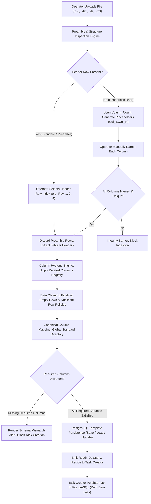
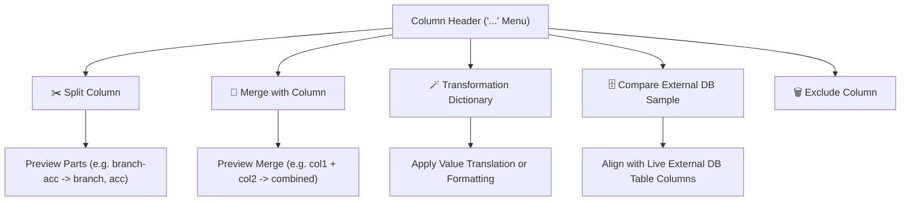

# Master Architectural Specification: Standard File Ingestion & Column Mapping Workspace

## Document Metadata
* **Document Identifier**: `SPEC-FILE-INGESTION-WORKSPACE-001`
* **Version**: `1.0.0`
* **Status**: `APPROVED / ARCHITECTURAL BASELINE`
* **Author**: Core Back-Office Architecture & Automation Team
* **Classification**: Subsystem Master Specification (Domain 7)
* **Master Index Anchor**: [`MASTER_ARCHITECTURE_INDEX.md`](file:///c:/Users/hp/Downloads/opration-workflow-mangement1/MASTER_ARCHITECTURE_INDEX.md)
* **Associated Implementation Plan**: [`IMPLEMENTATION_PLAN_STANDARD_FILE_INGESTION_WORKSPACE.md`](file:///c:/Users/hp/Downloads/opration-workflow-mangement1/IMPLEMENTATION_PLAN_STANDARD_FILE_INGESTION_WORKSPACE.md)

---

## 1. Executive Summary & Problem Definition

### 1.1 Context
In financial back-office operations, inbound transactional datasets arrive across heterogeneous formats (`.csv`, `.xlsx`, `.xls`, `.xml`) with wildly varying structural quality:
- Files frequently contain **preamble rows** (e.g., bank report banners, date ranges, institution codes, or blank lines) before the actual tabular column headers begin.
- Some systems export **headerless files** (raw delimited transactions with no column titles whatsoever).
- Files contain unwanted system metadata columns that must be **permanently excluded** before pipeline ingestion.
- Files suffer from data quality defects: stray empty rows, duplicate transactions, un-normalized date formats, unmasked card numbers, and trailing whitespace.
- Datasets must conform to **strict required columns** mandated by upstream operational directives and universal hashtags (e.g. `#AIB_SETTLEMENT_2026`).

### 1.2 Identified Architectural Deficiencies in Current Implementation
Prior to this specification, file handling was entangled directly inside [`WorkspaceTaskCreator.tsx`](file:///c:/Users/hp/Downloads/opration-workflow-mangement1/frontend/src/components/issue/WorkspaceTaskCreator.tsx) (~1,700 lines), exhibiting critical architectural failures:
1. **Fixed Header Row Fallacy**: The parser assumed that headers are strictly located at row index `0` / line 1. Any file with a 2- or 3-row report preamble produced corrupted headers (e.g. `"Bank Name"`, `"Report Generated On"`), breaking schema mapping.
2. **Lack of Headerless Support**: Headerless datasets could not be ingested without external manual file editing, as there was no mechanism to manually assign column headers.
3. **Mock Data Clutter**: The task creator contained hardcoded mock test loaders (`📄 Chargebacks CSV`, `📊 Settlement CSV`) that bypassed real ingestion pipelines.
4. **Ephemeral / In-Memory Templates**: The "Save Mapping Template" feature stored configurations in hardcoded React state (`tpl-1`, `tpl-2`, `tpl-3`) and in-memory backend arrays, never persisting templates to PostgreSQL.
5. **No Parameterized Ingestion Recipe**: Cleaning decisions, column exclusions, and validation actions were ad-hoc UI mutations rather than an immutable, reusable recipe.
6. **Premature Task Persistence (Missing Integrity Barrier)**: Operators could click "Create Task" while a file was partially parsed or missing required fields, creating corrupt tasks in PostgreSQL without blocking.
7. **Rigid Global Required Column Collision**: Required columns were historically enforced globally at the `GlobalMappingService` level. Because different banking feeds (e.g., ATM switch logs vs. Visa clearing vs. chargebacks) require fundamentally different mandatory fields, global enforcement caused false-positive rejections. Required column rules must be delegated entirely to individual saved file mapping templates.

---

## 2. Core Architectural Principles & Invariants

This specification establishes eight mandatory invariants governed by **AGENTS.md**:

1. **Standalone Separation of Concerns**: File parsing, preamble truncation, manual header definitions, column exclusion, data cleaning, schema mapping, and template persistence MUST reside in a dedicated, decoupled component ([`StandardFileIngestionWorkspace.tsx`](file:///c:/Users/hp/Downloads/opration-workflow-mangement1/frontend/src/components/common/StandardFileIngestionWorkspace.tsx)), reusable across Task Creator, Investigation Workspace, and Reconciliation Staging.
2. **Preamble-Agnostic Header Row Positioning**: The ingestion engine MUST support arbitrary header row locations (`headerRowIndex >= 1`), automatically discarding preamble metadata rows above the designated header row.
3. **Interactive Headerless Column Definition**: When an uploaded file lacks headers, the engine MUST allow operators to manually specify unique, non-empty names for every column before proceeding.
4. **Persistent Ingestion Recipes in PostgreSQL**: All mapping templates MUST be stored in the relational database (`file_ingestion_mapping_templates`), encapsulating source formats, header positions, manual headers, deleted columns, required fields, and data cleaning policies.
5. **Deterministic Column Exclusion Tracking**: Columns deleted by the operator MUST be logged in an explicit `deletedColumns` registry, automatically stripped from downstream payloads, and saved to the template recipe.
6. **Rule-Based Empty & Duplicate Row Policies**: Empty and duplicate records MUST be evaluated against deterministic policies (`DROP`, `FILL_NA`, `KEEP_FIRST`, `FLAG_FOR_REVIEW`, `ERROR_BLOCK`) rather than opaque silent mutations.
7. **Pre-Commit Data Integrity Gate (Save Interruption)**: Parent task creation MUST be strictly blocked if the ingestion component reports an incomplete, invalid, or schema-mismatched state.
8. **Template-Scoped Required Column Enforcement (Decoupled from Global Mapping Service)**: Required column constraints (`requiredColumns: string[]`) are permanently removed from hardcoded global schema enforcements (`GlobalMappingService`). Instead, mandatory column rules are defined and owned strictly by individual saved mapping templates (`FileIngestionMappingTemplate`). Enforcement operates across dual execution points:
   - **Task Creation**: When a template is active for an uploaded file, task creation is interrupted and blocked if any mandated columns are missing or unmapped.
   - **Universal Hashtags**: When a hashtag directive absorbs input transactions, the template's required columns enforce schema integrity on the absorbed transactions, preventing malformed ingestion into the pipeline.

---

## 3. Subsystem Architecture & Workflow Flowchart



---

## 4. Ingestion Recipe Domain Model

Every file ingestion operation produces or consumes a structured, serializable `FileIngestionRecipe`:

```typescript
export interface FileIngestionRecipe {
  // Header specification
  headerMode: 'ROW_INDEX' | 'HEADERLESS_MANUAL';
  headerRowIndex: number; // 1-indexed (e.g. 1 = first row, 4 = after 3 preamble lines)
  dataStartRowIndex: number; // Row index where actual data begins
  manualHeaders: Record<string, string>; // e.g. { "col_0": "Transaction_ID", "col_1": "Amount" }

  // Structural column exclusion
  deletedColumns: string[]; // List of original column names/indexes to permanently exclude

  // Schema & Mapping
  columnMappings: Record<string, string>; // sourceColumn -> canonicalGlobalStandardKey
  requiredColumns: string[]; // Columns mandated for successful ingestion

  // Data Hygiene & Cleaning Policies
  cleaningPolicies: {
    emptyRowsAction: 'DROP' | 'FILL_NA' | 'ERROR_BLOCK';
    duplicateRowsAction: 'DROP_EXACT' | 'KEEP_FIRST' | 'FLAG_FOR_REVIEW' | 'ERROR_BLOCK';
    trimWhitespace: boolean;
    normalizeDatesToIso: boolean; // Normalizes DD/MM/YYYY, MM/DD/YYYY to YYYY-MM-DD
    maskCardPan: boolean; // Masks 16-digit PANs to 4111****
    fillBlanksWithNa: boolean; // Replaces empty string/null with 'N/A'
  };

  // Auto-Cleaner & Transformer Operations (Domain 7: Captured & Replayed Ingestion Recipe)
  splitOperations?: SplitOperation[];       // Delimiter-based column splitting rules
  mergeOperations?: MergeOperation[];       // Two-column concatenation with custom/standard separators
  transformOperations?: TransformOperation[]; // Regex, uppercase, date ISO, or dictionary lookups
  cleaningActions?: string[];              // Sequence of cleaning operations triggered on dataset
  valueTranslations?: Record<string, string>; // Inline column translation mappings

  // Format details
  sourceType: 'csv' | 'xlsx' | 'xls' | 'xml';
  sheetName?: string; // Excel sheet
  xmlRecordTag?: string; // XML repeating element tag
}
```

---

## 5. PostgreSQL Persistence Schema

To replace ephemeral in-memory state, this specification establishes migration `028_file_ingestion_mapping_templates.sql`:

```sql
-- Migration 028: Persistent File Ingestion & Column Mapping Templates
CREATE TABLE IF NOT EXISTS file_ingestion_mapping_templates (
    id VARCHAR(64) PRIMARY KEY,
    name VARCHAR(255) NOT NULL,
    description TEXT,
    source_type VARCHAR(32) NOT NULL DEFAULT 'csv',
    header_mode VARCHAR(32) NOT NULL DEFAULT 'ROW_INDEX',
    header_row_index INT NOT NULL DEFAULT 1,
    manual_headers JSONB NOT NULL DEFAULT '{}'::jsonb,
    deleted_columns JSONB NOT NULL DEFAULT '[]'::jsonb,
    required_columns JSONB NOT NULL DEFAULT '[]'::jsonb,
    column_mappings JSONB NOT NULL DEFAULT '{}'::jsonb,
    cleaning_recipe JSONB NOT NULL DEFAULT '{}'::jsonb,
    created_by VARCHAR(64),
    team_id VARCHAR(64),
    is_default BOOLEAN NOT NULL DEFAULT false,
    created_at TIMESTAMPTZ NOT NULL DEFAULT NOW(),
    updated_at TIMESTAMPTZ NOT NULL DEFAULT NOW()
);

CREATE INDEX IF NOT EXISTS idx_file_ingest_tpl_team ON file_ingestion_mapping_templates(team_id);
CREATE INDEX IF NOT EXISTS idx_file_ingest_tpl_name ON file_ingestion_mapping_templates(name);
```

### 5.1 Backend REST API Endpoints
- `GET /api/file-mapping-templates?teamId=...` - Returns all saved templates scoped to the user's permanent team.
- `POST /api/file-mapping-templates` - Creates or updates a template in PostgreSQL.
- `DELETE /api/file-mapping-templates/:id` - Deletes a template with team-scoped authorization.

---

## 6. Pre-Commit Data Integrity Protocol & Save Interruption

To prevent partial, un-validated, or corrupt datasets from contaminating operational issues:

### 6.1 State Verification Contract
The component exposes a deterministic integrity verification handle:

```typescript
export interface IngestionWorkspaceRef {
  validateAndPrepareDataset: () => Promise<IngestionValidationOutcome>;
  isProcessing: () => boolean;
  hasFileAttached: () => boolean;
}

export interface IngestionValidationOutcome {
  isValid: boolean;
  blockingErrors: string[];
  warnings: string[];
  datasetPayload?: {
    fileName: string;
    rawHeaders: string[];
    activeHeaders: string[];
    parsedRows: Record<string, any>[];
    transformedRows: Record<string, any>[];
    columnMappings: Record<string, string>;
    recipe: FileIngestionRecipe;
  };
}
```

### 6.2 Save Interruption Invariants
When the operator triggers task creation:
1. `validateAndPrepareDataset()` executes synchronously or resolves pre-commit.
2. If `isValid === false`:
   - Task creation is **strictly halted** (`return;`).
   - The workspace scrolls directly to the error notification banner.
   - The blocking errors (e.g. *"Headerless Column 3 has no name"*, *"Required column 'Amount' is missing"*) are displayed prominently with 1-click corrective focus.
3. No task issue is persisted to PostgreSQL until the verification outcome confirms `isValid === true`.

---

## 7. Mock Loader Deprecation

All synthetic sample loaders in production intake are permanently decommissioned:
- Deprecated & Removed: `handleLoadSampleChargebacks` (`📄 Chargebacks CSV`)
- Deprecated & Removed: `handleLoadSampleSettlements` (`📊 Settlement CSV`)
- Rationale: Operational environments must ingest authentic files and rely on verified PostgreSQL templates rather than hardcoded mock stubs.

---

---

## 10. Column Header Transformation Suite & External DB Comparator

To eliminate pre-ingestion spreadsheet modifications, each column header in the table preview provides an interactive `...` More Actions context menu with real-time row feedback:



### 10.1 Column Splitting
- **Capabilities**: Splits single delimited columns into $N$ target columns (e.g. splitting `branch_account` `"001-49201948"` into `branch_code` and `account_number`).
- **Supported Delimiters**: Space (` `), Comma (`,`), Hyphen (`-`), Slash (`/`), Underscore (`_`), Pipe (`|`), Semicolon (`;`), and custom delimiters.
- **Preview & Reversibility**: Generates a dynamic 4-row preview table using real file records before mutation, creates an undo snapshot, and provides an option to keep or replace the original column.

### 10.2 Column Merging
- **Capabilities**: Combines two columns into one target column (e.g. `currency` + `amount` into `formatted_amount` or `first_name` + `last_name` into `full_name`).
- **Supported Separators**: Space, Hyphen, Underscore, Slash, Comma, None, or custom string.
- **Preview & Hygiene**: Provides interactive live row preview, customizable target header naming, and optional preservation of source columns.

### 10.3 Inline Transformation Suite
- **Sanitizers**: Uppercase, Lowercase, Title Case, Whitespace Trim, Ethiopian Mobile Phone Normalization (`09...`/`+251...` $\rightarrow$ `2519...`).
- **Data Converters**: ISO Date Formatting (`DD/MM/YYYY` or `MM/DD/YYYY` $\rightarrow$ `YYYY-MM-DD`), Currency Stripping (`$12,450.00` $\rightarrow$ `12450.00`), Regex Extraction, and PAN/Card Masking (`4111222233334444` $\rightarrow$ `4111••••••••4444`).

### 10.4 External DB Sample Data Inspection
- Allows operators to connect to external databases, select target tables, and fetch live sample records via `GET /api/db/databases/:id/tables/:tableName/preview`.
- Renders external columns alongside file columns with 1-click mapping alignment and auto-matching by case-insensitive name similarity.

### 10.5 Prevention of Form Submission Redirection
- Inner modal dialogs within [`StandardFileIngestionWorkspace.tsx`](file:///c:/Users/hp/Downloads/opration-workflow-mangement1/frontend/src/components/common/StandardFileIngestionWorkspace.tsx) MUST NOT use `<form>` containers or unshielded submit buttons.
- All actions execute via `<button type="button">` with strict `e.stopPropagation()` and `e.preventDefault()`, preventing unintended parent form bubbling in [`WorkspaceTaskCreator.tsx`](file:///c:/Users/hp/Downloads/opration-workflow-mangement1/frontend/src/components/issue/WorkspaceTaskCreator.tsx) that could trigger task submission and premature redirection to the task investigation panel.

---

## 11. Pre-Configured Value Transformation / Translation Dictionary Architecture

### 11.1 Architectural Separation: Global Schema vs. Value Translation Dictionary
A fundamental distinction is established between the **Global Data Dictionary** (`global_standard_directory`) and the **Value Transformation Dictionary**:
- **Global Data Dictionary**: Governs **structural canonical field definitions** (e.g. `TRANSACTION_REFERENCE`, `TRANSACTION_AMOUNT`, `SOURCE_ACCOUNT`). It defines *what fields exist* in the enterprise standard.
- **Value Transformation Dictionary**: Governs **data content translation lookup mappings** (e.g. translating `"Commercial Bank of Ethiopia"` $\rightarrow$ `"01"`, `"Awash Bank"` $\rightarrow$ `"02"`, or channel `"ATM"` $\rightarrow$ `"01"`). It defines *how incoming file values map to internal database codes*.

### 11.2 Pre-Configured Value Lookup Dictionaries
Financial feeds frequently supply human-readable descriptions, whereas core banking and switch databases require raw numeric or ISO codes. The Value Transformation Dictionary provides pre-defined, system-level translation tables:
1. **Bank Name to Bank Code** (e.g., CBE $\rightarrow$ 01, Awash $\rightarrow$ 02, Dashen $\rightarrow$ 03, BOA $\rightarrow$ 04).
2. **Channel Name to Channel Code** (e.g., ATM $\rightarrow$ 01, POS $\rightarrow$ 02, Mobile Banking $\rightarrow$ 03, Internet Banking $\rightarrow$ 04).
3. **Transaction Status / ISO Decline Codes** (e.g., Success $\rightarrow$ 00, Insufficient Funds $\rightarrow$ 51, Expired Card $\rightarrow$ 54).
4. **Currency Description to ISO-4217 Numeric Code** (e.g., ETB $\rightarrow$ 230, USD $\rightarrow$ 840, EUR $\rightarrow$ 978).

### 11.3 Runtime Translation Execution Points
- **Task Creation File Ingestion**: When an operator uploads a statement with human-readable values, assigning a Value Transformation Dictionary automatically translates values into database-compatible codes prior to saving the task.
- **Universal Hashtags File Templates**: When an automated hashtag pipeline ingests an incoming statement or FTP file, the linked file template executes the value transformation rule, ensuring data ingested into reconciliation mirrors adheres to database constraints.
- **System Settings Management**: Located under the **Transformations** tab in Admin Settings, allowing administrators to define, test in a real-time sandbox, and persist value lookup mappings.

---

## 12. Admin Hub: "Table Mapping" Subsystem Architecture

### 12.1 Tab Renaming & Scope Refinement
- The Admin Hub tab previously labeled **"Environment & Table Mappings"** is officially renamed to **"Table Mapping"** to reflect its direct operational focus.

### 12.2 Live Database Sample Grid Paradigm
Instead of static vertical attribute lists, Table Mapping adopts the interactive table grid layout proven in file ingestion:
1. **Interactive Database & Table Selection**: Administrator selects any connected database and target table.
2. **Live Sample Data Grid**: Immediately fetches and displays 5 to 10 live rows from the selected database table via `api.getTablePreview`.
3. **Visual Real-Data Inspection**: Operators inspect real database values directly within the columns, confirming format and content before establishing mappings.

### 12.3 Column Header `...` Action Set in Table Mapping
Each column in the live database table preview provides the standard `...` More Actions menu:
- ✂️ **Data Splitting**: Split database columns into multiple target fields.
- 🔗 **Column Merging**: Combine multiple database columns into a single target field.
- ➕ **Add this Column to Global Field**: A direct 1-click action allowing administrators to register the physical database column directly into the **Global Data Dictionary** (`global_standard_directory`) with customized label, data type, and description—eliminating the need to navigate back and forth to the Global Dictionary tab.
- 🔤 **Map to Transformation Dictionary**: Link the database column to a pre-configured Value Translation Dictionary (e.g. associating `bank_code` with the Bank Name $\rightarrow$ Bank Code lookup table).

---

## 13. Implementation Traceability & Roadmap

| Artifact | Purpose | Status |
|---|---|---|
| [`STANDARD_FILE_INGESTION_AND_MAPPING_ARCHITECTURE.md`](file:///c:/Users/hp/Downloads/opration-workflow-mangement1/STANDARD_FILE_INGESTION_AND_MAPPING_ARCHITECTURE.md) | Subsystem Master Specification (This Document) | **Approved** |
| [`IMPLEMENTATION_PLAN_STANDARD_FILE_INGESTION_WORKSPACE.md`](file:///c:/Users/hp/Downloads/opration-workflow-mangement1/IMPLEMENTATION_PLAN_STANDARD_FILE_INGESTION_WORKSPACE.md) | 5-Phase Refactoring Implementation Plan | **Completed** |
| [`028_file_ingestion_mapping_templates.sql`](file:///c:/Users/hp/Downloads/opration-workflow-mangement1/backend/src/database/migrations/028_file_ingestion_mapping_templates.sql) | PostgreSQL Persistence Migration | **Executed & Verified** |
| [`StandardFileIngestionWorkspace.tsx`](file:///c:/Users/hp/Downloads/opration-workflow-mangement1/frontend/src/components/common/StandardFileIngestionWorkspace.tsx) | Decoupled Ingestion & Mapping Component (Table Format & Toolbar) | **Implemented & Verified** |
| [`SystemSettings.tsx`](file:///c:/Users/hp/Downloads/opration-workflow-mangement1/frontend/src/components/settings/SystemSettings.tsx) | Data Transformation Dictionary Page & Table Mapping Subsystem | **Implemented & Synchronized** |
| [`fileIngestionMappingTemplates.test.ts`](file:///c:/Users/hp/Downloads/opration-workflow-mangement1/backend/src/services/__tests__/fileIngestionMappingTemplates.test.ts) | Integration Verification Test Suite (5/5 passing) | **Passed (100%)** |
| [`029_value_translation_dictionaries.sql`](file:///c:/Users/hp/Downloads/opration-workflow-mangement1/backend/src/database/migrations/029_value_translation_dictionaries.sql) | PostgreSQL Relational Migration for Translation Dictionaries | **Executed & Verified** |
| [`valueTranslationDictionaries.test.ts`](file:///c:/Users/hp/Downloads/opration-workflow-mangement1/backend/src/services/__tests__/valueTranslationDictionaries.test.ts) | PostgreSQL Translation Dictionary Integration Suite (5/5 passing) | **Passed (100%)** |
| [`MASTER_ARCHITECTURE_INDEX.md`](file:///c:/Users/hp/Downloads/opration-workflow-mangement1/MASTER_ARCHITECTURE_INDEX.md) | Master Architecture Directory Indexing | **Synchronized** |

---

## 14. Architectural Changelog

| Date | Author | Scope of Modification | Rationale | Status |
|---|---|---|---|---|
| **2026-10-09** | Architecture Team | Created Master Specification for Standard File Ingestion & Column Mapping Workspace. | Solves preamble row errors, headerless file ingestion, in-memory template loss, and establishes pre-commit integrity gate. | **Approved** |
| **2026-10-09** | Engineering Team | Full Implementation: PostgreSQL templates (Migration 028), decoupled required columns, hashtag absorption enforcement, and former table-format UI layout. | Restored operator-preferred in-place table preview with toolbar Auto Map/cleaning tools, eliminating extraneous upload dialogs while preserving preamble offsets, column exclusions, and template-scoped required field barriers. | **Verified (100%)** |
| **2026-10-09** | Engineering Team | Added Column Header `...` Action Suite: Data Splitting, Column Merging, Transformation Dictionary, and External DB Sample Comparator. | Enables rich in-place row transformation, eliminating external spreadsheet manipulation; resolves template save form bubbling bug. | **Verified (100%)** |
| **2026-10-09** | Architecture Team | Established Value Transformation / Translation Dictionary Architecture & Table Mapping Redesign. | Distinguishes data value translations (e.g. Bank Name $\rightarrow$ Bank Code) from Global Schema definitions; unifies Admin Hub Table Mapping with file ingestion table grid paradigm and header `...` action set (including inline "Add to Global Field"). | **Approved** |
| **2026-10-10** | Engineering Team | Universal Column Checkbox Selection & Dynamic Merge Column Toolbar Action. | Added select boxes to all column headers and master select in `#` header; dynamic toolbar button activates with badge count when $\ge 2$ columns selected across both Table Mapping and File Ingestion. | **Verified (100%)** |
| **2026-10-10** | Engineering Team | Full PostgreSQL Relational Migration (029) & Rule 23 Codification for Value Translation Dictionaries. | Replaced ephemeral client `localStorage` with relational persistence in PostgreSQL (`value_translation_dictionaries`), REST API endpoints (`/api/value-translation-dictionaries`), and codified Rule 23 in `AGENTS.md`. | **Verified (100%)** |
| **2026-10-10** | Architecture & Engineering Team | Auto-Cleaner Recipe & Data Transformer Template Engine. | Elevated templates from static column maps into full data transformation recipes (`splitOperations`, `mergeOperations`, `transformOperations`, `cleaningActions`, `valueTranslations`). All modifications executed on a file prior to saving are captured in PostgreSQL (`cleaning_recipe` JSONB) and faithfully replayed upon template selection, file upload, or hashtag ingestion. | **Verified (100%)** |
| **2026-10-24** | Engineering Team | Data Setup redesign Phase A (screens 33-37): value dictionary direction/matching/no-match, persisted column links, column-list Table Mapping with JSON-safe previews. | See [`DATA_SETUP_AND_TECHNICIAN_SOLUTION_FLOW_SPECIFICATION.md`](file:///c:/Users/hp/Downloads/opration-workflow-mangement1/DATA_SETUP_AND_TECHNICIAN_SOLUTION_FLOW_SPECIFICATION.md). Migration 037 adds dictionary semantics and `value_dictionary_column_links`. | **Implemented; code-verified, visual audit pending** |
