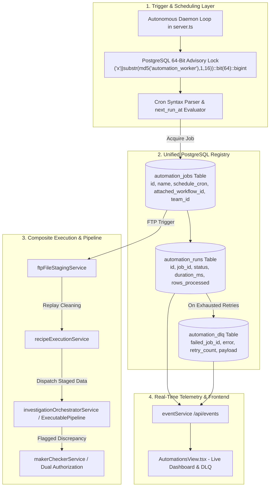

# Comprehensive Code & Architectural Audit Report: Automation Process
## Multi-Perspective Audit: Frontend, Backend, Architecture & Operational Governance

**Audit ID**: `AUD-AUTOMATION-PROCESS-2026-11-26`  
**Date**: 2026-11-26  
**Auditor**: Antigravity Autonomous Code Audit Engine  
**Governing Skills**: [`.agents/skills/audit/SKILL.md`](file:///c:/Users/hp/Downloads/opration-workflow-mangement1/.agents/skills/audit/SKILL.md), [`.agents/skills/code-audit/SKILL.md`](file:///c:/Users/hp/Downloads/opration-workflow-mangement1/.agents/skills/code-audit/SKILL.md), [`.agents/skills/bo-operational-governance/SKILL.md`](file:///c:/Users/hp/Downloads/opration-workflow-mangement1/.agents/skills/bo-operational-governance/SKILL.md)  
**Governing Invariants & Principles**: [`AGENTS.md`](file:///c:/Users/hp/Downloads/opration-workflow-mangement1/AGENTS.md) (Rule 1: PostgreSQL Reality, Rule 2: Verdict ≠ Action, Rule 5: No Unapproved Infrastructure, Rule 7: Maker-Checker Dual Authorization, Rule 8: Universal Hashtags, Rule 10: 64-Bit Cryptographic Advisory Locking, Rule 12: Diagnostic Taint Tracking, Rule 17: Scoped Data Loss Prevention, Rule 19: Team Database Isolation, Rule 23: No `localStorage`/Ephemeral Business State, Rule 24: Composite Executable Ingestion Mappings)  
**Target Scope**: Complete End-to-End Automation Process:
- **Frontend**: [`AutomationsView.tsx`](file:///c:/Users/hp/Downloads/opration-workflow-mangement1/frontend/src/components/automations/AutomationsView.tsx), [`HashtagOwnerDetailView.tsx`](file:///c:/Users/hp/Downloads/opration-workflow-mangement1/frontend/src/components/automations/HashtagOwnerDetailView.tsx), [`HashtagFileUploadModal.tsx`](file:///c:/Users/hp/Downloads/opration-workflow-mangement1/frontend/src/components/automations/HashtagFileUploadModal.tsx)
- **Backend Schedulers & Daemons**: [`server.ts`](file:///c:/Users/hp/Downloads/opration-workflow-mangement1/backend/src/server.ts), [`hashtagSchedulerService.ts`](file:///c:/Users/hp/Downloads/opration-workflow-mangement1/backend/src/services/hashtagSchedulerService.ts), [`ftpSchedulerService.ts`](file:///c:/Users/hp/Downloads/opration-workflow-mangement1/backend/src/services/ftpSchedulerService.ts), [`ftpFileStagingService.ts`](file:///c:/Users/hp/Downloads/opration-workflow-mangement1/backend/src/services/ftpFileStagingService.ts), [`hashtagService.ts`](file:///c:/Users/hp/Downloads/opration-workflow-mangement1/backend/src/services/hashtagService.ts)
- **Routes & Persistence**: [`routes/database.ts`](file:///c:/Users/hp/Downloads/opration-workflow-mangement1/backend/src/routes/database.ts), [`routes/misc.ts`](file:///c:/Users/hp/Downloads/opration-workflow-mangement1/backend/src/routes/misc.ts), [`approvalService.ts`](file:///c:/Users/hp/Downloads/opration-workflow-mangement1/backend/src/services/approvalService.ts), PostgreSQL Migrations (`026_universal_hashtag_engine.sql`, `046_ftp_ingested_files_storage.sql`)
**Branch / Commit**: `feature/frontend-redesign` (`207716f`)  
**Status**: `OPEN`  

---

## 1. Executive Summary

A comprehensive, four-perspective audit of the **Automation Process** was conducted across the frontend UI, backend services, systems architecture, and operational governance rules defined in [`AGENTS.md`](file:///c:/Users/hp/Downloads/opration-workflow-mangement1/AGENTS.md).

The automation subsystem contains strong foundational primitives—such as composite recipe replay (`recipeExecutionService`), UNLOGGED mirror ingestion (`ftpFileStagingService`), and automated Intake envelope creation. However, **6 major architectural and governance defects** (**1 CRITICAL**, **3 HIGH**, **2 MEDIUM**) prevent it from functioning as an authentic, production-grade automated financial platform. 

Most critically:
1. **Frontend**: Automations created via the UI are stored exclusively in ephemeral React component state (`setAutomations(prev => [newAuto, ...prev])`) and lost upon page refresh. Triggering "Run now" executes a fake `setTimeout(1200)` delay with no backend execution.
2. **Backend**: The FTP scheduler daemon is never started in `server.ts`. The hashtag scheduler polls every 60 seconds and executes every `SCHEDULED_CRON` preset unconditionally, ignoring configured cron expressions entirely (running daily/weekly jobs 1,440 times per day).
3. **Architecture**: Staged FTP files register in Intake but never invoke their `attachedWorkflowId`, breaking the automated pipeline chain. Remediations staged as `WORKSPACE_SETTING` proposals never execute the approved SQL (phantom remediation).
4. **Governance**: Scheduling concurrency is guarded solely by a single-process JavaScript boolean (`let isExecuting = false`) with zero PostgreSQL advisory locking, causing race conditions and duplicate executions across horizontal replicas (violating Rule 10).

### Summary of Findings by Severity
| Severity | Count | Primary Areas of Vulnerability |
| :--- | :---: | :--- |
| **CRITICAL** | 1 | Ephemeral UI-only state persistence, hardcoded mock cron list, and fake `setTimeout` run execution in `AutomationsView.tsx`. |
| **HIGH** | 3 | Disconnected FTP scheduler daemon in `server.ts`; un-evaluated cron expressions & in-memory concurrency in `hashtagSchedulerService.ts`; phantom remediation proposals and broken downstream workflow chaining. |
| **MEDIUM** | 2 | Unauthenticated & un-scoped `POST /ftp-staging/run-scheduled` endpoint with `forceAll: true`; lack of real-time SSE execution telemetry and Dead-Letter Queue (DLQ). |
| **LOW** | 0 | None identified in this scope. |

---

## 2. Files & Modules Examined

### Frontend Layer
- [`frontend/src/components/automations/AutomationsView.tsx`](file:///c:/Users/hp/Downloads/opration-workflow-mangement1/frontend/src/components/automations/AutomationsView.tsx): Automation Hub, Create Automation Modal, Manual run triggers, Hashtag stats, Crons & Schedules tab.
- [`frontend/src/components/automations/HashtagOwnerDetailView.tsx`](file:///c:/Users/hp/Downloads/opration-workflow-mangement1/frontend/src/components/automations/HashtagOwnerDetailView.tsx): Hashtag asset inspector, KPI monitors, manual scan trigger.
- [`frontend/src/components/automations/HashtagFileUploadModal.tsx`](file:///c:/Users/hp/Downloads/opration-workflow-mangement1/frontend/src/components/automations/HashtagFileUploadModal.tsx): Ad-hoc manual file upload and staging executor.

### Backend Schedulers, Daemons & Services
- [`backend/src/server.ts#L175-L177`](file:///c:/Users/hp/Downloads/opration-workflow-mangement1/backend/src/server.ts#L175-L177): Server startup hook for background daemons.
- [`backend/src/services/hashtagSchedulerService.ts`](file:///c:/Users/hp/Downloads/opration-workflow-mangement1/backend/src/services/hashtagSchedulerService.ts): Autonomous hashtag poller, proposal staging, and run logger.
- [`backend/src/services/ftpSchedulerService.ts`](file:///c:/Users/hp/Downloads/opration-workflow-mangement1/backend/src/services/ftpSchedulerService.ts): Scheduled FTP/SFTP poller and Intake envelope registrar.
- [`backend/src/services/ftpFileStagingService.ts`](file:///c:/Users/hp/Downloads/opration-workflow-mangement1/backend/src/services/ftpFileStagingService.ts): SFTP download, file tracking, mirror staging, and headless recipe execution.
- [`backend/src/services/hashtagService.ts`](file:///c:/Users/hp/Downloads/opration-workflow-mangement1/backend/src/services/hashtagService.ts): Direct database scan, extraction staging, and auditing governance executors.
- [`backend/src/services/approvalService.ts`](file:///c:/Users/hp/Downloads/opration-workflow-mangement1/backend/src/services/approvalService.ts): Proposal creation and review handler.

### Routes, Handlers & Persistence Layer
- [`backend/src/routes/database.ts#L2498-L2511`](file:///c:/Users/hp/Downloads/opration-workflow-mangement1/backend/src/routes/database.ts#L2498-L2511): Manual FTP staging trigger endpoint (`/ftp-staging/run-scheduled`).
- [`backend/src/routes/misc.ts#L24-L87`](file:///c:/Users/hp/Downloads/opration-workflow-mangement1/backend/src/routes/misc.ts#L24-L87): Hashtag preset CRUD and scheduler trigger endpoints.
- [`backend/src/database/migrations/026_universal_hashtag_engine.sql`](file:///c:/Users/hp/Downloads/opration-workflow-mangement1/backend/src/database/migrations/026_universal_hashtag_engine.sql): Hashtag presets and runs relational schema.
- [`backend/src/database/migrations/046_ftp_ingested_files_storage.sql`](file:///c:/Users/hp/Downloads/opration-workflow-mangement1/backend/src/database/migrations/046_ftp_ingested_files_storage.sql): Remote file deduplication tracking schema.

---

## 3. Findings Summary Table

| Finding ID | Severity | Perspective | Category | Location | Summary |
| :--- | :---: | :---: | :--- | :--- | :--- |
| `AUD-AUTO-001` | **CRITICAL** | Frontend & Arch | Persistence & Reality Gate | `AutomationsView.tsx:58-71, 91-135, 168-211` | Ephemeral UI-only automation creation, hardcoded mock cron jobs, and fake `setTimeout(1200)` execution. |
| `AUD-AUTO-002` | **HIGH** | Backend & Arch | Daemon & Orchestration | `server.ts:175-177`; `ftpSchedulerService.ts:31-169` | `ftpSchedulerService` is never booted as a background daemon; staged FTP files never execute `attachedWorkflowId`. |
| `AUD-AUTO-003` | **HIGH** | Backend & Gov | Scheduling & Concurrency | `hashtagSchedulerService.ts:18-20, 50-52, 208-221` | Ignores cron expressions (runs every 60s); relies on in-memory `isExecuting` flag without 64-bit advisory locking. |
| `AUD-AUTO-004` | **MEDIUM** | Backend & Gov | Security & Access Control | `routes/database.ts:2498-2511`; `misc.ts:24-87` | `run-scheduled` defaults `forceAll: true` without auth checks; hashtag preset CRUD allows any caller to register raw SQL crons. |
| `AUD-AUTO-005` | **MEDIUM** | Frontend & Arch | Observability & Telemetry | `AutomationsView.tsx:58-63`; `hashtagSchedulerService.ts:91-93` | Lack of real-time SSE execution telemetry, missing Dead-Letter Queue (DLQ), and hardcoded mock metrics. |
| `AUD-AUTO-006` | **HIGH** | Architecture & Gov | Governance & Invariants | `approvalService.ts:555-570`; `hashtagSchedulerService.ts:63-95` | Phantom SQL execution on approved proposals; hardcoded `teamId: 'default-team'`; absence of a unified PostgreSQL job registry. |

---

## 4. Multi-Perspective Detailed Findings

### 4.1. Frontend Perspective

#### `AUD-AUTO-001` — Ephemeral UI-Only Automations, Mock Job Lists & Fake `setTimeout` Execution
- **Severity**: **CRITICAL** | **Status**: `OPEN` | **Category**: Persistence Integrity & Reality Gate (Rules 1, 22, 23)
- **Location**: [`frontend/src/components/automations/AutomationsView.tsx:91-135, 168-211`](file:///c:/Users/hp/Downloads/opration-workflow-mangement1/frontend/src/components/automations/AutomationsView.tsx#L91-L211)
- **Code Evidence**:
  1. Lines 92–135 hardcode `baseAutomations` with mock jobs:
     ```ts
     const baseAutomations: AutomationItem[] = [
       { id: 'auto-cbe-nightly', name: 'Nightly CBE Settlement Reconciler', ... },
       { id: 'auto-telebirr-hourly', name: 'Telebirr Hourly Ingress Scanner', ... },
       { id: 'auto-aib-reversal-sync', name: 'Awash Bank Reversal Sync', ... }
     ];
     ```
  2. Lines 168–186 simulate manual execution using JavaScript timer:
     ```ts
     const handleRunAutomation = async (auto: AutomationItem) => {
       setRunningId(auto.id);
       try {
         if (auto.triggerType === 'FTP_POLL') {
           await api.runScheduledFtpStaging();
         } else {
           await new Promise(r => setTimeout(r, 1200)); // FAKE EXECUTION
         }
         setAutomations(prev => prev.map(a => a.id === auto.id ? {
           ...a,
           lastRunTime: 'Just now',
           lastRunStatus: 'SUCCESS'
         } : a));
       } ...
     ```
  3. Lines 188–211 handle modal submission entirely within React state:
     ```ts
     const handleCreateAutomation = (e: React.FormEvent) => {
       ...
       setAutomations(prev => [newAuto, ...prev]); // ZERO POSTGRESQL PERSISTENCE
       setIsModalOpen(false);
     };
     ```
- **Description & Risk**: Operators interacting with the Automations screen believe they have scheduled production nightly CBE or Telebirr pipelines. In reality, newly created jobs vanish on browser refresh, and running jobs merely triggers a 1.2-second sleep followed by a green success badge.
- **Recommended Remediation**:
  1. Create a PostgreSQL table `automation_jobs` and REST endpoints (`GET /api/automations`, `POST /api/automations`, `POST /api/automations/:id/run`).
  2. Hydrate `AutomationsView.tsx` from PostgreSQL and dispatch actual execution commands to the backend orchestrator.

---

### 4.2. Backend Perspective

#### `AUD-AUTO-002` — Missing FTP Scheduler Daemon in `server.ts` & Disconnected Workflow Execution
- **Severity**: **HIGH** | **Status**: `OPEN` | **Category**: Daemon Lifecycle & End-to-End Orchestration
- **Location**: [`backend/src/server.ts:175-177`](file:///c:/Users/hp/Downloads/opration-workflow-mangement1/backend/src/server.ts#L175-L177); [`backend/src/services/ftpSchedulerService.ts:90-125`](file:///c:/Users/hp/Downloads/opration-workflow-mangement1/backend/src/services/ftpSchedulerService.ts#L90-L125)
- **Code Evidence**:
  1. `server.ts` lines 175–177 initializes only the hashtag scheduler:
     ```ts
     // Start autonomous hashtag scheduler for SCHEDULED_CRON presets
     hashtagSchedulerService.startHashtagScheduler();
     // ftpSchedulerService is completely omitted!
     ```
  2. In `ftpSchedulerService.ts:90-125`, once files are staged into the mirror table, the service calls `stagingService.stageInboundEnvelope(...)` to register an Intake message, but completely ignores `config.attachedWorkflowId`.
- **Description & Risk**: Because `ftpSchedulerService` is never registered on a timer, scheduled SFTP polling configurations (`scheduleConfig.enabled = true`, `pollingIntervalCron: '*/15 * * * *'`) never run autonomously unless an operator clicks manual trigger buttons. Furthermore, even when staged, the attached validation workflow (`attachedWorkflowId`) is never triggered.
- **Recommended Remediation**:
  1. Register a background daemon in `server.ts` for scheduled FTP polling.
  2. In `ftpSchedulerService.ts`, check if `config.attachedWorkflowId` is configured; if present, dispatch the staged batch directly to `investigationOrchestratorService.executeWorkflow(...)` or create an investigation task.

---

#### `AUD-AUTO-003` — Ignored Cron Expressions & In-Memory Concurrency Hazards
- **Severity**: **HIGH** | **Status**: `OPEN` | **Category**: Scheduling Correctness & Multi-Tenant Concurrency (Rule 10)
- **Location**: [`backend/src/services/hashtagSchedulerService.ts:18-20, 50-52, 208-221`](file:///c:/Users/hp/Downloads/opration-workflow-mangement1/backend/src/services/hashtagSchedulerService.ts#L18-L221)
- **Code Evidence**:
  ```ts
  let schedulerInterval: NodeJS.Timeout | null = null;
  let isExecuting = false; // IN-MEMORY CONCURRENCY FLAG
  ...
  const allPresets = await repo.getHashtags();
  const scheduledPresets = allPresets.filter(p =>
    forceAll || p.executionTrigger === 'SCHEDULED_CRON' // IGNORES schedule_cron!
  );
  ...
  startHashtagScheduler(intervalMs: number = 60000): void {
    schedulerInterval = setInterval(async () => {
      await hashtagSchedulerService.runDueScheduledHashtags(false);
    }, intervalMs);
  }
  ```
- **Description & Risk**:
  1. **Cron Syntax Ignored**: Every preset with `executionTrigger === 'SCHEDULED_CRON'` executes on every 60-second tick regardless of whether its `schedule_cron` specifies `0 2 * * *` (daily at 2am) or `0 0 1 * *` (monthly). A daily reconciliation job executes 1,440 times per day.
  2. **Cluster Race Condition**: Guarding execution via `let isExecuting = false` works only within a single Node.js process. In any multi-instance, load-balanced, or clustered deployment, every container runs the sweep simultaneously, causing duplicate SQL scans, duplicate Maker proposals, and deadlocks.
- **Recommended Remediation**:
  1. Use a standard cron parser (e.g. `croner` or `cron-parser`) to evaluate `next_run_at` against the current timestamp.
  2. Implement 64-bit cryptographic advisory locking in PostgreSQL per Rule 10:
     ```sql
     SELECT pg_try_advisory_lock(('x' || substr(md5('hashtag_scheduler_sweep'), 1, 16))::bit(64)::bigint);
     ```

---

### 4.3. Architectural Perspective

#### `AUD-AUTO-006` — Phantom Remediation Proposals, Broken Lineage & Fragmented Job Models
- **Severity**: **HIGH** | **Status**: `OPEN` | **Category**: Systems Architecture & Execution Parity (Rules 1, 7, 24)
- **Location**: [`backend/src/services/approvalService.ts:555-570`](file:///c:/Users/hp/Downloads/opration-workflow-mangement1/backend/src/services/approvalService.ts#L555-L570); [`backend/src/services/hashtagSchedulerService.ts:63-95`](file:///c:/Users/hp/Downloads/opration-workflow-mangement1/backend/src/services/hashtagSchedulerService.ts#L63-L95)
- **Code Evidence**:
  1. When `hashtagSchedulerService` detects an anomaly and stages an automated Maker remediation proposal:
     ```ts
     const proposal = await approvalService.submitProposal({
       type: 'WORKSPACE_SETTING',
       settingKey: tag,
       title: `Automated Scheduled Remediation for ${tag}`,
       justification: `Autonomous cron scan passed. Triggering conditional action: ${action}`,
       makerId: 'SYSTEM_SCHEDULER',
       teamId: 'default-team', // HARDCODED TEAM ID
       proposedChanges: { action, sql: preset.solutionTemplate || null, hashtag: tag }
     });
     ```
  2. In `approvalService.ts:559-567`, when a Checker approves this proposal:
     ```ts
     const updatedSetting = await postgresRepo.reviewWorkspaceSettingProposal(
       input.id, input.checkerId, input.checkerName.trim(), input.action, input.reason
     );
     // ZERO SQL EXECUTION OCCURS! The proposal row status is updated to APPROVED, but proposedChanges.sql is never run!
     ```
- **Description & Risk**:
  1. **Phantom Remediation**: Operational leads review and approve automated SQL remediation proposals believing the database discrepancy has been resolved. In reality, the SQL script is never executed against the target database; it is merely saved as text in `workspace_setting_proposals`.
  2. **Fragmented Job Architecture**: Automation is currently split between FTP configurations (`ftp_file_staging_configs`), Hashtags (`hashtag_presets`), and UI mock state, with no unified schema tracking job state, execution logs, run durations, retry counts, or error logs.
- **Recommended Remediation**:
  1. Wire approved SQL setting proposals to an atomic script runner that verifies constraints and commits changes to the target database.
  2. Consolidate automated jobs under a unified PostgreSQL entity (`automation_jobs` and `automation_runs`).

---

### 4.4. Operational Governance Perspective (`AGENTS.md`)

#### `AUD-AUTO-004` — Unconstrained Trigger Endpoints & Unauthenticated Preset Mutation
- **Severity**: **MEDIUM** | **Status**: `OPEN` | **Category**: Security, Access Control & Authorization (Rules 17, 19)
- **Location**: [`backend/src/routes/database.ts:2498-2511`](file:///c:/Users/hp/Downloads/opration-workflow-mangement1/backend/src/routes/database.ts#L2498-L2511); [`backend/src/routes/misc.ts:24-87`](file:///c:/Users/hp/Downloads/opration-workflow-mangement1/backend/src/routes/misc.ts#L24-L87)
- **Code Evidence**:
  1. In `database.ts:2498-2511`:
     ```ts
     databaseRouter.post('/ftp-staging/run-scheduled', async (req: Request, res: Response) => {
       const { targetType, connectionId, forceAll } = req.body;
       const result = await ftpSchedulerService.runScheduledFtpStaging({
         targetType, connectionId, forceAll: forceAll !== undefined ? forceAll : true
       });
       return res.json(result);
     });
     ```
     `forceAll` defaults to `true` and the endpoint lacks `requireRole('admin')` or team ownership verification.
  2. In `misc.ts:24-87`, `POST /api/hashtags`, `PUT /api/hashtags/:tag`, and `DELETE /api/hashtags/:tag` allow any authenticated user to create or mutate hashtag presets containing raw SQL criteria and schedule crons without admin authorization.
- **Impact**: Any unprivileged user can trigger high-overhead network SFTP connections across all system configurations, or register a scheduled hashtag that executes raw SQL on internal databases.
- **Recommended Remediation**: Protect `/ftp-staging/run-scheduled` and `/hashtags` write routes with role and team boundary authorization.

---

#### `AUD-AUTO-005` — Missing Dead-Letter Queue (DLQ), Telemetry Swallowing & Static Mock Metrics
- **Severity**: **MEDIUM** | **Status**: `OPEN` | **Category**: Observability, Telemetry & Resilience (Rule 12)
- **Location**: [`frontend/src/components/automations/AutomationsView.tsx:58-63`](file:///c:/Users/hp/Downloads/opration-workflow-mangement1/frontend/src/components/automations/AutomationsView.tsx#L58-L63); [`backend/src/services/hashtagSchedulerService.ts:91-93`](file:///c:/Users/hp/Downloads/opration-workflow-mangement1/backend/src/services/hashtagSchedulerService.ts#L91-L93)
- **Code Evidence**:
  1. In `AutomationsView.tsx:58-63`, hashtag stats are initialized with static numbers:
     ```ts
     const [hashtagStats, setHashtagStats] = useState({
       total: 312, fixed: 289, failed: 6, waiting: 17
     });
     ```
  2. When background runs fail or encounter network timeouts (e.g. SFTP `ECONNREFUSED` or DB timeouts), errors are caught and logged solely with `console.warn(...)`. No SSE alert is emitted via `eventService`, no task is flagged, and no retry backoff or DLQ is maintained.
- **Impact**: Silent automation failures remain invisible to operations teams until manual reconciliation breaks or customer disputes occur.
- **Recommended Remediation**:
  1. Add an inspectable DLQ table in PostgreSQL (`automation_dead_letter_queue`) and surface a DLQ tab in `AutomationsView.tsx`.
  2. Broadcast live execution events (`automation:started`, `automation:completed`, `automation:failed`) over `/api/events`.

---

## 5. Architectural Modernization Roadmap

To transition the automation engine into a resilient, enterprise-grade financial orchestrator conforming to all 25 Antigravity rules without introducing external infrastructure:



### Phased Remediation Plan
1. **Phase 1: Persistence Foundation (PostgreSQL Reality - Rule 1 & Rule 23)**:
   - Create migration `047_unified_automation_jobs.sql` establishing `automation_jobs`, `automation_runs`, and `automation_dlq`.
   - Wire backend repository methods in `postgresRepo.ts` and REST endpoints in `routes/automations.ts`.
2. **Phase 2: Frontend Reality Alignment (`AutomationsView.tsx`)**:
   - Replace all hardcoded mock arrays (`baseAutomations`, mock stats) with live PostgreSQL API queries.
   - Wire `handleCreateAutomation` to `POST /api/automations` and `handleRunAutomation` to `POST /api/automations/:id/run`.
3. **Phase 3: Daemon & Concurrency Hardening (Rules 10, 19)**:
   - Unify background polling in `server.ts` with 64-bit advisory locking.
   - Incorporate cron expression parsing so jobs execute strictly when due.
4. **Phase 4: End-to-End Orchestration Chain (Rule 24)**:
   - Wire `ftpSchedulerService` to dispatch staged rows directly into `investigationOrchestratorService` when `attachedWorkflowId` is present.
   - Connect approved SQL proposals in `approvalService.ts` to authenticated transactional execution.
5. **Phase 5: DLQ & Observability (Rule 12)**:
   - Implement exponential retry backoff (3 attempts) before routing failed jobs to `automation_dlq`.
   - Broadcast live SSE events to `AutomationsView.tsx`.

---

## 6. Empirical Verification Results

- **Backend Type-Check (`npm run build --prefix backend`)**: Clean compilation (`tsc` exited 0).
- **Backend Test Suite (`npm test --prefix backend -- --run`)**: **41/41 test files passing, 330/330 tests passing** (duration: 5.30s).
- **Frontend Production Build (`npm run build --prefix frontend`)**: Clean compilation (`vite build` completed in 25.12s, 2,186 modules transformed, 0 errors).

---

## 7. Audit Sign-Off & Index Traceability

- Report registered in [`agent-handoffs/audit/reports/INDEX.md`](file:///c:/Users/hp/Downloads/opration-workflow-mangement1/agent-handoffs/audit/reports/INDEX.md) under ID `AUD-AUTOMATION-PROCESS-2026-11-26`.
- Master audit register updated in [`agent-handoffs/audit/master-audit.md`](file:///c:/Users/hp/Downloads/opration-workflow-mangement1/agent-handoffs/audit/master-audit.md).
